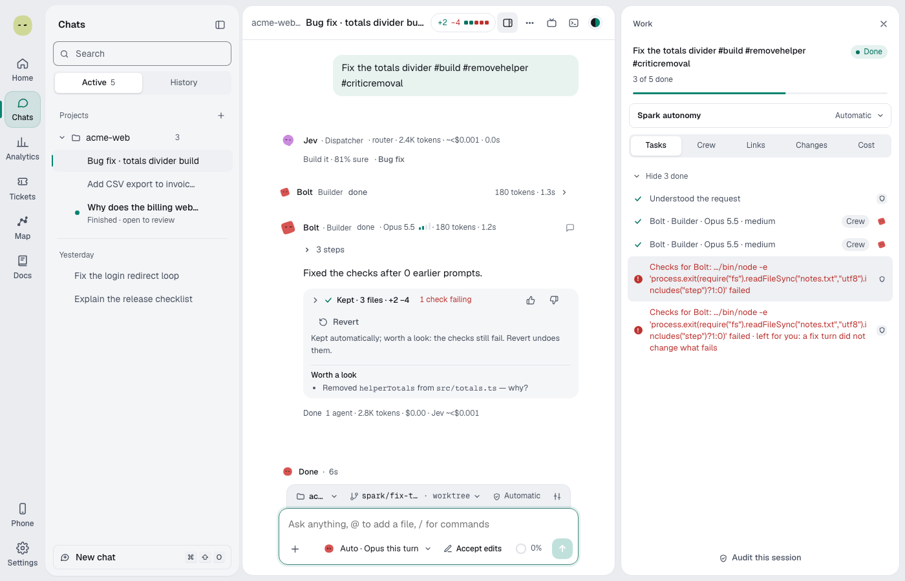
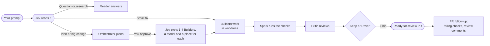
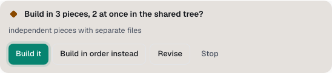
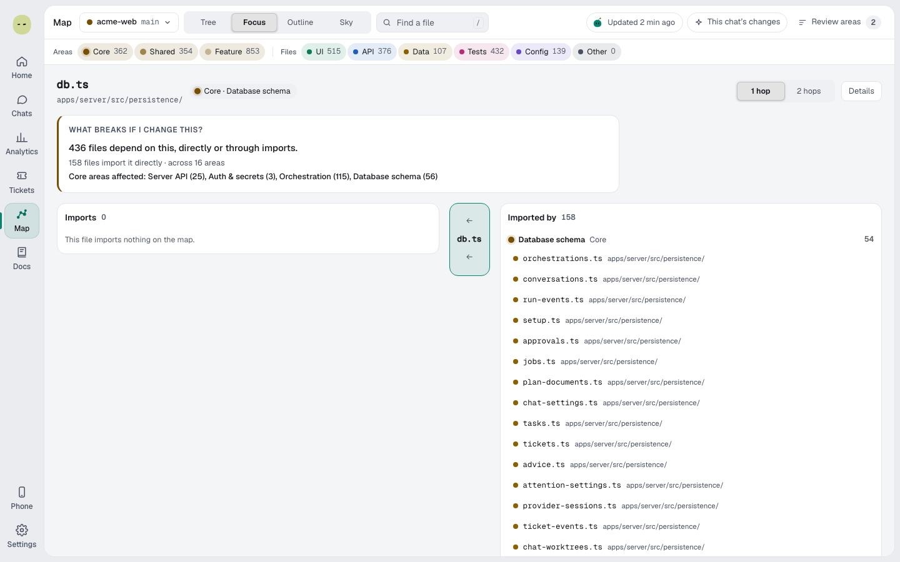
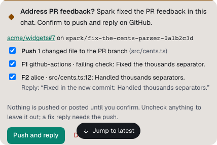
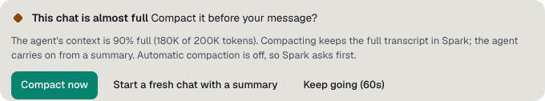
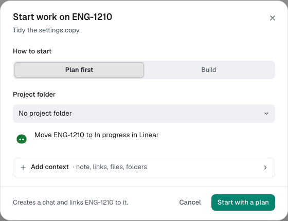
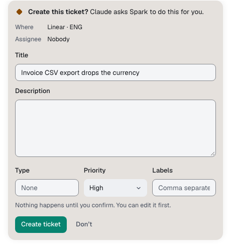
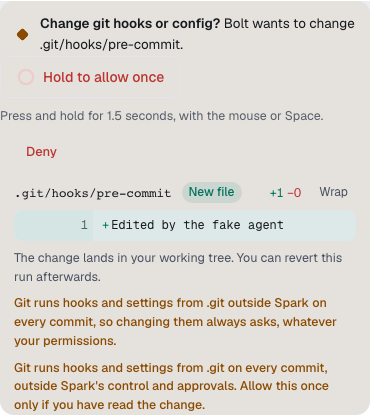
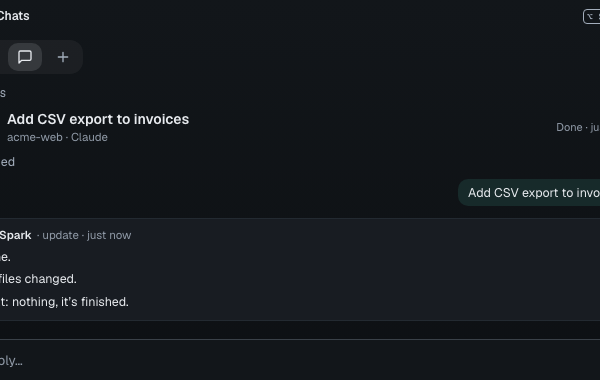

<div align="center">


# Spark Outpost

**Your AI coding agents, with a crew, a conscience and a ship button.**

A Mac app that runs Claude, Codex and Z.ai agents on your own machine.<br>
Spark plans the work, builds it in safe worktrees, checks it with its own test runs and opens the pull request.

<p>
<a href="apps/desktop/CHANGELOG.md"></a>


</p>

<a href="#getting-started">Get started</a> ·
<a href="#how-it-works">How it works</a> ·
<a href="#safety-by-design">Safety</a> ·
<a href="docs/guide/getting-started.md">User guide</a>

<br><br>

<picture>
  <source media="(prefers-color-scheme: dark)" srcset="docs/guide/images/prompt-flow-crew-turn-dark.png">
  <source media="(prefers-color-scheme: light)" srcset="docs/guide/images/prompt-flow-crew-turn-light.png">
  
</picture>

</div>

## Why Spark

**A crew, not a chatbot.** Each request gets the smallest crew that fits. A Reader answers questions. Builders make changes. A Critic reviews the bigger or riskier ones, on a second provider when you have one connected.

**Proof, not promises.** Spark runs your checks itself after every Builder turn and reports its own run, never the agent's claim. It flags unexplained removals and weakened tests before you keep anything.

**Your checkout stays yours.** Code changes happen in a git worktree on a new branch. Nothing touches your files until you keep, ship or bring the changes in.

**From prompt to pull request.** Approve a plan and walk away. Spark builds, checks, opens a ready-for-review PR, then fixes failing checks and answers review comments for up to 3 rounds. It never merges.

## How it works



1. **Jev reads the request.** A cheap, typed advisor sorts it into one of ten kinds: Question, Research, Plan, Bug fix, Feature, Refactor, Docs, Tests, Config or Review. You see the call above the crew, for example "Build it · 87% sure".
2. **The orchestrator plans.** Big or destructive work gets a **Build this plan?** card with a time and cost estimate from your own history.
3. **Jev staffs it.** After you approve, Jev picks 1 to 4 Builders, the model for each, and whether each runs in its own worktree, a shared tree or in order.
4. **Builders build.** Each one owns its files and works within a budget of tool calls and time.
5. **Spark checks.** It runs your tests and lint itself. Failing checks give the Builder up to 2 turns to fix them.
6. **The Critic reviews** and a Builder fixes its findings, up to 3 rounds.
7. **You keep or revert**, then **Ship** commits, pushes or opens the PR. **Full auto → PR** does it all for you.

No Jev key? Rules do the same jobs. Turn the Spark switch off and you talk to the agent directly, with the same approvals and safety rules.

## Feature highlights

<table>
<tr>
<td width="50%" valign="top">

### Big work in pieces

A Coordinator splits big plans into pieces, runs Builders side by side, joins their work and runs the checks once.

<picture>
  <source media="(prefers-color-scheme: dark)" srcset="docs/guide/images/pieces-card-dark.png">
  
</picture>

</td>
<td width="50%" valign="top">

### The Map

See how your codebase fits together in **Tree**, **Focus**, **Outline** or **Sky**. Ask "what breaks if I change this?" before you change it.

<picture>
  <source media="(prefers-color-scheme: dark)" srcset="docs/guide/images/map-focus-dark.png">
  
</picture>

</td>
</tr>
<tr>
<td width="50%" valign="top">

### PR follow-up

Spark watches its pull requests, fixes failing checks and answers review comments. You confirm the push, or let Full auto handle it.

<picture>
  <source media="(prefers-color-scheme: dark)" srcset="docs/guide/images/pr-follow-up-card-dark.png">
  
</picture>

</td>
<td width="50%" valign="top">

### Long chats that stay sharp

A context ring shows how full the chat is. Spark compacts at the point you choose (80% by default) and keeps the full transcript.

<picture>
  <source media="(prefers-color-scheme: dark)" srcset="docs/guide/images/compaction-card-dark.png">
  
</picture>

</td>
</tr>
<tr>
<td width="50%" valign="top">

### Tickets in, PRs out

Connect Linear, Jira and GitHub. Start a chat from a ticket, and Spark moves it to In review when the PR opens and to Done when it merges.

<picture>
  <source media="(prefers-color-scheme: dark)" srcset="docs/guide/images/tickets-start-dark.png">
  
</picture>

</td>
<td width="50%" valign="top">

### Agents that know Spark

Every agent gets Spark's own MCP tools. Ask "which chats are waiting for me?" or "what did I spend today?". Actions always show a confirm card first.

<picture>
  <source media="(prefers-color-scheme: dark)" srcset="docs/guide/images/spark-tools-action-card-dark.png">
  
</picture>

</td>
</tr>
</table>

Also inside: **Auto** model routing per request, model cards, terminals docked to each chat's worktree, analytics and spend, and the full user guide in the app's **Docs** page.

## Safety by design

Approval checks run in Spark, not in the model. Agents can't switch them off.

- **Two dials.** The agent's permission mode decides what it may do without asking. Spark autonomy (**Review each step**, **Automatic**, **Full auto → PR**) decides what Spark keeps, checks and ships alone.
- **Approval cards** for commands and edits, with per-project allowlists.
- **Protected paths always ask**, in every mode: secret files, agent instruction files, `.git/hooks` and git config, force pushes, and sending data out after reading secrets.
- **Hold to confirm, then Undo.** Force pushes and git hook changes have no plain Allow button: you press and hold. A force push from the island and a full reset of Spark both wait 10 seconds for **Undo**.
- **Secrets stay secret.** Keys live in the macOS Keychain. Agent output is redacted before Spark stores or shows it. Paste a key into a message and Spark stops you first.
- **Guardrails on every Builder.** No unexplained removals. Checks Spark runs itself. Estimates from your history. Budgets that fit the task. Models that keep failing a kind of task stop getting it.
- **`.sparkignore`** keeps any file you list away from agents and from Jev.

<picture>
  <source media="(prefers-color-scheme: dark)" srcset="docs/guide/images/approvals-hold-dark.png">
  
</picture>

## The desktop companion

Scout, Spark's blob, lives under your Mac's notch and peeks out when your chats need you. A session blob wobbles while a chat works, shows **!** when it waits for you and sparkles when it's done.

| Shortcut            | What it does                                                                    |
| ------------------- | ------------------------------------------------------------------------------- |
| **⌥Space**          | **Quick chat**: start a chat from any app, pick a project and an autonomy level |
| **⌥⇧Space**         | **Sessions**: find a chat, ask for an update, reply, without interrupting it    |
| **⌘3** in the panel | **Ask**: "Who needs me?" or "What did I spend today?", answered on the spot     |

Answer approvals right from the island with **Y** and **N**. The blobs react to your work: happy when it lands, worried when it fails, and a badge appears when something needs you.

<picture>
  <source media="(prefers-color-scheme: dark)" srcset="docs/guide/images/companion-island-sessions-dark.png">
  
</picture>

## Getting started

### Use the beta

Spark Outpost is in private beta. Testers get a dmg for **Apple silicon** (arm64) or **Intel** (x64).

1. Open the dmg and drag **Spark Outpost** to **Applications**. The first start sets up a local database and takes up to a minute.
2. Connect a provider: the Claude Code CLI, the Codex CLI, or an Anthropic, OpenAI or Z.ai API key. Git is needed for code work.
3. Optionally connect Jev, GitHub, Jira or Linear.
4. Start a chat. Ask a question about a project, or link a repo and ask for a small change.

Requires macOS 12 or later and about 2 GB of disk space. The app updates itself on the **Stable** or **Beta** channel, and never while an agent is working.

### Run from source

You need Node.js 24, pnpm 12 and PostgreSQL 17.

```bash
pnpm install
pnpm db:setup && pnpm db:up && pnpm db:migrate
pnpm dev            # API, worker and web app at http://127.0.0.1:5173
pnpm desktop:dev    # the Electron desktop app
pnpm check          # format, lint, typecheck, source rules, knip, unit tests
```

See [docs/DEVELOPMENT.md](docs/DEVELOPMENT.md) for every command, the repo layout and testing. Contributors and coding agents: read [AGENTS.md](AGENTS.md) first.

## Docs

The user guide ships inside the app and lives in [`docs/guide`](docs/guide).

| Start here                                                         | Go deeper                                                |
| ------------------------------------------------------------------ | -------------------------------------------------------- |
| [Getting started](docs/guide/getting-started.md)                   | [The Spark crew](docs/guide/spark-crew.md)               |
| [Spark at a glance](docs/guide/how-spark-works.md)                 | [Big work in pieces](docs/guide/pieces.md)               |
| [What happens when you send a prompt](docs/guide/prompt-flow.md)   | [Jev, Spark's advisor](docs/guide/jev.md)                |
| [Permissions and autonomy](docs/guide/permissions-and-autonomy.md) | [Guardrails](docs/guide/guardrails.md)                   |
| [Use cases](docs/guide/use-cases.md)                               | [Privacy and secrets](docs/guide/privacy-and-secrets.md) |
| [The desktop companion](docs/guide/desktop-companion.md)           | [Troubleshooting](docs/guide/troubleshooting.md)         |

Architecture notes are in [`docs/architecture`](docs/architecture). The full docs index is [docs/README.md](docs/README.md).

## Status and feedback

**Beta, version 0.1.0-beta.1.** Expect rough edges. Slack isn't connected yet, and there is no Windows or Linux build.

Found something? Open **Settings → Help → Send feedback** (or **Help → Send Feedback…**), turn on **Include diagnostics** for bugs, and send the draft. Diagnostics hold versions, settings and recent logs, never chats, prompts, file contents, keys or tokens. Nothing is sent without you.

## Built with

Electron · React and Vite · Express · PostgreSQL 17 (embedded in the desktop app) · TypeScript and Zod contracts · Agent Client Protocol · MCP · Vitest and Playwright

<div align="center">
<sub>Made for people who want agents to do the work and still sleep at night.</sub>
</div>
