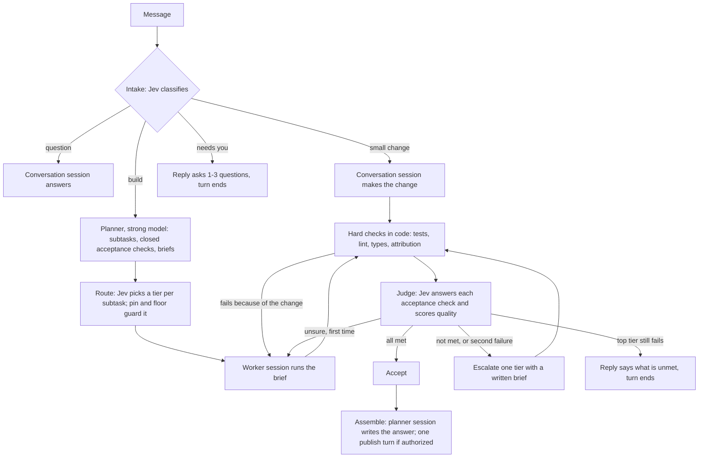

# A simpler harness

A design proposal, October 6, 2026. Nothing here is built. It replaces the routing stack, the Coordinator and the review loops described in [HARNESS_PLAN.md](HARNESS_PLAN.md) with one loop: plan once, work on the cheapest model that passes, let code and Jev decide what happens next. Line counts are non-test source lines on `main` at `59b39d93`. External facts were read through a summarising fetch tool on October 6, 2026; re-read a page before quoting it elsewhere.

## 1. Goal and non-goals

- **Goal:** one loop a person can hold in their head, with fewer sessions per turn, cheaper models for most work, and every decision recorded.
- **Principle:** Spark is a moderator, not a gatekeeper. No new cards, no babysitting, no run budgets or caps; agents publish; the safety floor in `AGENTS.md` is unchanged.
- **Not a goal:** a new protocol between Spark and its workers, a second decision service, or parallel pieces in the first version.
- **Not a goal:** changing approvals (`workflow/approval-gate.ts`), check attribution (`checks/`), publish rules (`orchestration/agent-publish.ts`) or PR follow-up.
- **Constraint:** nothing requires Jev. Every Jev question has a rule fallback, as today ([JEV.md](JEV.md)).

## 2. The design in one page

| Step                 | Who                                                               | Runs when                                             |
| -------------------- | ----------------------------------------------------------------- | ----------------------------------------------------- |
| Intake               | Jev, one batched call                                             | Every turn                                            |
| Plan                 | One strong-model planner turn                                     | Builds only                                           |
| Route                | Jev tier pick, then pin and floor in code                         | Per subtask                                           |
| Work                 | Conversation session (small change) or a worker session (subtask) | Changes                                               |
| Hard checks          | Code (`checks/`, `orchestration/checks.ts`)                       | Files changed                                         |
| Judge                | Jev: one Noul per acceptance check, one quality Score             | After green checks                                    |
| Act                  | Code, from the judge's bands                                      | Always                                                |
| Assemble and publish | The planner session, resumed                                      | Builds with 2+ subtasks; publish only when authorized |

A question or a small change opens no new session. A build with one subtask skips assemble: the worker's reply is the answer.

## 3. Every Jev question

What Jev is here: TypeSafe's "System One" model, called at `POST /v1/systemone` with a `state` and typed questions (`advisor/jev.ts`). It returns Choice, Score and Noul (probability a statement is true) answers; it writes no text, calls no tools and reads only the state it is sent ([JEV.md](JEV.md)). Cost is $0.042 per million input tokens (`JEV_INPUT_USD_PER_MILLION`); measured latency is 150 to 360 ms (JEV.md); orchestration calls time out at 3 s (`orchestration/jev-calls.ts`); the request text is capped at 4,000 characters and a diff at 24,000 (`advisor/questions.ts`). After 3 failed calls in a row every call is skipped for 30 s (`advisor/jev-breaker.ts`). JEV.md notes calibration holds across groups of answers, not for one answer.

"Act" below means confidence at or above the line in `advisor/policy.ts` (0.8 today for acting questions). Fallback applies when Jev is not connected, paused, late, invalid or under the line.

| Step            | Question                                                                                          | Type      | State passed                             | Per answer                                                                             | Fallback                                                       | Today                                                                                           |
| --------------- | ------------------------------------------------------------------------------------------------- | --------- | ---------------------------------------- | -------------------------------------------------------------------------------------- | -------------------------------------------------------------- | ----------------------------------------------------------------------------------------------- |
| Intake          | "What does this message need?" question, small change, build, needs you                           | Choice    | Message, previous reply, task summary    | Routes the turn                                                                        | Rules: `intentByRule`; unsure answers read-only                | Replaces the 10-way `intent`, `vague`, `plan_only` (`advisor/intake-questions.ts`)              |
| Intake          | "Does this continue the open task?"                                                               | Noul      | Message, previous request                | Same task or new task                                                                  | Follow-up rule (`orchestration/follow-up.ts`)                  | Exists: `continues_task`                                                                        |
| Intake          | "Would this remove or rewrite existing data?"                                                     | Noul      | Message                                  | Top tier, own copy, risky note                                                         | Keyword rule (`orchestration/risk-rules.ts`)                   | Exists: `destructive`                                                                           |
| Plan needed     | Folded into intake: build means plan                                                              | n/a       | n/a                                      | n/a                                                                                    | n/a                                                            | Replaces builder count and piece questions (`coordinator/builder-jev.ts`, `piece-questions.ts`) |
| Tier pick       | "Which model tier fits this subtask?" mid, top, ask the human (small only for read-only subtasks) | Choice    | Brief, acceptance checks, files named    | Sets the worker's model                                                                | Mid tier; top for destructive work                             | Exists, observed only: `tier` (JEV.md)                                                          |
| Acceptance      | One per check, as the planner wrote it: "Does the function handle empty input?"                   | Noul each | Brief, the check, diff, hard-check lines | All at 0.8 or more: accept. Any at 0.2 or less: escalate. Otherwise retry once         | Not verified: finish on hard checks alone, say so in the reply | Reshapes `verdict` plus `unmet_N` (`advisor/verify-questions.ts`)                               |
| Quality         | "How well does the change meet the brief?" five levels                                            | Score     | Same                                     | Below 3 with confidence: counts as an unmet check                                      | Ignored                                                        | New; same type as `advisor/rating-questions.ts`                                                 |
| Failure typing  | "Why did the worker stop?" needs information, wrong approach, environment, out of scope           | Choice    | Brief, last reply, failing output        | Information: ask you. Approach: escalate. Environment: report, no retry                | Retry once, then escalate                                      | New; today a failed Builder is retried one tier up by rule                                      |
| Stop check      | "Is the request fully done?"                                                                      | Noul      | Request, plan with statuses, final reply | No: the reply ends "Incomplete: …"                                                     | Open plan items decide                                         | New; today `PLAN_CONTINUES` reads the Builder's plan                                            |
| Escalate or ask | No Jev call                                                                                       | n/a       | n/a                                      | Code: below the top tier and under a pin's ceiling, escalate; otherwise the reply asks | n/a                                                            | Replaces `orchestration/escalation.ts`, `cascade.ts`                                            |

**Permission requests.** Jev never adds a card and never turns an allowed action into a question. The agent's mode decides when a card appears, as `AGENTS.md` says. Whether Jev may pre-answer safe read-only requests in modes that already ask is an open decision (11.2), off by default. Today's four edit-policy Nouls stay observed only (`advisor/policy-gate.ts`).

**Retry text.** Jev cannot write feedback. A retry prompt is built by code: the names of the checks below 0.8 plus the failing check output. A model writes a brief only on escalation.

## 4. Sessions and context

Evidence: in session A about $38–40 of $59 was cache writes because each helper opened its own session, and a question after build turns could never resume the Builder's session, because sessions are keyed `chat:<mode>` (`agentKey` in `workflow/session-decision.ts`).

| Choice                 | Design                                                                                                                                                                                                                                     | Why                                                                                                                                    |
| ---------------------- | ------------------------------------------------------------------------------------------------------------------------------------------------------------------------------------------------------------------------------------------ | -------------------------------------------------------------------------------------------------------------------------------------- |
| Conversation session   | One per chat per provider, keyed by chat and provider only. Questions and small changes resume it whatever the run mode                                                                                                                    | Removes the mode key; a follow-up reads the cache it already paid for                                                                  |
| Mode and model changes | Sent with `session/set_config_option` on the same session, not hashed into its identity (`settingsHash` today includes model, mode and roots)                                                                                              | ACP allows a config option to change "at any point during a session" (https://agentclientprotocol.com/protocol/session-config-options) |
| Folder                 | Resume across folders when the adapter accepts it                                                                                                                                                                                          | Spark refuses today; the diagnosis found real claude-agent-acp resumes fine                                                            |
| Worker sessions        | One per subtask, opened with a self-contained brief; a retry resumes the same session; escalation opens a new one                                                                                                                          | A retry in a new session would pay the read and the cache write again                                                                  |
| Planner session        | One per build on the strong tier, resumed to assemble                                                                                                                                                                                      | Two turns, one cache                                                                                                                   |
| Idle                   | No fixed 4 h cliff (`SESSION_IDLE_MS`). Try `session/resume` whenever the adapter still lists the session; replace only when it refuses or when a fresh start is cheaper than re-reading (the estimate in `orchestration/cache-switch.ts`) | The cliff replaced sessions silently                                                                                                   |
| Handoff                | When a session must be replaced: goal, agreed plan, open subtasks with check status, files changed, last check output, last three exchanges. The builder for this exists (`orchestration/handoff.ts`)                                      | Today's seed is user messages plus final replies only (`chatSeed` in `workflow/run-input.ts`)                                          |
| Audit                  | Every open, resume, replace and close writes a row with the reason, the tokens carried and the cache-write cost                                                                                                                            | Replacement is unaudited today                                                                                                         |

**Sub-agents inside a session, or separate sessions?** Both pinned adapters advertise `sessionCapabilities.subagents` ([ACP_COMPLIANCE.md](ACP_COMPLIANCE.md)). claude-agent-acp 0.81.2 ships a typed surface for the ACP subagents draft (`dist/acp-subagents.d.ts`: `subagent_spawned`, `subagent_state_update`); the draft merged upstream as unstable on September 30, 2026 (https://github.com/agentclientprotocol/agent-client-protocol/pull/1992). Spark does not advertise the client capability, so it sees flattened tool calls. Claude Code resolves a sub-agent's model from the invocation, then the definition, then `CLAUDE_CODE_SUBAGENT_MODEL`; each has its own context window; only forks reuse the parent's cache (https://code.claude.com/docs/en/sub-agents). Spark already tells Claude to delegate with the Agent tool (`agents/acp/spark-instructions.ts`).

Recommendation: a mix with one rule. **Reading fans out inside the session; building gets its own session.** In-session sub-agents cost Spark nothing to drive and keep their output out of the main context, but Spark cannot pick their tier, run checks between them, judge them or resume one by name. Build subtasks need all four, so they are ACP sessions Spark drives. Not verified: whether `usage_update` cost includes sub-agent spend, and what codex-acp 1.13.1 sub-agents report.

## 5. Model tiers

| Tier   | Source                                                             | Used for                                                                                                   |
| ------ | ------------------------------------------------------------------ | ---------------------------------------------------------------------------------------------------------- |
| Small  | Card tier `small` (`model-cards/vendor-cards.json`)                | Read-only subtasks only, until replay data supports more. The floor (`orchestration/model-floor.ts`) stays |
| Mid    | Card tier `mid`, or the sign-in's middle model when no card exists | Default worker; default conversation model in an Auto chat                                                 |
| Strong | Card tier `top`                                                    | Planner, destructive work, escalations                                                                     |

- **Models offered** are the cards crossed with what the sign-in reports per connection ([PROTOCOL_ALIGNMENT.md](PROTOCOL_ALIGNMENT.md)). A model without a card is placed by the provider's own ordering (the fix in progress).
- **A pin** means every session of the chat runs on that model. Jev's pick is recorded as "would have used" and not applied. This deletes `pinned-builder.ts`.
- **Defaults.** New chats are Auto (the fix in progress).
- **Ladder.** Mid, then strong, then the reply asks. One step per subtask; a task never steps back down.
- **Cross-provider review** is no longer the default for large diffs. It runs when you ask, for destructive work, or when the judge is unsure on a strong-tier result.

## 6. What gets deleted, kept or shrunk

| Group (files)                                                                                                                                                                                 | Lines       | Verdict                                                                                                                                        | Replaced by                                              |
| --------------------------------------------------------------------------------------------------------------------------------------------------------------------------------------------- | ----------- | ---------------------------------------------------------------------------------------------------------------------------------------------- | -------------------------------------------------------- |
| Routing: `routing`, `route-score`, `pinned-builder`, `escalation`, `builder-complexity`, `task-signals`, `cache-switch`, `session-keep`, `member-routes`, `critic-provider`, `route-fixtures` | 1,770       | Delete; keep the re-read estimate                                                                                                              | Tier pick and ladder, about 250                          |
| `tiers.ts`, `model-floor.ts`                                                                                                                                                                  | 263         | Keep                                                                                                                                           | Guards                                                   |
| Review and verify: `review-loop`, `critic-fix`, `critic-scope`, `critic-rule`, `critic-recheck`, `fix-rounds`, `cascade`, `verify`, `review`                                                  | 728         | Delete about 580                                                                                                                               | Judge and act, about 300; Critic is one conditional step |
| Observation: `observe*`, `code-context`, `likely-files`                                                                                                                                       | 993         | Delete                                                                                                                                         | Decision audit (slice 1)                                 |
| Intake and start: `intake`, `intent-rules`, `intake-run`, `follow-up`, `clarify*`, `plan-first`, `plan-only`, `checkpoint*`                                                                   | 1,959       | Shrink by about 900                                                                                                                            | Four-way intake; "needs you" is a reply                  |
| `coordinator/**`                                                                                                                                                                              | 6,387       | Delete about 5,400. Keep the pieces schema (`packages/contracts/src/pieces.ts` already has `acceptance` and `checks`), `scoped-checks`, report | Planner and worker loop, about 800                       |
| `advisor/**`                                                                                                                                                                                  | 1,975       | Shrink by about 650: `rating-questions`, most of `policy.ts` (about 150 constants), half of `intake-questions`                                 | Question table in section 3                              |
| `transitions`, `members`, `context`, `handoff`                                                                                                                                                | 1,430       | Shrink by about 500                                                                                                                            | The loop in section 2                                    |
| `workflow/**` (`agent-turn`, `approval-gate`, `plan-recorder`, audit, recovery)                                                                                                               | 5,013       | Keep. Rewrite `session-decision` and `turn-session` (410) at similar size                                                                      | Section 4                                                |
| `checks/**`, `check-attribution`, `checks.ts`                                                                                                                                                 | 1,593       | Keep                                                                                                                                           | n/a                                                      |
| `agents/acp/**`                                                                                                                                                                               | 4,786       | Keep; add the subagents client capability later                                                                                                | n/a                                                      |
| Publish, place, safety: `agent-publish`, `full-auto-ship`, `chat-place`, `solo-copy`, `risk-rules`, `loop-guard`, `land`                                                                      | about 1,400 | Keep                                                                                                                                           | n/a                                                      |
| `laws/**`                                                                                                                                                                                     | 1,176       | Keep; demotions feed the tier pick                                                                                                             | n/a                                                      |

Estimate: about 10,800 source lines deleted and about 1,800 added, a net reduction near 9,000 of the 24,900 in `orchestration`, `coordinator`, `advisor` and `workflow` (about 36%). Tests fall roughly in proportion (11,300 lines today). Treat it as plus or minus 20%: no file was traced caller by caller.

What must stay: the safety floor, the approvals gate, check attribution, publish rules, the audit, Spark's MCP tools, PR follow-up, chat worktrees and the universal laws.

Parallel pieces (shared tree, per-Builder copies, the integrator) go in this design. Subtasks run in order in the chat's worktree. That removes a documented feature (`docs/guide/spark-crew.md`) and is open decision 11.7.

## 7. A2A

**What it is.** The Agent2Agent protocol lets independent agents discover each other and exchange work. Spec releases: v1.0.0 on March 12, 2026 and v1.0.1 on May 28, 2026 (https://github.com/a2aproject/A2A/releases); the spec page still reads v1.0.0 (https://a2a-protocol.org/latest/specification/). Google created it; the Linux Foundation has hosted it since June 23, 2025 (https://linuxfoundation.org/press/linux-foundation-launches-the-agent2agent-protocol-project-to-enable-secure-intelligent-communication-between-ai-agents). IBM says its Agent Communication Protocol "is now part of A2A" (https://research.ibm.com/projects/agent-communication-protocol); the August 2025 date is unverified.

| Concept               | Fact                                                                                                                                                                                                                                                                     |
| --------------------- | ------------------------------------------------------------------------------------------------------------------------------------------------------------------------------------------------------------------------------------------------------------------------ |
| Agent Card            | JSON served at `/.well-known/agent-card.json`; self-reported skills, capabilities and auth (https://a2a-protocol.org/latest/topics/agent-discovery/)                                                                                                                     |
| Task states           | Submitted, working, completed, failed, canceled, input required, rejected, auth required                                                                                                                                                                                 |
| Messages              | A role and Parts (text, file, data); results are Artifacts (definition not re-read)                                                                                                                                                                                      |
| Long work             | SSE streaming; push notifications to a client webhook                                                                                                                                                                                                                    |
| Auth                  | API key, HTTP auth, OAuth2, OpenID Connect, mutual TLS                                                                                                                                                                                                                   |
| Bindings              | JSON-RPC, gRPC, HTTP+JSON                                                                                                                                                                                                                                                |
| Node SDK              | `@a2a-js/sdk`, Apache-2.0, v1.3.0 on September 29, 2026, generally available since July 22, 2026, a release every two to four weeks (https://github.com/a2aproject/a2a-js/releases). npm version not checked against the tags. [PLAN.md](../product/PLAN.md) cites 1.2.1 |
| MCP                   | Complementary: A2A between agents, MCP for tools (https://a2a-protocol.org/latest/topics/a2a-and-mcp/)                                                                                                                                                                   |
| Agent Client Protocol | Editor to coding agent (https://agentclientprotocol.com/overview/introduction). Neither project's docs relate the two                                                                                                                                                    |

Neither adapter README mentions A2A (https://github.com/agentclientprotocol/claude-agent-acp, https://github.com/zed-industries/codex-acp). Native A2A in Claude Code or Codex was not checked. One ACP-to-A2A bridge, `a2acode` on PyPI, is a claim only: its page did not load.

**Recommendation: keep ACP between Spark and its workers; do not add A2A now.**

- The worker link needs things A2A does not carry: per-session mode and model, `session/request_permission` answered by Spark's gate, forwarded MCP servers, file and command updates, resume. ACP has them and they are built and tested (`agents/acp/**`, 4,786 lines). An A2A worker is opaque by design, which would remove the approval gate and the audit.
- No worker speaks A2A, so Spark would have to write both ends. That is the wrapping `AGENTS.md` rules out.
- Inside an agent, sub-agents are already covered by the ACP subagents draft (section 4).

Where A2A would help, in order of likelihood:

1. **Spark as an A2A server:** another tool hands a chat a task and follows it. Task states map onto run states and the SSE stream exists. This also fits a future cloud runner.
2. **Third-party A2A agents as helpers**, the phase 3 item in PLAN.md (a remote reviewer).
3. **Phone remote:** no. It is Spark's own web UI over Tailscale, later a relay ([PHONE_REMOTE.md](PHONE_REMOTE.md)), not a second agent.

**Now:** nothing. **Later**, when a real caller exists: a read-only Agent Card plus `message/send` and task streaming for one chat, behind a setting, on Express with the SDK's handlers. Rough cost: 400–600 lines and a contract test pinned to the SDK version, per the gates in PROTOCOL_ALIGNMENT.md. Auth and what a remote caller may do are the real work and are not estimated.

## 8. Risks and how each is watched

| Risk                    | Evidence                                                                                                                                                                                                                          | Signal logged                                                                         | Guard                                                                                                         |
| ----------------------- | --------------------------------------------------------------------------------------------------------------------------------------------------------------------------------------------------------------------------------- | ------------------------------------------------------------------------------------- | ------------------------------------------------------------------------------------------------------------- |
| Judge passes wrong work | LLM judges agree with humans about 80% of the time and show known biases (https://arxiv.org/abs/2306.05685). Spark's verifier measured precision 0.91, recall 0.83 on 24 diffs (HARNESS_PLAN.md)                                  | Each answer joined later to Revert, a follow-up fix, CI failure, thumbs               | Hard checks run first and outrank Jev; unsure never counts as accepted                                        |
| Briefs lose context     | A vague brief made sub-agents duplicate work (https://www.anthropic.com/engineering/multi-agent-research-system); inter-agent misalignment is one of three failure categories in 1,600+ traces (https://arxiv.org/abs/2503.13657) | Worker tool calls outside the files its brief names; failure type "needs information" | Brief template: goal, files, contract, checks, what not to touch. Small changes get no brief                  |
| Retries loop            | Models struggle to self-correct without external feedback (https://arxiv.org/abs/2310.01798)                                                                                                                                      | Retries and escalations per subtask; repeated failure signature                       | One retry, one escalation, then the reply asks. Retry text always carries check output. `loop-guard.ts` stays |
| Cheap tier costs more   | The Sonnet card notes about 30% more tokens for the same text (`vendor-cards.json`); multi-agent runs used about 15 times chat tokens in Anthropic's report                                                                       | Cost per accepted subtask by tier, including retries and the escalated run            | Mid is the default, not small. The Peter-principle demotion keeps running                                     |
| Jev outage              | Breaker pauses after 3 failures                                                                                                                                                                                                   | Rows with `failed`, `timed_out`, paused                                               | Rule fallback per question; a build still runs on mid with hard checks only                                   |
| Plan quality            | Coordinator ran twice in 10 of 10 turns in session A                                                                                                                                                                              | Plan turns per build; subtasks later split or merged; checks Jev cannot answer        | Limits stated in the planner prompt; one repair turn with the validator's message, then a single-subtask plan |
| Provider differences    | Claude command output arrives when the command ends; Codex writes inside its sandbox ([ACP_AGENTS.md](ACP_AGENTS.md))                                                                                                             | Per-provider silence time and first-prompt failures                                   | Workers stay on the chat's provider unless it is unusable                                                     |

Cascades can pay: FrugalGPT reports matching the best model with up to 98% lower cost on its benchmarks (https://arxiv.org/abs/2305.05176) and RouteLLM over 2 times cheaper at equal quality in some cases (https://arxiv.org/abs/2406.18665). Both studied single-answer queries, not coding sessions with cache costs, so the replay in section 9 decides, not these papers.

## 9. Measurement

Baseline, session A: 19 turns, 90 runs (4.7 per turn), $60.14 ($3.17 per turn), 108 minutes waiting on cards. The targets are design intent, not measurements.

| Replay case                            | Happened                                      | Target runs                  | Tier                      | New sessions |
| -------------------------------------- | --------------------------------------------- | ---------------------------- | ------------------------- | ------------ |
| Plan turn                              | Coordinator twice, on Opus                    | 1 planner turn               | Strong                    | 1            |
| One-line follow-up                     | 5-run crew                                    | 1                            | Conversation model        | 0            |
| Status question                        | Fresh session, bare transcript                | 1                            | Conversation model        | 0            |
| Check-fix, failures in untouched files | 11 fix runs, $7.34                            | 0 fix runs                   | n/a                       | 0            |
| Publish                                | Extra Builder route                           | 1 publish turn               | Session that did the work | 0            |
| PR follow-up round                     | Not measured                                  | 1                            | Conversation model        | 0            |
| Review request                         | Codex Critic failed its first prompt 10 of 10 | 1 Critic, with fallback      | Other provider            | 1            |
| Build, 3 subtasks                      | Coordinator, pieces, integrator, Critic       | 5: plan, 3 workers, assemble | Strong, mid               | 4            |

Whole-session targets for the replay: under 2 runs per turn, cost per turn at most half the baseline, no card except "Build this plan?" and those the agent's mode raises.

Logged from the first slice: every Jev answer with its probabilities and the later outcome; cost per turn split into cache write, cache read and output; sessions opened, resumed and replaced per turn with reasons; cards shown and minutes waited; retries and escalations per subtask; tier chosen against tier that finally passed. Thresholds start at today's 0.8 and 0.2 and move only from that data (`pnpm jev:thresholds` already prints precision and recall per threshold, per HARNESS_PLAN.md). The 0.90 and 0.60 figures in the proposals come from an illustrative routing snippet (https://www.besthub.dev/articles/jev-typesafe-s-system-one-model-adds-high-speed-decision-layer-to-java-agents-6a3797d191e6); neither it nor https://github.com/valentynkit/awesome-jev-typesafe ties them to secret-leak checks or failure typing.

## 10. Build plan in slices

Each slice sits behind one setting, `HARNESS` with values `current` and `simple`, read per step so slices can be turned on one at a time, and ships with the replay cases as its acceptance test.

| #   | Slice                                                                             | Deletes                                                                               | Acceptance                                                                         |
| --- | --------------------------------------------------------------------------------- | ------------------------------------------------------------------------------------- | ---------------------------------------------------------------------------------- |
| 1   | Decision audit and export: one row per decision, session event and Jev answer     | Nothing                                                                               | The export reproduces session A's run and session counts                           |
| 2   | One conversation session per chat and provider, structured handoff, no idle cliff | Mode key, `session-keep.ts`                                                           | Status question after build turns resumes; every replacement has a row             |
| 3   | Four-way intake; question and small change go solo with no Coordinator            | Intent start rules, clarify cards, plan-first branches                                | One-line follow-up is 1 run, 0 new sessions                                        |
| 4   | Planner with acceptance checks and briefs; subtasks in order                      | Coordinator turn, validator repair loop, builder count and piece questions, placement | Plan turn is 1 planner run; build case opens 4 sessions                            |
| 5   | Jev tier pick with pin and floor guards                                           | Routing stack                                                                         | Why-line shows tier, source and fallback; no Opus worker without a recorded reason |
| 6   | Judge and confidence policy; Critic conditional                                   | Review loop, fix rounds, cascade, verify                                              | No fix run for failures outside the change; one retry at most                      |
| 7   | Remove dead modules, the `current` path and the setting                           | Observation code, the rest of `coordinator/**`                                        | `pnpm check` (knip) reports no unused files                                        |

The held `fix/crew-overhead` commits (`31e40853`, `1e637293`):

| Change                                                                  | Verdict                                                                            |
| ----------------------------------------------------------------------- | ---------------------------------------------------------------------------------- |
| Session kept on a Spark stop (`session-decision.ts`, `turn-session.ts`) | Keep; merge with slice 2                                                           |
| Critic diff by whole files (`critic-diff.ts`), Critic fallback          | Keep for the conditional Critic in slice 6                                         |
| Coordinator prompt limits and trimming (`prompts.ts`, `pieces-trim.ts`) | Carry the limits into the planner prompt in slice 4; the files go                  |
| Plan coverage only while building the plan (`pieces-validate.ts`)       | Superseded by slice 4                                                              |
| Follow-ups of 60 words or fewer go solo (`engage.ts`)                   | Drop; intake decides (slice 3)                                                     |
| Regex intent rules (`intent-rules.ts`, `risk-rules.ts`)                 | Drop, except as the no-Jev fallback already on `main`                              |
| 10-minute Critic silence watchdog (`stall-watch.ts`)                    | Drop as a stop rule: it is a cap. Keep the signal as a logged, non-blocking notice |

## 11. Open decisions for the owner

1. **What a pin means.** Recommended: every session runs on the pinned model; Jev's pick is recorded only.
2. **May Jev answer permission requests?** Recommended: no. Revisit only for safe reads in modes that already ask, as an opt-in.
3. **Starting thresholds.** Recommended: today's 0.8 and 0.2, tuned from slice 1 data after 50 judged subtasks.
4. **Cross-provider Critic by default?** Recommended: no; on request, destructive work, or an unsure judge on a strong-tier result.
5. **A2A now or later?** Recommended: later, as a server for one chat when a caller exists.
6. **Sub-agents or separate sessions?** Recommended: sub-agents for reading, separate ACP sessions for build subtasks.
7. **Drop parallel pieces?** Recommended: yes for now; re-add only if the replay shows wall-clock time is the complaint.
8. **Small tier for workers?** Recommended: read-only subtasks only, until data says otherwise.
9. **"Needs you" as a reply, not a card.** Recommended: yes at every autonomy level; "Build this plan?" stays the one waiting card.
