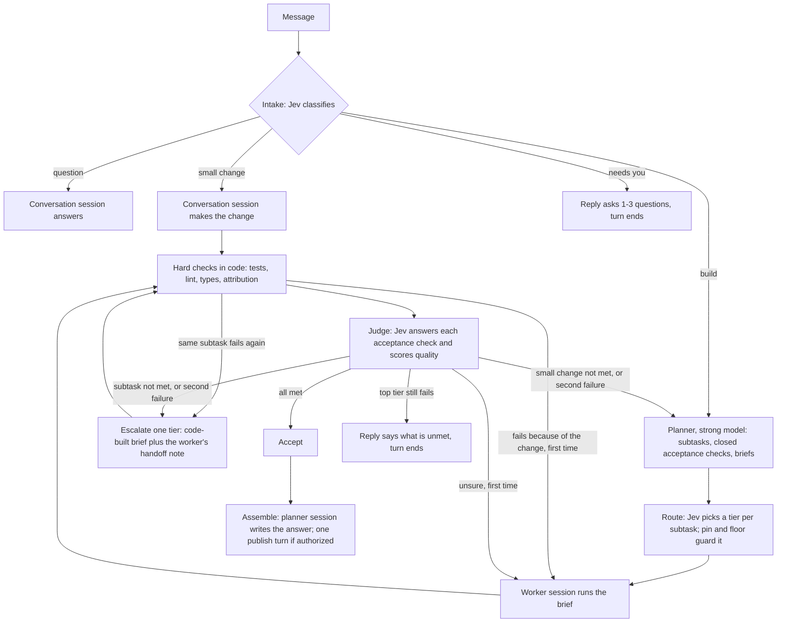

# A simpler harness

A design proposal, October 6, 2026. Nothing here is built. Revised the same day after a design review, and again when the build started; section 12 lists what changed each time. Slices 1 to 4 are being built on the branch `feat/harness-simple` behind the `HARNESS` setting, which stays `current` by default. The owner has since decided that `simple` becomes the only harness: the setting, the current-only code and its tests are deleted on this branch before it merges (slice 7), with no second harness kept. It replaces the routing stack, the Coordinator and the review loops described in [HARNESS_PLAN.md](HARNESS_PLAN.md) with one loop: plan once, work on the cheapest model that passes, let code and Jev decide what happens next. Line counts are non-test source lines on `main` at `59b39d93`. External facts were read through a summarising fetch tool on October 6, 2026; re-read a page before quoting it elsewhere.

## 1. Goal and non-goals

- **Goal:** one loop a person can hold in their head, with fewer sessions per turn, cheaper models for most work, and every decision recorded.
- **Principle:** Spark is a moderator, not a gatekeeper. No new cards, no babysitting, no run budgets or caps; agents publish; the safety floor in `AGENTS.md` is unchanged.
- **Not a goal:** a new protocol between Spark and its workers, a second decision service, or parallel pieces in the first version.
- **Not a goal:** changing approvals (`workflow/approval-gate.ts`), check attribution (`checks/`), publish rules (`orchestration/agent-publish.ts`) or PR follow-up.
- **Constraint:** nothing requires Jev. Every Jev question has a rule fallback, as today ([JEV.md](JEV.md)).

## 2. The design in one page

| Step                 | Who                                                                                  | Runs when                                             |
| -------------------- | ------------------------------------------------------------------------------------ | ----------------------------------------------------- |
| Intake               | Jev, one batched call                                                                | Every turn                                            |
| Plan                 | One strong-model planner turn                                                        | Builds only                                           |
| Route                | Jev tier pick, then pin and floor in code                                            | Per subtask                                           |
| Work                 | Conversation session (small change) or a worker session (subtask)                    | Changes                                               |
| Hard checks          | Code (`checks/`, `orchestration/checks.ts`)                                          | Files changed                                         |
| Judge                | Jev: one Noul per acceptance check no test covers (three at most), one quality Score | After green checks                                    |
| Act                  | Code, from the judge's bands                                                         | Always                                                |
| Assemble and publish | The planner session, resumed                                                         | Builds with 2+ subtasks; publish only when authorized |

A question or a small change opens no new session. A build with one subtask skips assemble: the worker's reply is the answer.

A small change has no planner, so it has no planner-written checks. It is judged on one fixed question (section 3). If that fails twice, the turn does not climb the tier ladder: it becomes a build, and the planner starts from a handoff of what was tried.

**"Build this plan?" waits only for builds that start as builds.** A small change that is upgraded to a build does not wait on the card: you already asked for the change. The plan is shown in the thread and the build proceeds. A message that intake reads as a build keeps the card, in every agent mode, as `AGENTS.md` says.

**The hard-check loop is bounded like the judge loop.** A failure attributed to the change (`checks/attribution.ts`) gets one retry in the same session, then one escalation, then the reply says what still fails. A failure with the same signature (`failureSignature` in `checks/failures.ts`, the rule `orchestration/checks.ts` already applies on `main`) is never sent to a worker twice: a repeat skips straight to the next step. Failures in files the change did not touch are reported and never start a fix run, as today.

## 3. Every Jev question

What Jev is here: TypeSafe's "System One" model, called at `POST /v1/systemone` with a `state` and typed questions (`advisor/jev.ts`). It returns Choice, Score and Noul (probability a statement is true) answers; it writes no text, calls no tools and reads only the state it is sent ([JEV.md](JEV.md)). Cost is $0.042 per million input tokens (`JEV_INPUT_USD_PER_MILLION`); measured latency is 150 to 360 ms (JEV.md); orchestration calls time out at 3 s (`orchestration/jev-calls.ts`); the request text is capped at 4,000 characters and a diff at 24,000 (`advisor/questions.ts`). After 3 failed calls in a row every call is skipped for 30 s (`advisor/jev-breaker.ts`). JEV.md notes calibration holds across groups of answers, not for one answer.

"Act" below means confidence at or above the line in `advisor/policy.ts` (0.8 today for acting questions). Fallback applies when Jev is not connected, paused, late, invalid or under the line. One question is the exception: `destructive` acts at 0.2, because missing a destructive request costs far more than a false alarm.

| Step            | Question                                                                                                                           | Type      | State passed                                                  | Per answer                                                                                                                         | Fallback                                                                                                               | Today                                                                                           |
| --------------- | ---------------------------------------------------------------------------------------------------------------------------------- | --------- | ------------------------------------------------------------- | ---------------------------------------------------------------------------------------------------------------------------------- | ---------------------------------------------------------------------------------------------------------------------- | ----------------------------------------------------------------------------------------------- |
| Intake          | "What does this message need?" question, small change, build, needs you                                                            | Choice    | Message, previous reply, task summary                         | Routes the turn                                                                                                                    | Rules: `intentByRule`; unsure answers read-only                                                                        | Replaces the 10-way `intent`, `vague`, `plan_only` (`advisor/intake-questions.ts`)              |
| Intake          | "Does this continue the open task?"                                                                                                | Noul      | Message, previous request                                     | Same task or new task                                                                                                              | Follow-up rule (`orchestration/follow-up.ts`)                                                                          | Exists: `continues_task`                                                                        |
| Intake          | "Would this remove or rewrite existing data?"                                                                                      | Noul      | Message                                                       | At 0.2 or more, or whenever the keyword rule fires: top tier, own copy, risky note                                                 | Keyword rule (`orchestration/risk-rules.ts`), which also runs alongside Jev                                            | Exists: `destructive`                                                                           |
| Plan needed     | Folded into intake: build means plan                                                                                               | n/a       | n/a                                                           | n/a                                                                                                                                | n/a                                                                                                                    | Replaces builder count and piece questions (`coordinator/builder-jev.ts`, `piece-questions.ts`) |
| Tier pick       | "Which model tier fits this subtask?" mid, top, ask the human (small only for read-only subtasks)                                  | Choice    | Brief, acceptance checks, files named                         | Sets the worker's model                                                                                                            | Mid tier; top for destructive work                                                                                     | Exists, observed only: `tier` (JEV.md)                                                          |
| Acceptance      | One per check no test can cover, three at most per subtask, as the planner wrote it: "Does the error message say what to do next?" | Noul each | Brief, the check, diff, hard-check lines                      | All at 0.8 or more: accept. Any at 0.2 or less: escalate. Otherwise retry once                                                     | Not verified, also when the diff was cut at the 24,000-character cap: finish on hard checks alone, say so in the reply | Reshapes `verdict` plus `unmet_N` (`advisor/verify-questions.ts`)                               |
| Quality         | "How well does the change meet the brief?" five levels                                                                             | Score     | Same                                                          | Below 3 with confidence: counts as an unmet check                                                                                  | Ignored                                                                                                                | New; same type as `advisor/rating-questions.ts`                                                 |
| Small change    | "Does the change do what the message asked?"                                                                                       | Noul      | Message, previous reply, task summary, diff, hard-check lines | 0.8 or more: accept. Otherwise retry once, then upgrade to a build                                                                 | Not verified: finish on hard checks alone, say so in the reply                                                         | New; a small change has no planner-written checks                                               |
| Failure typing  | "Why did the worker stop?" needs information, wrong approach, environment, out of scope                                            | Choice    | Brief, last reply, failing output                             | Information: ask you. Approach: escalate. Environment: report, no retry                                                            | Retry once, then escalate                                                                                              | New; today a failed Builder is retried one tier up by rule                                      |
| Stop check      | "Is the request fully done?"                                                                                                       | Noul      | Request, plan with statuses, final reply                      | No: the reply ends "Incomplete: …"                                                                                                 | Open plan items decide                                                                                                 | New; today `PLAN_CONTINUES` reads the Builder's plan                                            |
| Escalate or ask | No Jev call                                                                                                                        | n/a       | n/a                                                           | Code: below the top tier and under a pin's ceiling, escalate; otherwise the reply asks. A small change upgrades to a build instead | n/a                                                                                                                    | Replaces `orchestration/escalation.ts`, `cascade.ts`                                            |

**Permission requests.** Jev never adds a card and never turns an allowed action into a question. The agent's mode decides when a card appears, as `AGENTS.md` says. Whether Jev may pre-answer safe read-only requests in modes that already ask is an open decision (11.2), off by default. Today's four edit-policy Nouls stay observed only (`advisor/policy-gate.ts`).

**Retry text.** Jev cannot write feedback. A retry prompt is built by code: the names of the checks below 0.8 plus the failing check output.

**Escalation brief.** Code builds it from a template: the original brief, the unmet check names, the failing output, the failure type and the files changed. The failing worker adds one thing, in a last turn on its own session: a short note of what it tried and what it found. That turn is cheap because the session is cached, and it counts as a run in section 9. The note is labelled as what was tried, not as instructions, since a worker that took the wrong approach may explain it badly. The planner is not resumed for escalations.

**What the failed attempt left behind.** Each subtask starts from a recorded commit (the run snapshot under `refs/spark-outpost/runs/<runId>` that `projects/run-changes.ts` already takes). The stronger worker's brief states exactly what the failed attempt left: the files changed, a summary of the diff since that commit and the check output. The failed attempt's edits are kept by default, so the stronger worker continues from them. They are reverted to the subtask's starting commit only when failure typing answers "wrong approach"; the revert is recorded in the audit, and the brief then says the tree is back at the start and why.

**A missing handoff note.** If the failing worker cannot write its note (it hung, crashed, ran out of context, or the adapter returned an error), escalation proceeds with the code-built brief alone. The audit row for the escalation says the note is missing and why; nothing waits for it.

**`destructive` firings are logged.** Because the question acts at 0.2, every firing writes a row with Jev's probability, whether the keyword rule also fired, the tier it forced and the later outcome (kept, reverted, follow-up fix), so the cost of false alarms is visible from slice 1.

**Unanswerable checks.** A check Jev answers between 0.4 and 0.6 on both the first attempt and the retry is logged as "unanswerable", with its text, for tuning the planner prompt. It still counts as unmet for that subtask.

**Checks as tests.** The planner writes any acceptance check a test can show as a test, and it runs with the hard checks. "Does the function handle empty input?" is a test, not a Jev question. Jev gets only what code cannot verify: wording, scope, whether the change stayed inside the brief.

**Check count.** At most three Jev checks per subtask; the plan validator rejects more. The reason is arithmetic: every check must clear 0.8, so if correct work clears each check 90% of the time, three checks pass together about 73% of the time and five about 59%. These figures are illustrative, not measured; the accept rate by check count is logged from slice 1 (section 9).

## 4. Sessions and context

Evidence: in session A about $38–40 of $59 was cache writes because each helper opened its own session, and a question after build turns could never resume the Builder's session, because sessions are keyed `chat:<mode>` (`agentKey` in `workflow/session-decision.ts`).

| Choice                 | Design                                                                                                                                                                                                                                                                                                                                                                                                                                 | Why                                                                                                                                    |
| ---------------------- | -------------------------------------------------------------------------------------------------------------------------------------------------------------------------------------------------------------------------------------------------------------------------------------------------------------------------------------------------------------------------------------------------------------------------------------- | -------------------------------------------------------------------------------------------------------------------------------------- |
| Conversation session   | One per chat per provider, keyed by chat and provider only. Questions and small changes resume it whatever the run mode                                                                                                                                                                                                                                                                                                                | Removes the mode key; a follow-up reads the cache it already paid for                                                                  |
| Mode and model changes | Sent with `session/set_config_option` on the same session, not hashed into its identity (`settingsHash` today includes model, mode and roots). A model change keeps the session but not its cache: prompt caches are per model (to confirm per adapter), so the first turn on the new model pays a full cache write. The change is priced before it is made, and the conversation model stays put within a chat unless the pin changes | ACP allows a config option to change "at any point during a session" (https://agentclientprotocol.com/protocol/session-config-options) |
| Folder                 | Resume across folders when the adapter accepts it                                                                                                                                                                                                                                                                                                                                                                                      | Spark refuses today; the diagnosis found real claude-agent-acp resumes fine                                                            |
| Worker sessions        | One per subtask, opened with a self-contained brief and a recorded starting commit; a retry resumes the same session; escalation opens a new one                                                                                                                                                                                                                                                                                       | A retry in a new session would pay the read and the cache write again                                                                  |
| Planner session        | One per build on the strong tier, resumed to assemble                                                                                                                                                                                                                                                                                                                                                                                  | Two turns, one cache                                                                                                                   |
| Idle                   | No fixed 4 h cliff (`SESSION_IDLE_MS`). Try `session/resume` whenever the adapter still lists the session; replace only when it refuses or when a fresh start is cheaper than re-reading (the estimate in `orchestration/cache-switch.ts`)                                                                                                                                                                                             | The cliff replaced sessions silently                                                                                                   |
| Handoff                | When a session must be replaced: goal, agreed plan, open subtasks with check status, files changed, last check output, last three exchanges. The builder for this exists (`orchestration/handoff.ts`)                                                                                                                                                                                                                                  | Today's seed is user messages plus final replies only (`chatSeed` in `workflow/run-input.ts`)                                          |
| Audit                  | Every open, resume, replace, model change and close writes a row with the reason, the tokens carried and the cache-write cost                                                                                                                                                                                                                                                                                                          | Replacement is unaudited today                                                                                                         |

**Sub-agents inside a session, or separate sessions?** Both pinned adapters advertise `sessionCapabilities.subagents` ([ACP_COMPLIANCE.md](ACP_COMPLIANCE.md)). claude-agent-acp 0.81.2 ships a typed surface for the ACP subagents draft (`dist/acp-subagents.d.ts`: `subagent_spawned`, `subagent_state_update`); the draft merged upstream as unstable on September 30, 2026 (https://github.com/agentclientprotocol/agent-client-protocol/pull/1992). Spark does not advertise the client capability, so it sees flattened tool calls. Claude Code resolves a sub-agent's model from the invocation, then the definition, then `CLAUDE_CODE_SUBAGENT_MODEL`; each has its own context window; only forks reuse the parent's cache (https://code.claude.com/docs/en/sub-agents). Spark already tells Claude to delegate with the Agent tool (`agents/acp/spark-instructions.ts`).

Recommendation: a mix with one rule. **Reading fans out inside the session; building gets its own session.** In-session sub-agents cost Spark nothing to drive and keep their output out of the main context, but Spark cannot pick their tier, run checks between them, judge them or resume one by name. Build subtasks need all four, so they are ACP sessions Spark drives. Not verified: whether `usage_update` cost includes sub-agent spend, and what codex-acp 1.13.1 sub-agents report.

## 5. Model tiers

| Tier   | Source                                                             | Used for                                                                                                   |
| ------ | ------------------------------------------------------------------ | ---------------------------------------------------------------------------------------------------------- |
| Small  | Card tier `small` (`model-cards/vendor-cards.json`)                | Read-only subtasks only, until replay data supports more. The floor (`orchestration/model-floor.ts`) stays |
| Mid    | Card tier `mid`, or the sign-in's middle model when no card exists | Default worker; default conversation model in an Auto chat                                                 |
| Strong | Card tier `top`                                                    | Planner, destructive work, escalations                                                                     |

- **Models offered** are the cards crossed with what the sign-in reports per connection ([PROTOCOL_ALIGNMENT.md](PROTOCOL_ALIGNMENT.md)). A model without a card is placed by the provider's own ordering (the fix in progress).
- **A pin** means every session of the chat runs on that model. Jev's pick is recorded as "would have used" and not applied. This deletes `pinned-builder.ts`.
- **Defaults.** New chats are Auto (the fix in progress).
- **Chats pinned by the old default.** Existing chats were pinned by the old database default and are not changed automatically. Under `simple`, a pinned chat shows one quiet, dismissible hint in the model picker: "This chat uses <model> for everything. Auto picks per task." It is not a card, it is shown once per chat, and it is built with slice 5.
- **Ladder.** Mid, then strong, then the reply asks. One step per subtask; a task never steps back down.
- **Cross-provider review** is no longer the default for large diffs. It runs when you ask, for destructive work, or when the judge is unsure on a strong-tier result.

## 6. What gets deleted, kept or shrunk

| Group (files)                                                                                                                                                                                 | Lines       | Verdict                                                                                                                                        | Replaced by                                              |
| --------------------------------------------------------------------------------------------------------------------------------------------------------------------------------------------- | ----------- | ---------------------------------------------------------------------------------------------------------------------------------------------- | -------------------------------------------------------- |
| Routing: `routing`, `route-score`, `pinned-builder`, `escalation`, `builder-complexity`, `task-signals`, `cache-switch`, `session-keep`, `member-routes`, `critic-provider`, `route-fixtures` | 1,770       | Delete; keep the re-read estimate, extended to price a model change                                                                            | Tier pick and ladder, about 250                          |
| `tiers.ts`, `model-floor.ts`                                                                                                                                                                  | 263         | Keep                                                                                                                                           | Guards                                                   |
| Review and verify: `review-loop`, `critic-fix`, `critic-scope`, `critic-rule`, `critic-recheck`, `fix-rounds`, `cascade`, `verify`, `review`                                                  | 728         | Delete about 580                                                                                                                               | Judge and act, about 300; Critic is one conditional step |
| Observation: `observe*`, `code-context`, `likely-files`                                                                                                                                       | 993         | Delete                                                                                                                                         | Decision audit (slice 1)                                 |
| Intake and start: `intake`, `intent-rules`, `intake-run`, `follow-up`, `clarify*`, `plan-first`, `plan-only`, `checkpoint*`                                                                   | 1,959       | Shrink by about 900                                                                                                                            | Four-way intake; "needs you" is a reply                  |
| `coordinator/**`                                                                                                                                                                              | 6,387       | Delete about 5,400. Keep the pieces schema (`packages/contracts/src/pieces.ts` already has `acceptance` and `checks`), `scoped-checks`, report | Planner and worker loop, about 800                       |
| `advisor/**`                                                                                                                                                                                  | 1,975       | Shrink by about 650: `rating-questions`, most of `policy.ts` (about 150 constants), half of `intake-questions`                                 | Question table in section 3                              |
| `transitions`, `members`, `context`, `handoff`                                                                                                                                                | 1,430       | Shrink by about 500                                                                                                                            | The loop in section 2                                    |
| `workflow/**` (`agent-turn`, `approval-gate`, `plan-recorder`, audit, recovery)                                                                                                               | 5,013       | Keep. Rewrite `session-decision` and `turn-session` (410) at similar size                                                                      | Section 4                                                |
| `checks/**`, `check-attribution`, `checks.ts`                                                                                                                                                 | 1,593       | Keep                                                                                                                                           | n/a                                                      |
| `agents/acp/**`                                                                                                                                                                               | 4,786       | Keep; add the subagents client capability later                                                                                                | n/a                                                      |
| Publish, place, safety: `agent-publish`, `full-auto-ship`, `chat-place`, `solo-copy`, `risk-rules`, `loop-guard`, `land`                                                                      | about 1,400 | Keep                                                                                                                                           | n/a                                                      |
| `laws/**`                                                                                                                                                                                     | 1,176       | Keep; demotions feed the tier pick                                                                                                             | n/a                                                      |

Estimate: about 10,800 source lines deleted and about 1,800 added, a net reduction near 9,000 of the 24,900 in `orchestration`, `coordinator`, `advisor` and `workflow` (about 36%). Tests fall roughly in proportion (11,300 lines today). Treat it as plus or minus 20%: no file was traced caller by caller.

What must stay: the safety floor, the approvals gate, check attribution, publish rules, the audit, Spark's MCP tools, PR follow-up, chat worktrees and the universal laws.

Parallel pieces (shared tree, per-Builder copies, the integrator) go in this design. Subtasks run in order in the chat's worktree. That removes a documented feature (`docs/guide/spark-crew.md`) and is open decision 11.7.

## 7. A2A

**What it is.** The Agent2Agent protocol lets independent agents discover each other and exchange work. Spec releases: v1.0.0 on March 12, 2026 and v1.0.1 on May 28, 2026 (https://github.com/a2aproject/A2A/releases); the spec page still reads v1.0.0 (https://a2a-protocol.org/latest/specification/). Google created it; the Linux Foundation has hosted it since June 23, 2025 (https://linuxfoundation.org/press/linux-foundation-launches-the-agent2agent-protocol-project-to-enable-secure-intelligent-communication-between-ai-agents). IBM says its Agent Communication Protocol "is now part of A2A" (https://research.ibm.com/projects/agent-communication-protocol); the August 2025 date is unverified.

| Concept               | Fact                                                                                                                                                                                                                                                                     |
| --------------------- | ------------------------------------------------------------------------------------------------------------------------------------------------------------------------------------------------------------------------------------------------------------------------ |
| Agent Card            | JSON served at `/.well-known/agent-card.json`; self-reported skills, capabilities and auth (https://a2a-protocol.org/latest/topics/agent-discovery/)                                                                                                                     |
| Task states           | Submitted, working, completed, failed, canceled, input required, rejected, auth required                                                                                                                                                                                 |
| Messages              | A role and Parts (text, file, data); results are Artifacts (definition not re-read)                                                                                                                                                                                      |
| Long work             | SSE streaming; push notifications to a client webhook                                                                                                                                                                                                                    |
| Auth                  | API key, HTTP auth, OAuth2, OpenID Connect, mutual TLS                                                                                                                                                                                                                   |
| Bindings              | JSON-RPC, gRPC, HTTP+JSON                                                                                                                                                                                                                                                |
| Node SDK              | `@a2a-js/sdk`, Apache-2.0, v1.3.0 on September 29, 2026, generally available since July 22, 2026, a release every two to four weeks (https://github.com/a2aproject/a2a-js/releases). npm version not checked against the tags. [PLAN.md](../product/PLAN.md) cites 1.2.1 |
| MCP                   | Complementary: A2A between agents, MCP for tools (https://a2a-protocol.org/latest/topics/a2a-and-mcp/)                                                                                                                                                                   |
| Agent Client Protocol | Editor to coding agent (https://agentclientprotocol.com/overview/introduction). Neither project's docs relate the two                                                                                                                                                    |

Neither adapter README mentions A2A (https://github.com/agentclientprotocol/claude-agent-acp, https://github.com/zed-industries/codex-acp). Native A2A in Claude Code or Codex was not checked. One ACP-to-A2A bridge, `a2acode` on PyPI, is a claim only: its page did not load.

**Recommendation: keep ACP between Spark and its workers; do not add A2A now.**

- The worker link needs things A2A does not carry: per-session mode and model, `session/request_permission` answered by Spark's gate, forwarded MCP servers, file and command updates, resume. ACP has them and they are built and tested (`agents/acp/**`, 4,786 lines). An A2A worker is opaque by design, which would remove the approval gate and the audit.
- No worker speaks A2A, so Spark would have to write both ends. That is the wrapping `AGENTS.md` rules out.
- Inside an agent, sub-agents are already covered by the ACP subagents draft (section 4).

Where A2A would help, in order of likelihood:

1. **Spark as an A2A server:** another tool hands a chat a task and follows it. Task states map onto run states and the SSE stream exists. This also fits a future cloud runner.
2. **Third-party A2A agents as helpers**, the phase 3 item in PLAN.md (a remote reviewer).
3. **Phone remote:** no. It is Spark's own web UI over Tailscale, later a relay ([PHONE_REMOTE.md](PHONE_REMOTE.md)), not a second agent.

**Now:** nothing. **Later**, when a real caller exists: a read-only Agent Card plus `message/send` and task streaming for one chat, behind a setting, on Express with the SDK's handlers. Rough cost: 400–600 lines and a contract test pinned to the SDK version, per the gates in PROTOCOL_ALIGNMENT.md. Auth and what a remote caller may do are the real work and are not estimated.

## 8. Risks and how each is watched

| Risk                           | Evidence                                                                                                                                                                                                                          | Signal logged                                                                         | Guard                                                                                                         |
| ------------------------------ | --------------------------------------------------------------------------------------------------------------------------------------------------------------------------------------------------------------------------------- | ------------------------------------------------------------------------------------- | ------------------------------------------------------------------------------------------------------------- |
| Judge passes wrong work        | LLM judges agree with humans about 80% of the time and show known biases (https://arxiv.org/abs/2306.05685). Spark's verifier measured precision 0.91, recall 0.83 on 24 diffs (HARNESS_PLAN.md)                                  | Each answer joined later to Revert, a follow-up fix, CI failure, thumbs               | Hard checks run first and outrank Jev; unsure never counts as accepted                                        |
| Briefs lose context            | A vague brief made sub-agents duplicate work (https://www.anthropic.com/engineering/multi-agent-research-system); inter-agent misalignment is one of three failure categories in 1,600+ traces (https://arxiv.org/abs/2503.13657) | Worker tool calls outside the files its brief names; failure type "needs information" | Brief template: goal, files, contract, checks, what not to touch. Small changes get no brief                  |
| Retries loop                   | Models struggle to self-correct without external feedback (https://arxiv.org/abs/2310.01798)                                                                                                                                      | Retries and escalations per subtask; repeated failure signature                       | One retry, one escalation, then the reply asks. Retry text always carries check output. `loop-guard.ts` stays |
| Cheap tier costs more          | The Sonnet card notes about 30% more tokens for the same text (`vendor-cards.json`); multi-agent runs used about 15 times chat tokens in Anthropic's report                                                                       | Cost per accepted subtask by tier, including retries and the escalated run            | Mid is the default, not small. The Peter-principle demotion keeps running                                     |
| Jev outage                     | Breaker pauses after 3 failures                                                                                                                                                                                                   | Rows with `failed`, `timed_out`, paused                                               | Rule fallback per question; a build still runs on mid with hard checks only                                   |
| Plan quality                   | Coordinator ran twice in 10 of 10 turns in session A                                                                                                                                                                              | Plan turns per build; subtasks later split or merged; checks Jev cannot answer        | Limits stated in the planner prompt; one repair turn with the validator's message, then a single-subtask plan |
| Provider differences           | Claude command output arrives when the command ends; Codex writes inside its sandbox ([ACP_AGENTS.md](ACP_AGENTS.md))                                                                                                             | Per-provider silence time and first-prompt failures                                   | Workers stay on the chat's provider unless it is unusable                                                     |
| Checks compound                | Every check must clear 0.8, so correct work fails more often as checks are added (section 3)                                                                                                                                      | Accept rate by number of checks per subtask                                           | Three Jev checks at most per subtask; anything a test can show is a test                                      |
| Small change outgrows its path | Intake decides from the message alone, before any file is read                                                                                                                                                                    | Small changes upgraded to builds; files touched per small change                      | One retry, then the planner takes over with a handoff                                                         |
| Baseline flatters the design   | Session A is where the current design did worst                                                                                                                                                                                   | Results per replay session, never one total                                           | Slice 7 waits for replay sessions where `current` did well (section 9)                                        |

Cascades can pay: FrugalGPT reports matching the best model with up to 98% lower cost on its benchmarks (https://arxiv.org/abs/2305.05176) and RouteLLM over 2 times cheaper at equal quality in some cases (https://arxiv.org/abs/2406.18665). Both studied single-answer queries, not coding sessions with cache costs, so the replay in section 9 decides, not these papers.

## 9. Measurement

Baseline, session A: 19 turns, 90 runs (4.7 per turn), $60.14 ($3.17 per turn), 108 minutes waiting on cards. The targets are design intent, not measurements.

| Replay case                            | Happened                                      | Target runs                            | Tier                            | New sessions      |
| -------------------------------------- | --------------------------------------------- | -------------------------------------- | ------------------------------- | ----------------- |
| Plan turn                              | Coordinator twice, on Opus                    | 1 planner turn                         | Strong                          | 1                 |
| One-line follow-up                     | 5-run crew                                    | 1                                      | Conversation model              | 0                 |
| Status question                        | Fresh session, bare transcript                | 1                                      | Conversation model              | 0                 |
| Check-fix, failures in untouched files | 11 fix runs, $7.34                            | 0 fix runs                             | n/a                             | 0                 |
| Publish                                | Extra Builder route                           | 1 publish turn                         | Session that did the work       | 0                 |
| PR follow-up round                     | Not measured                                  | 1                                      | Conversation model              | 0                 |
| Review request                         | Codex Critic failed its first prompt 10 of 10 | 1 Critic, with fallback                | Other provider                  | 1                 |
| Build, 3 subtasks                      | Coordinator, pieces, integrator, Critic       | 5: plan, 3 workers, assemble           | Strong, mid                     | 4                 |
| Escalated subtask                      | Failed Builder retried one tier up by rule    | 2 more: handoff note, strong worker    | Mid, then strong                | 1                 |
| Small change that grows                | Not measured                                  | Attempt and retry, then the build case | Conversation model, then strong | As the build case |
| Parallel build, session to be chosen   | To be recorded                                | To be set from the recording           | Strong, mid                     | To be set         |

**More than one baseline.** Session A is where the current design did badly, so on its own it flatters this one. Before slice 7, record and replay at least two sessions where `current` did well, one of them a parallel build. The `current` path is deleted only when the simple path matches or beats it there on cost per turn and on wall-clock time.

Whole-session targets for the replay: under 2 runs per turn, cost per turn at most half the baseline, no card except "Build this plan?" and those the agent's mode raises.

Logged from the first slice: every Jev answer with its probabilities and the later outcome; cost per turn split into cache write, cache read and output; sessions opened, resumed and replaced per turn with reasons; cards shown and minutes waited; retries and escalations per subtask; tier chosen against tier that finally passed; accept rate by number of checks; diffs cut at the cap; model changes with their cache-write cost; small changes upgraded to builds; every `destructive` firing with Jev's probability, the keyword rule, the tier forced and the outcome; checks logged as unanswerable; escalations whose handoff note is missing; reverts to a subtask's starting commit. Thresholds start at today's 0.8 and 0.2 and move only from that data (`pnpm jev:thresholds` already prints precision and recall per threshold, per HARNESS_PLAN.md). The 0.90 and 0.60 figures in the proposals come from an illustrative routing snippet (https://www.besthub.dev/articles/jev-typesafe-s-system-one-model-adds-high-speed-decision-layer-to-java-agents-6a3797d191e6); neither it nor https://github.com/valentynkit/awesome-jev-typesafe ties them to secret-leak checks or failure typing.

## 10. Build plan in slices

Each slice sits behind one setting, `HARNESS` with values `current` and `simple`, read per step so slices can be turned on one at a time, and ships with the replay cases as its acceptance test.

| #   | Slice                                                                             | Deletes                                                                               | Acceptance                                                                                                                           |
| --- | --------------------------------------------------------------------------------- | ------------------------------------------------------------------------------------- | ------------------------------------------------------------------------------------------------------------------------------------ |
| 1   | Decision audit and export: one row per decision, session event and Jev answer     | Nothing                                                                               | The export reproduces session A's run and session counts                                                                             |
| 2   | One conversation session per chat and provider, structured handoff, no idle cliff | Mode key, `session-keep.ts`                                                           | Status question after build turns resumes; every replacement has a row                                                               |
| 3   | Four-way intake; question and small change go solo with no Coordinator            | Intent start rules, clarify cards, plan-first branches                                | One-line follow-up is 1 run, 0 new sessions; a small change that fails twice becomes a build                                         |
| 4   | Planner with acceptance checks and briefs; subtasks in order                      | Coordinator turn, validator repair loop, builder count and piece questions, placement | Plan turn is 1 planner run; build case opens 4 sessions; no subtask carries more than three Jev checks                               |
| 5   | Jev tier pick with pin and floor guards                                           | Routing stack                                                                         | Why-line shows tier, source and fallback; no Opus worker without a recorded reason                                                   |
| 6   | Judge and confidence policy; Critic conditional                                   | Review loop, fix rounds, cascade, verify                                              | No fix run for failures outside the change; one retry at most; a cut diff is never accepted on Jev's word; `destructive` acts at 0.2 |
| 7   | Remove dead modules, the `current` path and the setting                           | Observation code, the rest of `coordinator/**`                                        | `pnpm check` (knip) reports no unused files; the simple path matches or beats `current` on the extra replay sessions                 |

The held `fix/crew-overhead` commits (`31e40853`, `1e637293`):

| Change                                                                  | Verdict                                                                            |
| ----------------------------------------------------------------------- | ---------------------------------------------------------------------------------- |
| Session kept on a Spark stop (`session-decision.ts`, `turn-session.ts`) | Keep; merge with slice 2                                                           |
| Critic diff by whole files (`critic-diff.ts`), Critic fallback          | Keep for the conditional Critic in slice 6                                         |
| Coordinator prompt limits and trimming (`prompts.ts`, `pieces-trim.ts`) | Carry the limits into the planner prompt in slice 4; the files go                  |
| Plan coverage only while building the plan (`pieces-validate.ts`)       | Superseded by slice 4                                                              |
| Follow-ups of 60 words or fewer go solo (`engage.ts`)                   | Drop; intake decides (slice 3)                                                     |
| Regex intent rules (`intent-rules.ts`, `risk-rules.ts`)                 | Drop, except as the no-Jev fallback already on `main`                              |
| 10-minute Critic silence watchdog (`stall-watch.ts`)                    | Drop as a stop rule: it is a cap. Keep the signal as a logged, non-blocking notice |

### Slice 1 as built

- **Setting.** `HARNESS` is an environment variable read per step (`harness/setting.ts`); tests pass it through the worker's dependencies. `current` is the default.
- **Where each record lives.** Jev answers stay in `run_advice`; routing stays in `runs.route` (the `rule` and `tier` fields come from `fix/model-routing`, and the export's run line carries them once that branch lands; nothing here repeats them); cards stay in `approvals`; cost is split from the token columns on `runs` and the model-card prices. Session events are the one new table, `provider_session_events` (migration 0150): the per-run protocol log cannot hold a close that happens outside a run, and adding rows to it would change the row counts the audit view shows.
- **Export.** The JSONL export appends `meta`, `turn`, `run_end`, `session`, `jev` and `card` lines after the existing `run` and `log` lines, which are unchanged; `export.csv?view=decisions` gives the same lines as one table ([ACP_AGENTS.md](ACP_AGENTS.md#audit-recording)).
- **Replay.** `apps/server/test/replay/` runs the section 9 cases through the fake agents and the real orchestrator, checks that the export's run and session counts match the run rows and the protocol log, and prints the table (`REPLAY_HARNESS=simple` for the other setting, `REPLAY_TABLE=<file>` to save it). Costs in that table are modelled from the bytes actually sent to and received from the fake agents at card prices, because the fake agents report the same token counts every turn.

### Slice 2 as built

Behind `HARNESS=simple`; with `current` nothing below runs.

- **Which runs share the conversation session.** Chat turns (a Reader answering in place is one) and the solo Builder, keyed `chat:<provider>` (`workflow/conversation-session.ts`). Pieces, the Coordinator, the integrator, the Critic and a Builder escalated by brief keep their own keys. The Builder joins because, until slices 3 and 4 exist, it is the session that holds what a status question asks about.
- **Mode, model and effort** are applied on the resumed session with `session/set_config_option` before the prompt, as on every turn today. The mode is now also checked against the agent's reply: if the agent reports it stayed in another mode, the run stops before the prompt is sent (`agents/acp/apply-settings.ts`, under both settings). A question turn keeps the Ask gate and a session opened with the read-only tool list, whatever mode the session last ran in. A model change on the same session writes a `model_change` row priced with `switchCostUsd`.
- **The conversation model stays put.** Routing keeps the model of a resumable conversation session through the existing `keepSession` rule (`resumableConversation` in `orchestration/session-keep.ts`), so a status question after Sonnet build turns stays on Sonnet. A destructive request still moves to the top tier.
- **What a resumed session missed.** Messages added to the chat since the session's last turn (a crew turn's summary, the line Spark appended about a pull request) are prepended to the next prompt under "Since your last turn in this chat", six at most, each cut at 1,500 characters. The session's own last reply is left out. This replaces replacing the session because "the chat changed since".
- **Folder.** A resume with a different folder is attempted for agents marked `resumesAcrossFolders`: Claude, Z.ai and, since the October 7 live check, Codex.
- **When a session is replaced.** Only when the agent refuses the resume or load, when the chat changes provider (the new provider gets its own session), or when you closed it yourself (Start fresh, compaction, moving to a fresh chat, archiving). There is no time limit and no cost or size rule: context size is the agent's own compaction's job. A session Spark closed as idle, evicted, unfinished or for a finished task is still tried. Assumed, the coordinator's call, pending the owner.
- **Handoff.** A chat turn whose resume was refused, or that is the first turn on a new provider, is seeded with `sessionHandoffPrompt` (`orchestration/handoff.ts`) instead of the raw history: goal, agreed plan, open subtasks with check status, files changed, last check output, last three exchanges and chat totals. It is prepared before the resume is tried. A Builder run keeps its own role prompt, which is already written for a fresh session. The thread shows one step: "Started a fresh agent session (reason). It has a handoff of the goal, plan, changes and last three exchanges".
- **Why a resume failed** (both settings). When the agent advertises `sessionCapabilities.list` and a stored session fails to resume or load, Spark calls `session/list` for the session's folder once, following the agent's pages, and the reason says which it was: "the agent no longer has the earlier session" or "the agent still has the earlier session but couldn't reopen it". The reason is the `replace` row in `provider_session_events` and the one line in the thread. No retry.
- **Kept on a Spark stop.** Taken from `fix/crew-overhead` as merged on `main` (`resumableStop` in `workflow/turn-session.ts`); nothing was added for it here.

**Where the code contradicted this document.**

| Section says                                                                                         | Code shows                                                                                                                                                                  | What slice 2 does                                                                                                                                                                  |
| ---------------------------------------------------------------------------------------------------- | --------------------------------------------------------------------------------------------------------------------------------------------------------------------------- | ---------------------------------------------------------------------------------------------------------------------------------------------------------------------------------- |
| 4, Idle: replace "when a fresh start is cheaper than re-reading (the estimate in `cache-switch.ts`)" | `PROMPT_CACHE_TTL_MS` is 5 minutes and `HANDOFF_TOKENS` is 25,000, so by that estimate every session over 25,000 tokens is cheaper to replace once it has sat for 5 minutes | No cost rule at all: a session is never replaced for cost, size or time                                                                                                            |
| 4, Mode and model: "a model change keeps the session but not its cache" as the only cost             | The first turn after a status question was routed to the top tier by today's rules, so the shared session changed model on a question                                       | Keeps the session's model through `keepSession`; a real change is priced and recorded                                                                                              |
| 4, evidence: a question "could never resume the Builder's session" because of the mode key           | True, and one more reason: the Builder's session is keyed by task (`key:<task>:builder`), so a new task also starts a new session, and a failed or reverted task closes it  | Under `simple` a new task continues in the conversation session; a reverted or failed task no longer closes it either; the session sees the reply the user saw as a missed message |
| 4, Audit: "every close writes a row"                                                                 | Seven code paths close sessions, four of them outside any run                                                                                                               | A trigger writes the close row; it has no run id when no run caused it                                                                                                             |
| 3, Escalation: "escalation opens a new session"                                                      | Today's verified rerun one tier up reuses the Builder's key                                                                                                                 | Under `simple` that rerun stays on the conversation session with a priced model change until slice 6 replaces the rerun                                                            |

**`session/list` on the real adapters, October 6, 2026** (throwaway repo with one git worktree, one short prompt in each folder). Both advertise `list`, `resume`, `close`, `delete`, `fork`, `additionalDirectories` and `subagents`. claude-agent-acp 0.81.2: with `cwd` it returned the sessions of that folder and of the repository's other worktree, whichever of the two was asked; with no `cwd` it returned every session on the machine in one page (1,154) with no cursor; an unknown folder returned none. Each entry has `sessionId`, `cwd`, a short generated `title` and `updatedAt`. codex-acp 1.13.1: with `cwd` it returned only that exact folder (the worktree is separate); pages are 25 entries with a `nextCursor`, and a filtered page can be empty or short while still carrying a cursor, so finding a session can take many requests; `title` is the whole first prompt, Spark's preamble included; `updatedAt` is present.

**Live check, October 6, 2026** (separate from the fake-agent tests; throwaway repos under the temp folder, two short prompts per run, Haiku 4.5 and 6 Luna at low effort). claude-agent-acp 0.81.2: `session/resume` with a different `cwd` was accepted, the reply recalled a fact from the first turn and named the new folder as its working directory; the model was changed from Haiku to Sonnet on the resumed session and the turn answered; a session that ran in plan mode came back in `default`, so no mode was carried over. codex-acp 1.13.1: `session/resume` with a different `cwd` was accepted, the reply recalled the fact and named the new folder. Not checked for either: a write in Do after a folder change, which is why Codex, whose sandbox is rooted at the session folder, stays off for cross-folder resume. Not checked: an effort change mid-session on Claude (Haiku offered no low effort), and whether a model change keeps reasoning state.

### Slice 3 as built so far

Behind `HARNESS=simple`.

- **Intake.** One Jev Choice, `need` ("What does `task` need from the agent?": question, small change, build, needs you), is added to the intake call under `simple` (`advisor/need-question.ts`); its state is the message, the previous request, the task summary and the previous reply, which the call already sends. At confidence 0.8 or more it routes the turn. Below that, or without Jev, the start the existing rules chose decides: a small change is then a trivial request or a follow-up that continues the task. A review request stays a review. The read is recorded as a `route` row with its source and confidence. The old intake questions are still asked in the same call, because `current` and the fallback use them.
- **No Spark plan card.** A plan-first or plan-only start never runs: a build builds, and a plan-only request is answered in the mode the user chose. "Build this plan?" and "Approve the plan?" are never raised. Spark sets plan mode only when the user's mode is the agent's plan mode.
- **Needs you is a reply.** An unclear request gets one read-only turn that asks its questions as a numbered list and ends the turn; there is no clarify card. Any card Spark itself would raise later in the turn (retries used up, missing context, an unverified change) ends the reply with "Needs you: …" instead. "Keep these changes?" is still settled by the autonomy level without being shown.
- **Small changes go solo.** The Coordinator engages only for a build. A small change whose checks still fail after its one fix turn becomes a build: one more Builder, one tier up, with the failing output, and the reply says so.
- **Plan turns** (`plans/simple-plan-turn.ts`, `orchestration/plan-turn-run.ts`). A message that starts with `/plan`, or any message in a chat the user put in Plan mode, is one changing run that starts in the agent's own plan mode: Claude's Plan mode, or Codex's `collaboration_mode: plan`. The agent's own request to leave plan mode goes through the approval gate like any other request, with the plan as its content, and is saved as the plan; once allowed, the same turn builds. Spark adds no card. The next turn is back in the mode the user picked, because the mode is applied every turn. With no project linked there is nothing to change, so the message is an ordinary read-only turn.
- **Plan mode is never chosen from wording**, with Spark on or off: only the user's own mode sets it.
- **Nothing deleted.** The intent start rules, clarify cards and plan-first code are all still used by `current`.

**Plan turns through Spark, live, October 7, 2026.** Claude in Auto with `/plan`: one card from the agent, "Approve Plan", then it built in the same turn; the allow-once option on that card is "manually approve edits", so after it Claude asked for each edit, as its own option says. A Claude chat in Plan mode behaved the same. Codex in Full access with `/plan`: its plan collaboration mode sent a `switch_mode` request titled "Implement this plan?" with the plan and two options (implement, or revise); Full access allowed it at once with no card, the option switched back to `default`, and it built in the same turn. Tests passed in all three.

**Live check, October 7, 2026** (throwaway repos, real adapters). claude-agent-acp 0.81.2 in Plan mode sent one `switch_mode` permission request titled "Approve Plan" with the plan in `rawInput.plan` and as content, with options to leave to manual approval or to auto; after it was allowed the agent sent `current_mode_update` to `default` and built in the same session and turn, asking for the edit. codex-acp 1.13.1 lists four modes and no Plan; it has a separate `collaboration_mode` option with `default` and `plan`. In Full access on a one-file task it sent no `plan` update, no permission request and nothing like `switch_mode`; its plan collaboration mode is described above. After `session/resume` in a different folder, Codex in Approve for me (sandboxed) and in Full access wrote the requested file in the new folder and nothing in the old one, so cross-folder resume is now on for Codex.

### Decided for slice 4

- **Parallel work stays** (decision 7). Prefer one shared tree with file ownership enforced in code and no model-run integrator; use separate copies only where commands make a shared tree unsafe, and say which with evidence. A parallel case joins the replay set.
- **Run events** (confirmed by the owner). A worker that is its own run sets `parentRunId` on `RUN_STARTED`. A worker that writes into the chat's own stream is announced with `SUBAGENT_STARTED`, `SUBAGENT_FINISHED` or `SUBAGENT_ERROR`, and its text, step and activity events carry `subagentRunId`. The `orchestration` `ACTIVITY_SNAPSHOT` stays for the board. Mid-build messages reuse `member_message` and its existing POST route; the leave-plan approval uses the existing `approval_requested` and `approval_decided`. Any new `CUSTOM` name is prefixed `spark.`. `@ag-ui/core` is not upgraded. The branch `feat/agui-events` is changing `workflow/run-events.ts`, `agents/acp/session-updates.ts`, `workflow/agent-turn.ts`, `workflow/stop-run.ts` and `packages/contracts/src/run-events.ts`, so slice 4 merges `main` before touching them.
- **Messages during a build** (assumed from the owner's question, not confirmed). While workers build, the conversation session is idle, so a message goes through intake: a question is answered at once, read-only; an added requirement goes to the running worker that owns those files, to the brief of a subtask not yet started, or becomes a follow-up subtask; unrelated work is queued. When one agent is making a small change in the conversation session itself, today's queue and send-now behaviour stays. Delivery reuses the steer mechanism pieces already have.

### Slice 4: what already exists and what is left

Read from the code on October 7, 2026; nothing in this section is new code except the replay case.

- **Already there, and used by `simple` today.** The Coordinator's piece list is the plan the owner described: each piece states `owns`, `reads` and `dependsOn` (`packages/contracts/src/pieces.ts`). `coordinator/pieces-validate.ts` rejects, in code, two pieces that own the same file unless one depends on the other, and makes a piece that reads another's file depend on it. Pieces that share one tree are held to their own files by the approval gate; pieces in their own copies are merged by the integrator. A piece has scoped checks; the whole change's checks run once after the pieces land. `coordinator/steer.ts` already delivers a message to a running piece.
- **Seen with real providers under `simple`** (the October 7 run, a five-function build that asked for pieces): Claude in Auto and in Bypass ran 2 Coordinator turns, 6 Builders and 2 Critic turns with no integrator; Codex in Full access ran 1 Coordinator turn, 6 Builders, 1 integrator and 2 Critic turns. No card in any of them; tests passed.
- **Replay, parallel build on a shared tree** (fake agents): `current` 6 agent runs, 6 sessions, 13 s; `simple` 5 agent runs, 5 sessions, 12 s. The difference is the plan turn `simple` no longer asks for.
- **Left to build (as of the first session; see "Slice 4 as built so far").** (1) Placement by the owner's rule only: shared tree unless a command makes it unsafe; today `coordinator/placement.ts` also weighs size and saving thresholds. In modes the gate cannot see (Bypass permissions, Approve for me, Full access) file ownership on a shared tree cannot be enforced in code, so those need copies or in-order work; this needs the owner's decision. (2) Messages during a build through intake. (3) `SUBAGENT_*` events and `parentRunId` on `RUN_STARTED`. (4) One planner turn where Claude still took two. (5) A worker that needs a file it does not own becoming a follow-up subtask; `coordinator/piece-demand.ts` was not read closely enough to say how much of this exists.

### Slice 4 as built so far (October 7, 2026, second session)

Commits `384fe346` and the one after it on `feat/harness-simple`. Read this with "Slice 4, third session" below: the first commit's separate-copies rule, the gate holding a piece to its files and the reverted edit are superseded there.

- **Placement has no thresholds** (`coordinator/placement.ts`, both settings). Size, critical-path saving, long pieces, busy repo, installs, destructive wording, blocker files and Jev's `wide`, `split_worth_it` and `same_folder` no longer place pieces; Jev is no longer asked `wide`. As committed the rule is: outside git in order; a mode the gate cannot see gets own copies; otherwise one shared tree. Deleted: `asksForInstall`, `criticalPathSaving`, `independent`, `listIsolation`, `pieceIsolation`, six `COORD_*` and two `PIECE_*` constants, the per-piece Jev placement in `piece-routes.ts`, and the test "moves one piece to its own worktree and lands the mixed list" (behaviour gone).
- **Copies were already merged by code.** `coordinator/merge.ts` runs `tryMerge` and calls the integrator only when it reports a conflict. The other integrator run, glue the plan named in `integration`, is no longer planned: the planner prompt now says glue is a piece that depends on the pieces it joins and `integration` is null. A reply that still carries `integration` runs as before.
- **Messages during a build** (`coordinator/mid-build.ts`, `mid-build-question.ts`; `simple` only). While a piece list has open pieces, Send now stores the message as a `member_message` for the top run with urgency `next`, so no worker's inbox claims it (`workflow/queue-drain.ts`). The orchestrator claims it and asks Jev one Choice, `mid_build` (question, requirement, unrelated), acting at 0.8; below that or without Jev, rules decide: a question by `intentByRule`, "also / add / make sure" a requirement, anything else unrelated. A question is answered by a read-only child run on the conversation session (`chat:<provider>`, seat key `<task>:conversation`), on the chat's model, with the piece statuses in its prompt; no worker is stopped. A requirement goes through `routeRequirement` (`coordinator/follow-up.ts`): the running piece that owns a file the message names (or the one piece it names), else a piece not started (appended to its acceptance and sent with its first turn), else a list note, which is the follow-up run after the pieces land. Unrelated work is added to the chat queue with the same id. Each read is a `route` row with `midBuild`, source and confidence. The existing `member_message` activity is emitted; no new event.
- **A worker that needs a file it does not own** (`coordinator/needs.ts`, `piece-run.ts`). `piece-demand.ts` turned out to be model demand, not this. The brief and the gate's refusal now ask for a last line `Needs: <path> — <what must change>`. At landing, each such line goes through `routeRequirement` with the reporting piece excluded. An edit to another piece's file that Spark reverts after the turn is routed the same way, with the reverted diff (cut at 4,000 characters). Notes left on a piece that landed before reading them are picked up by the follow-up run (`strandedPieceNotes`).
- **The follow-up subtask runs on the integrator seat** (`build.ts` `integrate`): one worker after every piece has landed, with the notes as its brief. Coordinator decision, owner to confirm: reuse that seat rather than add a role.
- **Tests run.** Unit: `coordinator/` (placement, piece-routes, piece-questions, needs, follow-up, mid-build-question), `approvals/`, `workflow/`. DB, one file at a time: `mid-build` (new: question answered on `chat:claude` in ask mode with P1 and P2 still running; requirement to the running owner and to a pending piece's brief; unrelated queued), `coordinator-worktrees`, `-shadow`, `-jev-routes`, `-parallel`, `-builders`, `-pieces`, `member-messages`. Not run: `pnpm check`, `pnpm test:db`, browser specs, anything with `HARNESS=simple` set for the whole suite.
- **Not verified.** (The `Needs:` path, the follow-up run receiving a routed note and the last-instant message were closed in the third session.) The answer run's reply shows as a crew member's reply, not as a chat message, until the `SUBAGENT_*` events exist.

**Why Claude took two Coordinator turns: not proven.** The only path to a second turn is `askForPieces` in `coordinator/turn.ts`: the first reply fails `validatePieces` (or has no JSON block) and gets one repair turn. The October 7 live records were overwritten (`live-cards.jsonl` now holds only the later plan runs) and that run used a throwaway database, so the first reply and the validator's message are gone. Session A's repair prompts (current harness, real use) show three causes, all Spark's validator: a `goal` over 800 characters, plan items no piece covered, and a check that named no path. None is shown to be the cause on October 7: that run had no agreed plan. Likely but unproven: the piece that owned `index.js` and `README.md` listed `npm test` or `node --test` as its check, which `scopedCheckProblem` rejects. Nothing was changed. To settle it in the final real test, save `SELECT prompt FROM runs WHERE role = 'coordinator' ORDER BY created_at` for the turn: the second prompt ends with the validator's list.

### Slice 4, third session (October 7, 2026)

- **Map blast radius in the Coordinator's planning input** (`coordinator/blast-radius.ts`, `prompts.ts`, `turn.ts`; both settings). For every file the Coordinator is shown (the files the agreed plan names, 30 at most, and the files the code scan ranked likely, 15 at most), Spark asks `fileNeighbors` in `map/neighbors.ts` for one hop, the call `spark_map` makes, and adds one line under "What depends on these files": the files that import it, in `spark_map`'s order (importance, then path) and under its cap (`MAP_NEIGHBORS_MAX`, 200), the count, and the names of the core areas that depend on it at any depth. A file nothing imports gets no line; a project with no Map, or a file not on it, gets no section, and the prompt is byte for byte what it was. The Map is looked up by the project's root when the chat works in its own worktree (`mapRootFor`). The repair turn repeats the first prompt, so it carries the same block. The section says it is data about the code, not instructions. No rule reads it: `pieces-validate.ts` is unchanged and nothing rejects a plan on dependency grounds. No new scan, table or limit.
- **Token cost of the block.** About 45 tokens for the heading and its two sentences, then per file with dependents about 15 tokens plus one path per dependent (a path in this repository is 8 to 14 tokens). A file with 5 dependents costs about 80 tokens; ten such files about 850. The line in the test (`store.ts`, two dependents, one core area) is 86 characters, about 22 tokens. Worst case is set by `spark_map`'s cap, not by a new one: a hub file with 200 or more dependents costs about 2,400 tokens for its line, and the 45 files that can be shown would cost about 108,000 if every one were such a hub. Not measured on a real Map; the first real Coordinator turn's prompt size should be read against this.
- **Tests run.** `coordinator-blast-radius.db.test.ts` (new): with Map rows, the Coordinator's stored prompt carries the ranked dependents and the core area; with no Map the section is absent. `coordinator/prompts.test.ts`.

- **Moderator placement** (owner confirmed; replaces the separate-copies rule of `384fe346`; both settings, because the code is shared and `current` is being deleted).
  - _Plan._ The Coordinator assigns files. `pieces-validate.ts` is unchanged: once, at plan time, it rejects two pieces that can run at the same time and own the same file.
  - _One tree._ `placePieces` gives a git project one shared tree in every agent mode and a project outside git pieces in order. There are no separate copies, no code merge and no integrator turn for placement.
  - _The gate._ A piece follows the agent's mode like any other run. Removed: the ask rules a shared-tree piece's Claude session was given (`PIECE_ASK_RULES`), Spark answering those forced requests itself (`approvals/piece-route.ts`), and the refusals for a file another piece owns, a file no piece owns, a whole-folder rewrite and an install while pieces share the tree. Kept, unchanged: no git state changes by a coordinated Builder, no whole-project check command inside a piece, pieces and the Coordinator never publish, the instruction and git-control rule for pieces, the safety floor and the `.env` rail.
  - _A change to another piece's file_ is kept, flagged and routed (`coordinator/ownership.ts`, `crossings.ts`). Detection uses only the change set Spark already reads after each worker turn. The file counts as this worker's change when its owner has not started, or landed before this worker started. It is recorded once: a rail flag of the new kind `other_piece` ("Rivet changed a file another piece owns: view.ts"; the existing non-blocking card and island notice, **Dismiss** only), a `spark/rail_crossed` audit entry on the worker's run, a `kept` line in the report, and a requirement with the diff sent through `routeRequirement`: to the owning piece's running worker, to its brief if it has not started, otherwise to the follow-up run. A worker that gets another turn on the piece is told the change was kept and its owner was told. A file no piece owns joins the piece that changed it, including manifests, lockfiles, generated files and migrations, which used to be reverted. Nothing is reverted; the run never stops for it.
  - _`Needs: <path> — <what>`_ stays a request routed the same way; the brief no longer says "do not change it".
  - _The integrator seat_ keeps its other jobs: the follow-up run after the pieces land (glue a reply still names, and routed notes), the Critic's fix rounds, and the crew publish turn.
  - _Old runs._ No migration. `worktree` stays in the placement contract; a stored list placed in worktrees loads and its report still reads "in worktrees"; a stored `reverted` violation and a stored run guard with `sharesTree` still parse. Resuming such a list would run its open pieces in the shared tree (read from the code, not tested).
- **The message stored as the last piece lands.** Diagnosis: Send now stores it for the top run with urgency `next`; the orchestrator claims those only while pieces run, and the drain that picks up unclaimed messages when a turn ends looked only at urgency `now`, so nothing ever claimed it. Fix, with no timer: a queued message addressed to a finished top-level run is a leftover whatever its urgency, so the existing drain sends it as the next chat message (`urgentLeftovers`, `waitingQueues`).
- **Tests run** (one file at a time). Unit: `approvals/decide-piece-matrix`, `decide-pieces`, `decide-worktree-commands`, `decide-session-audit`, `agents/acp/agents`, all of `coordinator/`, `packages/contracts`. DB: `coordinator-ownership` (a tool edit and a shell write to another piece's file are kept, flagged, audited, shown in the report and reach the owner's brief while every piece lands; the full `Needs:` path through fake agents, to a piece not started and to the follow-up run), `piece-gate`, `coordinator-parallel`, `piece-list-stored` (new: an old worktree list loads and reports), `mid-build` (new case for the last-instant message), `member-messages`, `coordinator-pieces`, `-builders`, `-shadow`, `-jev-routes`, `-providers`, `-steering`, `-shared-ship`, `agent-publish`. Overlap rejected at plan time is `coordinator/pieces-validate.test.ts`, unchanged. Not run: `pnpm check` as a whole (prettier, eslint, typecheck, knip and `check:docs` were run), `pnpm test:db`, browser specs, the replay, real providers.
- **Limits, stated plainly.**
  - A change to a file whose owner is running at the same time is not flagged: the change set cannot tell it from the owner's own edit. Telling them apart needs the edit paths of each run's tool calls, which pass through `workflow/agent-turn.ts`; that file is frozen until `feat/agui-events` merges.
  - When two workers that own neither file could both have changed it, the flag names the one whose turn ended first.
  - "The Coordinator is told" means the requirement is routed by code to the owner or the follow-up run. No Coordinator model turn runs mid-build.
  - `tests/browser/pieces-parallel.spec.ts` lost its two copy tests and was not run.

**Removed in this session, for the removal list.**

| Removed                                                                                                                                                                                                                                                                                                                                                                                                                                                                                                                                                                                                                                                 | Why                                                                                                                                                         |
| ------------------------------------------------------------------------------------------------------------------------------------------------------------------------------------------------------------------------------------------------------------------------------------------------------------------------------------------------------------------------------------------------------------------------------------------------------------------------------------------------------------------------------------------------------------------------------------------------------------------------------------------------------- | ----------------------------------------------------------------------------------------------------------------------------------------------------------- |
| `coordinator/group.ts`, `merge.ts`, `merge-main.ts`, `migrations.ts` and `migrations.test.ts`                                                                                                                                                                                                                                                                                                                                                                                                                                                                                                                                                           | Only served separate copies: opening a copy per piece, merging it, the integrator's conflict turn, merging main into a running copy, renumbering migrations |
| `approvals/piece-route.ts`, `approvals/tool-writes.ts`                                                                                                                                                                                                                                                                                                                                                                                                                                                                                                                                                                                                  | Spark answering a shared-tree piece's forced requests; write targets of formatters, read only by the ownership refusal                                      |
| In `approvals/piece-guard.ts`: `ownershipReason`, `SHARED_INSTALL_REASON`, `WHOLE_TREE_REWRITE_REASON`, the `RelativeOf` argument                                                                                                                                                                                                                                                                                                                                                                                                                                                                                                                       | The ownership, install and whole-folder refusals                                                                                                            |
| `PIECE_ASK_RULES`, `routesSharedPieces`, the `sharesTree` argument of `doSessionMeta` and `sessionMeta`, `routedPiece` in `decide.ts`                                                                                                                                                                                                                                                                                                                                                                                                                                                                                                                   | Routing a shared-tree piece through the gate                                                                                                                |
| `COORDINATOR_PLACEMENT`, `forcedPlacement`, `forcedPlace`, `OWN_COPIES_REASON`, `skipsGate`, `sharedTreeBlocker`, `separateShared` in `piece-routes.ts`                                                                                                                                                                                                                                                                                                                                                                                                                                                                                                 | Placement has one answer per project; plan validation already rejects the overlap `separateShared` moved to a copy                                          |
| `COORD_OWNERSHIP_STRIKES` and `narrowed` in `schedule.ts`; `COORD_INTEGRATOR_TRIES`                                                                                                                                                                                                                                                                                                                                                                                                                                                                                                                                                                     | Two reverted edits narrowed the build to one piece at a time: a penalty for an enforcement that is gone; tries for the conflict turn                        |
| `revertedText`, `reportReverted`; the `before`, `boundary`, `land` and `copy` hooks of `PieceSite`; `renumbered` and `conflicts` in the report; producing `merge_main` notes; `ownerOf`, `saveBase`, `unmergedPieceCopy`                                                                                                                                                                                                                                                                                                                                                                                                                                | Reverts and copies                                                                                                                                          |
| Tests deleted: `coordinator-worktrees.db.test.ts` (6: copies land and merge, integrator reconciles, conflict card, renumbering, crashed copies swept, copies under the chat worktree), `coordinator-pr-split.db.test.ts` (3: the card needs pieces built in copies), `place-list.test.ts` (forced placement), one case each in `coordinator-steering.db.test.ts` (merge main into a copy), `schedule.test.ts` (narrowed), `integrator.test.ts` (conflict model), `piece-routes.test.ts` (overlap moved to a copy), `notes.test.ts` (merge-main notice dropped from one case), two in `tests/browser/pieces-parallel.spec.ts` (copies, colliding copies) | The behaviour is gone                                                                                                                                       |
| Tests rewritten to the new behaviour: `decide-piece-matrix`, `decide-pieces`, `decide-worktree-commands`, `decide-session-audit`, `agents`, `placement`, `report`, `piece-gate.db`, `coordinator-ownership.db`, `coordinator-parallel.db`                                                                                                                                                                                                                                                                                                                                                                                                               | Refusals became "follows the mode"; reverts became flags                                                                                                    |

**Left in place, now unreachable for new runs; for the removal list.** `orchestration/pr-split.ts`, `shipPiece` and the "One PR or separate PRs?" card (it needs landed pieces placed in worktrees; the guide no longer documents it); `sharesTree` on `ProviderTurn` and `PieceGuard`, which `workflow/agent-turn.ts` still reads and nothing sets; the `merge_main` note kind and the `worktree` placement value, kept so old rows load; `conflictTurn` and the copy tags in the fake agents; `COORDINATOR_PLACEMENT` in `scripts/e2e-live/story/arms.ts`, which the server now ignores. The merge-conflict card stays: the solo task copy (`orchestration/solo-copy.ts`) uses it.

**Decided, recorded here.**

1. The follow-up subtask keeps the integrator seat; no new role.
2. With no Jev, or a Jev answer under 0.8, a mid-build message that is neither a question (by `intentByRule`) nor an addition ("also / add / make sure") is queued as the next message.
3. The final real test saves the Coordinator prompts of the turn (in its throwaway database: `SELECT prompt FROM runs WHERE role = 'coordinator' ORDER BY created_at`) to prove why Claude took two Coordinator turns; the second prompt ends with the validator's list.

**For the owner to decide.** (a) Whether "the Coordinator is told" should become a real Coordinator turn mid-build; today code routes it. (b) Whether the whole-project check refusal and the git-state refusal for pieces stay; they are not ownership rules, so they were kept. (c) Whether to delete the unreachable "One PR or separate PRs?" card now or with slice 7. (d) Whether `spark_map`'s 200-dependent cap is acceptable in the Coordinator prompt for hub files.

Order from here: the events item when `main` has `feat/agui-events` (then flag concurrent-owner edits from tool-call paths and delete `sharesTree`), then slices 5 and 6, the removal list, slice 7.

## 11. Open decisions for the owner

The build proceeds on the recommended answer to each of these. Every one is **assumed, not yet confirmed by the owner**; a different answer changes the slice named beside it.

1. **What a pin means.** Recommended: every session runs on the pinned model; Jev's pick is recorded only. Assumed, not yet confirmed by the owner (slice 5).
2. **May Jev answer permission requests?** Recommended: no. Revisit only for safe reads in modes that already ask, as an opt-in. Assumed, not yet confirmed by the owner (slice 6).
3. **Starting thresholds.** Recommended: today's 0.8 and 0.2, tuned from slice 1 data after 50 judged subtasks. The `destructive` question is the exception and acts at 0.2. Assumed, not yet confirmed by the owner (slice 6).
4. **Cross-provider Critic by default?** Recommended: no; on request, destructive work, or an unsure judge on a strong-tier result. Assumed, not yet confirmed by the owner (slice 6).
5. **A2A now or later?** Recommended: later, as a server for one chat when a caller exists. Assumed, not yet confirmed by the owner (no slice depends on it).
6. **Sub-agents or separate sessions?** Recommended: sub-agents for reading, separate ACP sessions for build subtasks. Assumed, not yet confirmed by the owner (slice 4).
7. **Drop parallel pieces?** Confirmed by the owner, reversed: keep parallel work. Subtasks whose files are disjoint and that do not depend on each other run at the same time; the plan validator, in code, rejects two concurrent subtasks that own the same file; a worker that needs a file it does not own stops and reports, and code makes that a follow-up subtask. Checks and the judge run per subtask; the whole change's hard checks run once after all subtasks land. There is no parallel-pieces removal (slice 4).
8. **Small tier for workers?** Recommended: read-only subtasks only, until data says otherwise. Assumed, not yet confirmed by the owner (slice 5).
9. **"Needs you" as a reply, not a card.** Confirmed by the owner, and changed: under `simple` Spark raises no plan card of its own either. In Auto, Bypass permissions, Approve for me and Full access Spark never puts the agent in plan mode; the agent's own plan updates are shown as progress and recorded as the plan. In Plan mode the agent's own leave-plan request is the approval. Manual, Ask every time and Read-only show the agent's ordinary cards (slice 3).
10. **How many Jev checks per subtask?** Recommended: three at most, with anything testable written as a test. Revisit from the accept rate by check count. Assumed, not yet confirmed by the owner (slice 4).
11. **Who writes the escalation brief?** Recommended: code, from a template, plus the failing worker's note of what it tried. The planner is not resumed. Assumed, not yet confirmed by the owner (slice 6).
12. **What happens when a small change fails?** Recommended: one retry, then it becomes a build. It does not climb the tier ladder on its own. Assumed, not yet confirmed by the owner (slice 3).
13. **When may the `current` path be deleted?** Recommended: only after the simple path matches or beats it on at least two replay sessions where `current` did well, one a parallel build. This also settles decision 7. Assumed, not yet confirmed by the owner (slice 7).

14. **Gitignored secret files and chat worktrees.** A file such as `.env` is not in the chat's worktree, so the agent either reports it missing or reaches for the copy in the project's checkout, which the safety floor treats as outside the project and asks about. Not decided; the rail is unchanged.

15. **The mode picker still labels Plan as read-only.** Under `simple` a Plan-mode turn can change files once the agent's leave-plan request is allowed. The picker and the Ask or Do label come from `packages/contracts/src/agent-modes.ts`, which is unchanged. To decide before `simple` becomes the default.
16. **The leave-plan request in modes that never ask.** In Codex Full access it is allowed at once, as the mode says, so a `/plan` turn there shows the plan and builds without a card. Whether a `/plan` turn should always wait is not decided.

## 12. Changes in this revision

| Change                                                                  | Where          | Why                                                                             |
| ----------------------------------------------------------------------- | -------------- | ------------------------------------------------------------------------------- |
| Three Jev checks at most per subtask; accept rate logged by check count | 3, 8, 9, 10    | Requiring every check to clear 0.8 fails correct work more often as checks grow |
| Testable checks become tests; a cut diff counts as not verified         | 3, 10          | Jev was judging behaviour from a diff, and could be judging half of one         |
| Small changes get one fixed check and upgrade to a build on failure     | 2, 3, 8, 9, 10 | The path had no checks to judge and no exit when intake was wrong               |
| A model change is priced and audited                                    | 4, 6, 9        | Caches are per model, so a switch pays a full cache write                       |
| `destructive` acts at 0.2 and the keyword rule always runs              | 3, 10, 11      | A missed destructive request costs far more than a false alarm                  |
| The escalation brief has an owner                                       | 2, 3, 9, 11    | "A model writes a brief" named no model and no run                              |
| More than one replay baseline before the old path is deleted            | 8, 9, 10, 11   | Session A is the old design's worst case                                        |

Second revision, when the build started:

| Change                                                                                                      | Where   | Why                                                                                     |
| ----------------------------------------------------------------------------------------------------------- | ------- | --------------------------------------------------------------------------------------- |
| A small change upgraded to a build does not wait on "Build this plan?"                                      | 2       | You already asked for the change; the card would be a second question about one request |
| Each subtask starts from a recorded commit; a failed attempt's edits are kept unless the approach was wrong | 3, 4, 9 | The stronger worker did not know what state the tree was in                             |
| Escalation proceeds without the handoff note when the worker cannot write one                               | 3, 9    | A hung or crashed worker would have blocked its own escalation                          |
| The hard-check loop has the same bound as the judge loop and never resends a failure signature              | 2       | Only the judge loop was bounded                                                         |
| Every `destructive` firing is logged with its inputs and outcome                                            | 3, 9    | Acting at 0.2 has a false-alarm cost nobody could see                                   |
| Chats pinned by the old default get one quiet hint, no automatic change                                     | 5       | Changing a chat's model without being asked is not Spark's call                         |
| The small-change check sees the previous reply and task summary; unanswerable checks are logged             | 3, 9    | "Do that for the other file too" cannot be judged from the message alone                |
| The 13 open decisions are marked as assumed                                                                 | 11      | The build started before the owner answered them                                        |

Third revision, with slice 2 built:

| Change                                                             | Where    | Why                                                                                       |
| ------------------------------------------------------------------ | -------- | ----------------------------------------------------------------------------------------- |
| No cost, size or time rule replaces a session                      | 4, 10    | Losing context was the complaint; a threshold would be a new heuristic                    |
| A resumed session is told what it missed instead of being replaced | 4, 10    | One session per chat means it will not have seen crew turns or Spark's own lines          |
| The conversation model is kept by the existing keep-session rule   | 4, 5, 10 | Routing moved a question to the top tier, which would re-write the shared session's cache |

Not changed: the session design, the tier ladder, the A2A recommendation and the deletion estimate. The estimate of lines added (about 1,800) does not include these changes; expect it to rise slightly.
