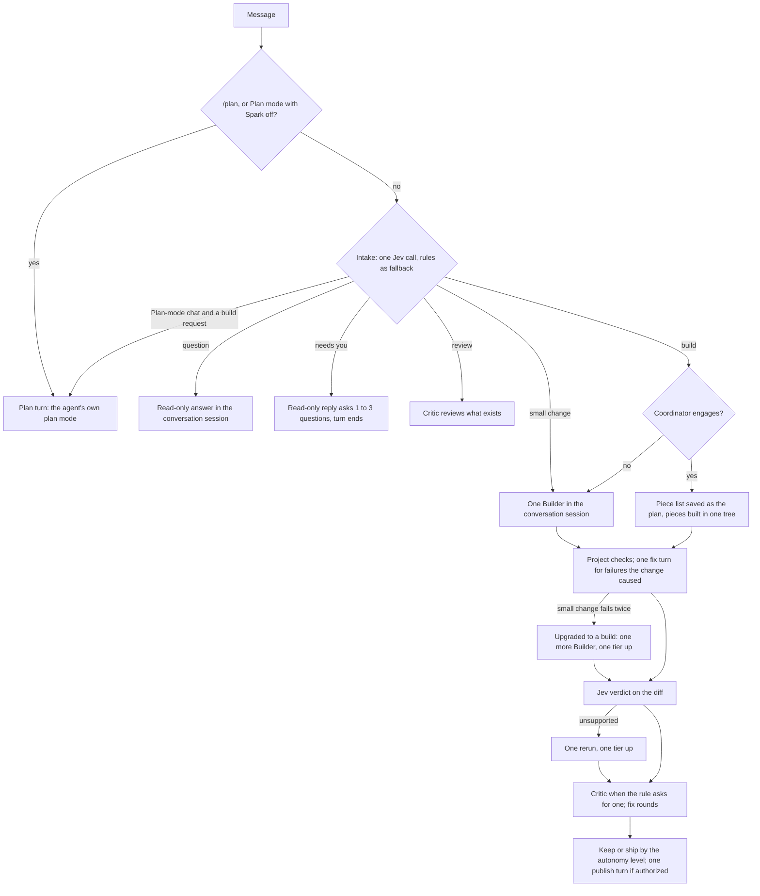

# The harness

What runs around every agent turn today: how a message is read, who works on it, what is checked, what is saved, and what the user is asked. This is the only harness. It began on October 6, 2026 as a proposal for a simpler second path behind a `HARNESS` switch; the switch and the older path were deleted on the branch `feat/harness-simple`, and the short [History](#16-history) at the end says what was planned, what was built and what was dropped. Older documents ([HARNESS_PLAN.md](HARNESS_PLAN.md), [COORDINATOR_PLAN.md](COORDINATOR_PLAN.md), [ROUTING_PLAN.md](ROUTING_PLAN.md)) still describe the parts this harness reuses; where they disagree with this file about plans, cards or sessions, this file is right.

Paths without a prefix are under `apps/server/src/`. External facts were read through a summarising fetch tool on October 6, 2026; re-read a page before quoting it elsewhere.

## 1. What it is

- **One loop.** Intake reads the message as one of four needs. A question is answered, a small change is made, an unclear request gets questions back in a reply, and a build is built, in pieces when it is big. Code and Jev decide what happens next; every decision is recorded.
- **Spark is a moderator, not a gatekeeper.** Spark raises no plan card, no questions card, no retry card and no verify card. The agent's mode decides when a permission card appears. There are no run budgets or caps. The safety floor in `AGENTS.md` is unchanged (section 9).
- **Nothing requires Jev.** Every Jev question has a rule fallback ([JEV.md](JEV.md)).
- **It is `orchestrate`, not a second orchestrator.** The loop is `orchestration/orchestrator.ts` driving the state machine in `orchestration/transitions.ts`. It reuses the route score, the project checks, `verifyChange`, `cascadeAction`, the Critic review loop and the Coordinator as they were (section 7).

## 2. The loop

| Step             | Who                                                                              | Runs when                                                   |
| ---------------- | -------------------------------------------------------------------------------- | ----------------------------------------------------------- |
| Intake           | Jev, one batched call; rules when Jev is missing or unsure                       | Every turn that reaches the orchestrator                    |
| Plan turn        | The chat's agent in its own plan mode, as the first Builder (`plan-turn-run.ts`) | `/plan`, or a build request in a Plan-mode chat (section 5) |
| Answer           | A read-only run (role `scout`) in the conversation session                       | Question; needs you; a plan-only request                    |
| Route            | Code: pin, floor, route score; Jev's ratings feed the score (section 7)          | Every Builder and piece                                     |
| Build            | One Builder, or the Coordinator's pieces (`coordinator/build.ts`)                | Small change and build                                      |
| Checks           | Code (`checks/`, `orchestration/checks.ts`)                                      | Files changed                                               |
| Verdict          | Jev: `verdict` and `unmet_N` (`orchestration/verify.ts`)                         | Green checks, files changed, Jev connected, diffs allowed   |
| Act              | Code (`cascadeAction` in `orchestration/cascade.ts`, `transitions.ts`)           | After the verdict                                           |
| Review           | The Critic and its fix rounds (`review-loop.ts`, `critic-*.ts`, `fix-rounds.ts`) | When `wantsCritic` or the request asks (section 7)          |
| Keep and publish | Code by the autonomy level (`full-auto-ship.ts`, `agent-publish.ts`)             | Files changed                                               |

**With Spark switched off** (Settings, Spark) a chat or Ask turn is one agent turn with no intake and no orchestration record. A Do turn in a linked project still goes through the orchestrator for the gate, the copy, snapshots and the keep or ship policy, but Jev is not called, the start is always a build, and the Builder runs on the chat's pick (`soloDecisions` in `orchestration/intake-run.ts`, `solo` in `transitions.ts`).

**Bounds on the loop.** A check failure the change caused gets one fix turn (`CHECK_FIXES`); a failure with the same signature is not sent to a worker twice (`failureSignature` in `checks/failures.ts`); failures in files the change did not touch are reported and never start a fix run. A failed Builder is retried one tier up at most twice (`MAX_REPAIR_RETRIES`). The verdict acts once per turn (at most `MAX_VERDICTS` 2 are recorded). The Critic's fix loop is at most 3 rounds (`CRITIC_FIX_ROUNDS`). `loop-guard.ts` stops a turn after 5 identical non-edit tool calls. These limits existed before this harness and were not changed.

## 3. Intake: the four needs

Intake (`orchestration/intake-run.ts`, `orchestration/intake.ts`, `orchestration/simple-intake.ts`) is one batched Jev call. The rules in `decideIntake` always produce a start; `readNeed` then picks the need.

| Need           | By Jev (`need` at 0.8 or more) | By rule (`needByRule`)                                    | What the turn does                                                                 |
| -------------- | ------------------------------ | --------------------------------------------------------- | ---------------------------------------------------------------------------------- |
| `question`     | "question"                     | The rules chose an answer, or a plan-only request         | One read-only answer; no card                                                      |
| `needs_you`    | "needs you"                    | The request is vague (Jev `vague` or the vague rule)      | One read-only turn that reads the code, asks 1 to 3 numbered questions and ends    |
| `small_change` | "small change"                 | A trivial request, or a follow-up that continues the task | One Builder; the Coordinator does not engage                                       |
| `build`        | "build"                        | Any other change                                          | One Builder, or pieces when the Coordinator engages; the plan is saved (section 5) |
| `review`       | Never: a review stays a review | The request asks for a review of existing work            | The Critic reviews, read-only                                                      |

- The read is recorded as the first `route` decision of the turn: `run_advice` with `purpose = 'route'`, no child run, and the summary "intake read this as build" (or question, small change, needs you, review), with its source and confidence (`recordNeed`). A model route row has a child run; anything that wants the Builder's route must select on that.
- A build starts at once in every agent mode, destructive work included, at both autonomy levels. The old starts `plan_first` and `plan` no longer run (`startWithoutPlans`): plan first becomes a build, plan only becomes an answer.
- **A small change that outgrows its path.** When its checks fail, get their one fix turn and fail again, the turn becomes a build: one more Builder (reason `retry`, one tier up) with the failing output, and the reply says "This started as a small change. Its checks failed twice, so it is now handled as a build." (`upgradeToBuild`).
- **Needs you is a reply.** A failed step after 2 retries ("Stopped after 2 retries."), a Builder missing context below Full auto, and a change Jev could not confirm all end a finished turn whose reply ends "Needs you: …" (`needsYouLine` in `transitions.ts`). At Full auto a Builder missing context ends the run as a failure report instead.

## 4. Every Jev question

Jev is TypeSafe's "System One" model, called at `POST /v1/systemone` with a `state` and typed questions (`advisor/jev.ts`). It returns Choice, Score and Noul (probability a statement is true) answers; it writes no text, calls no tools and reads only the state it is sent ([JEV.md](JEV.md)). Input costs $0.042 per million tokens (`JEV_INPUT_USD_PER_MILLION`); orchestration calls time out at 3 s (`orchestration/jev-calls.ts`); the request text is capped at 4,000 characters and a diff at 24,000 (`advisor/questions.ts`). After 3 failed calls in a row every call is skipped for 30 s (`advisor/jev-breaker.ts`). JEV.md notes that calibration holds across groups of answers, not for one answer.

"Acts" means the answer changes what happens when its confidence reaches the line in `advisor/policy.ts` (`ACT_AT`, 0.8 unless stated). The fallback applies when Jev is not connected, paused, late, invalid or under the line.

| Call                       | Question (key)                                                                                                                 | Type                  | Asked when                                                             | What it does                                                                                                                                                 | Fallback                                                                                 |
| -------------------------- | ------------------------------------------------------------------------------------------------------------------------------ | --------------------- | ---------------------------------------------------------------------- | ------------------------------------------------------------------------------------------------------------------------------------------------------------ | ---------------------------------------------------------------------------------------- |
| Intake                     | "What does `task` need from the agent?" (`need`): question, small change, build, needs you                                     | Choice                | Do turns                                                               | Picks the need (`NEED_ACT_AT` 0.8)                                                                                                                           | `needByRule`, from the start the rules chose                                             |
| Intake                     | "What is the main goal of `task`?" (`intent`), ten categories                                                                  | Choice                | Every turn                                                             | The category; the answer-first signal for the rules; in a Plan-mode chat, whether the message is a build request (`asksToBuild`)                             | `intentByRule`                                                                           |
| Intake                     | `plan_only`, `vague`, `review`, `destructive`                                                                                  | Noul each             | Do turns                                                               | Plan only: a read-only answer. Vague: needs you. Review: the Critic. Destructive: top tier, a Critic, a copy when working in the checkout                    | Wording rules; the destructive keyword rule always runs alongside                        |
| Intake                     | "Does `task` continue the work …?" (`continues_task`)                                                                          | Noul                  | The chat has an open task                                              | Same task or a new one; a continuing follow-up is a small change by rule                                                                                     | Follow-up rule (`orchestration/follow-up.ts`)                                            |
| Intake                     | `complexity`, `ambiguity`, `stakes`, `context_dependence`                                                                      | Score (5 levels) each | Do turns                                                               | Feed the route score (`route-score.ts`)                                                                                                                      | Rule signals (`task-signals.ts`)                                                         |
| Intake                     | "Which model size does `task` need?" (`tier`)                                                                                  | Choice                | Do and Ask turns with two or more tiers                                | Recorded as "Jev would have used …"; never applied                                                                                                           | n/a                                                                                      |
| Intake                     | `plan_agreed`, `previous_is_plan`                                                                                              | Noul each             | There is a previous reply                                              | Both at 0.85: the previous reply is saved as the agreed plan. Both at 0.6: "Save as agreed plan" is offered (`plans/agreement.ts`)                           | Nothing saved                                                                            |
| Intake                     | `injection`                                                                                                                    | Noul                  | Attached text                                                          | Recorded; never relaxes anything                                                                                                                             | n/a                                                                                      |
| Intake                     | `speed`                                                                                                                        | Choice                | A first message that asks to make something faster                     | Nothing reads the answer any more (its card is gone). Still asked; see section 13                                                                            | n/a                                                                                      |
| Builders, before the build | "How many Builders?" (`builders`) plus `T<n>_kind`, `_reasoning`, `_coding`, `_context`, `_reliability` per plan item          | Choice, Scores, Noul  | An agreed plan with 2 to 12 open items existed before the build        | Count used at `BUILDER_COUNT_AT` 0.7; items grouped into pieces; each piece routed from its items' answers (`askBuilders` in `coordinator/builder-jev.ts`)   | The engage rules; pieces take the rules pick                                             |
| Pieces, after the list     | `P<n>_kind`, `_reasoning`, `_coding`, `_context`, `_reliability` per piece                                                     | Choice, Scores, Noul  | The Coordinator wrote 2 to 12 pieces and no agreed plan existed before | Routes each piece: the demand maps to a tier; a migration or destructive piece is lifted to the top tier (`askPieces`; `piece-demand.ts`, `piece-routes.ts`) | The rules pick                                                                           |
| During a build             | `mid_build`: question, requirement, unrelated                                                                                  | Choice                | A message arrives while pieces are open                                | Routes the message (section 6)                                                                                                                               | Rules: a question by `intentByRule`, "also / add / make sure" a requirement, else queued |
| Verdict                    | "Does `diff` do what `task` asks?" (`verdict`): supported, unsupported, declined; plus `unmet_N` per requirement, five at most | Choice, Nouls         | Green checks with files changed                                        | See section 7                                                                                                                                                | Not verified: the turn finishes on the checks                                            |
| Critic findings            | "Is this finding a concrete correctness bug in the change?" (`finding_N`)                                                      | Noul each             | The Critic raised concerns                                             | Findings at 0.8 or more get a fix round                                                                                                                      | Rules on the finding text                                                                |
| Edit policy                | `beyond_request`, `destroys_work`, `weakens_tests`, `unsupported_file` (`advisor/policy-gate.ts`)                              | Noul each             | Proposed edits                                                         | Observed only; never changes a permission                                                                                                                    | n/a                                                                                      |

- **Jev never adds a card** and never turns an allowed action into a question. The agent's mode decides when a card appears.
- **Jev writes no feedback.** A rerun's follow-up text is built by code from the unmet requirement lines (`escalateFollowUp`); a fix turn carries the failing check output.
- **A cut diff is never accepted on Jev's word.** When the redacted diff is longer than the 24,000 characters Jev is sent, a confident "supported" is recorded as not verified ("Jev read only the start of the diff"); a confident "unsupported" still acts (`readVerdict` in `advisor/verify-questions.ts`).
- **Piece routing line.** The piece list's why-line starts "Jev: 4 pieces · P1 … · P2 …" when the pieces were asked about after the list, and "Jev: 2 Builders (0.84) …" when a plan existed before.

## 5. Plans: the plan line and plan mode

**There is no Spark plan card.** Nothing waits for a plan unless the agent itself asks.

**The plan Spark already has is saved** when intake reads a message as a build, with no approval and no wait (`plans/build-plan.ts`):

- _A build in pieces:_ the Coordinator's piece list, one numbered line per piece with its goal and files (`saveBuildPlan`, called from `writePieceList` in `coordinator/turn.ts`).
- _A single Builder:_ the Builder's own ACP plan entries, as they arrive (`watchBuilderPlan`, attached in `orchestration/members.ts` when the need is `build` and no piece list exists).
- _Where:_ `plan_documents`, source `chat`, status approved, `approved_option` `build_pieces` or `build_steps` (`PLAN_SAVED_OPTION` in `packages/contracts/src/plans.ts`). No new table. A changed plan is a new version.
- _Not saved_ while the chat is still following an earlier agreed plan that has not been built (`builtSinceApproval` in `plans/plan-turn.ts`). The Coordinator's list is then built from that plan, and is not saved as a new one.
- _The line._ The thread shows one line per turn at the latest version, "Plan saved · 4 pieces" or "Plan saved · 3 steps" (`planSavedText`), derived from `conversationPlans().lines` in `persistence/plan-documents.ts`. It opens the Work panel's Plan tab.
- _What the saved plan does next._ It goes into Builder prompts and new sessions as the `## Agreed plan` block; the Critic rule "a build from an agreed plan gets a review" applies (`wantsCritic` in `orchestration/critic-rule.ts`); and the pull request body carries an "Agreed plan" section (`ship/message.ts`).

**Plan turns** (`plans/simple-plan-turn.ts`, `orchestration/plan-turn-run.ts`, `orchestration/orchestrator.ts`). A plan turn is one changing run that starts in the agent's own plan mode: Claude's Plan mode, or Codex's `collaboration_mode: plan`. The agent's own request to leave plan mode goes through the approval gate like any other request, with the plan as its content; that request is the stop. Once allowed, the approved plan is the agreed plan, gets the same line, and the same turn builds. Spark adds no card. The plan turn is the turn's first Builder, run in place on the chat's own run (`buildFromPlan`): what it built then goes through the same end of turn as any build (checks and their fix turn, the verdict, the Critic when the rule asks, keep or ship by the autonomy level). A plan turn that fails, or that ends without changing a file, ends there.

| Message                                                                | What happens                                                                                                                             |
| ---------------------------------------------------------------------- | ---------------------------------------------------------------------------------------------------------------------------------------- |
| Starts with `/plan`, in a chat with a linked project (`isPlanCommand`) | Always a plan turn, in any agent mode                                                                                                    |
| Chat's agent mode is Plan, Spark off (`isPlanModeChat`)                | A plan turn                                                                                                                              |
| Chat's agent mode is Plan, message reads as a build request            | Intake runs first; `asksToBuild` (Jev's intent, else `intentByRule`: bug fix, feature, refactor, tests, docs, config) starts a plan turn |
| Chat's agent mode is Plan, anything else                               | An ordinary read-only turn with intake and an orchestration record                                                                       |
| No project linked                                                      | No plan turn: there is nothing to change, so the message is an ordinary turn                                                             |

- The third and fourth rows are a **coordinator decision, owner to confirm** (section 13).
- Plan mode is never chosen from wording in any other agent mode. The next turn is back in the mode the user picked, because the mode is applied every turn.
- The composer's `/plan` sends the text `/plan …`. "Plan first" in the ticket start dialog and the Slack start settings sends the brief prefixed with `/plan ` (`PLAN_COMMAND` in `tickets/request.ts`).
- A pending approval that carries a plan gives the chat attention kind `plan` (`persistence/attention.ts`): the sidebar line, and "Approve plan" on a ticket.
- In a mode that never asks, the leave-plan request is allowed at once. Seen live on October 7, 2026: Codex in Full access with `/plan` showed the plan and built in the same turn with no card; Claude in Auto raised one card from the agent, "Approve Plan", and its allow-once option is "manually approve edits", so Claude then asked for each edit.

## 6. Builds in pieces

The Coordinator ([COORDINATOR_PLAN.md](COORDINATOR_PLAN.md)) engages only for a build (`mayCoordinate` in `coordinator/shadow.ts`), by Jev's Builder count when a plan existed, otherwise by the engage rules (`coordinator/engage.ts`).

- **The piece list is the plan.** Each piece states `owns`, `reads`, `dependsOn`, acceptance and a scoped check (`packages/contracts/src/pieces.ts`). `coordinator/pieces-validate.ts` rejects, once, at plan time, two pieces that can run at the same time and own the same file. An invalid list gets one repair turn with the validator's message.
- **What the Coordinator is shown.** For the files the plan names and the files the code scan ranked likely, one line per file of what imports it, from the project Map (`coordinator/blast-radius.ts`). It is data for the Coordinator; no rule reads it.
- **One tree.** `placePieces` gives a git project one shared working tree in every agent mode, and a project outside git pieces in order. There are no per-Builder copies, no code merge and no integrator turn for placement.
- **A piece follows the agent's mode** like any other run. Kept rules: a coordinated Builder makes no git state changes, runs no whole-project check command, and never publishes; the safety floor applies.
- **A change to another piece's file is kept, flagged and routed** (`coordinator/ownership.ts`, `crossings.ts`, `edit-evidence.ts`). The evidence is each worker's own edit tool calls and its commands' redirect targets. The flag is the non-blocking rail flag `other_piece` with an audit entry; the diff is routed to the owning piece's worker, to its brief if it has not started, otherwise to the follow-up run. Nothing is refused or reverted. A write Spark cannot read (a script, `sed -i`, a formatter) to the file of a piece that is running is not flagged.
- **`Needs: <path> — <what must change>`** as a piece's last line is routed the same way (`coordinator/needs.ts`).
- **The integrator seat** runs the follow-up after the pieces land (glue the list names, and routed notes) and the Critic's fix rounds. Decided: no new role for the follow-up.
- **After the pieces land,** the whole change's checks run once, then the verdict and the Critic.
- **Messages during a build** (`coordinator/mid-build.ts`, `mid-build-question.ts`). A question is answered at once by a read-only run on the conversation session, with the piece statuses in its prompt; no worker is stopped. A requirement goes to the running piece that owns the file it names, else to a piece not started, else to the follow-up run (`routeRequirement` in `coordinator/follow-up.ts`). Unrelated work is queued as the next message. A message stored as the last piece lands is sent as the next chat message by the existing drain.
- **Run events** (AG-UI 1.0.2's own; `workflow/subagent-events.ts`). Every run another run started carries `parentRunId` on `RUN_STARTED`. The run that answers a mid-build question is announced in the chat run with `SUBAGENT_STARTED` and closed with `SUBAGENT_FINISHED`, or `SUBAGENT_ERROR` with code `cancelled` (stopped) or `interrupted` (the chat run ended first); its reply text is copied there. It is listed under `answers` on the orchestration, not in `crew` (`orchestration/view.ts`), and the thread shows it as an ordinary reply under the message it answers.

## 7. Sessions, tiers and what happens after a build

### Sessions

| Choice               | Today                                                                                                                                                                                                                                                                                                        |
| -------------------- | ------------------------------------------------------------------------------------------------------------------------------------------------------------------------------------------------------------------------------------------------------------------------------------------------------------ |
| Conversation session | One per chat and provider, key `chat:<provider>` (`workflow/conversation-session.ts`). Chat turns, the read-only answer, the solo Builder and the mid-build answer share it, across modes, tasks, folders and idle time                                                                                      |
| Other keys           | Pieces, the Coordinator, the integrator, the Critic and a Builder escalated by brief keep their own keys. A rerun one tier up stays on the conversation session                                                                                                                                              |
| Mode, model, effort  | Applied on the resumed session with `session/set_config_option` before the prompt. If the agent reports it stayed in another mode, the run stops before the prompt is sent (`agents/acp/apply-settings.ts`). A model change writes a `model_change` row priced with `switchCostUsd`                          |
| Model stays put      | Routing keeps the model of a resumable conversation session (`keepSession`, `resumableConversation` in `orchestration/session-keep.ts`), so a question after Sonnet build turns stays on Sonnet. Destructive work still moves to the top tier; a pin always holds                                            |
| What it missed       | Messages added to the chat since the session's last turn are prepended under "Since your last turn in this chat" (`agents/acp/session-open.ts`, `workflow/session-handoff.ts`)                                                                                                                               |
| Folder               | A resume in a different folder is attempted for agents marked `resumesAcrossFolders` (`agents/acp/agents.ts`)                                                                                                                                                                                                |
| Replaced only when   | The agent refuses the resume or load, the chat changes provider, or the user closed it (Start fresh, compaction, moving to a fresh chat, archiving). No time limit and no cost or size rule (`decideConversationResume`)                                                                                     |
| Handoff              | A replaced session is seeded with `sessionHandoffPrompt` (`orchestration/handoff.ts`): goal, agreed plan, open work, files changed, last check output, last three exchanges. The thread shows "Started a fresh agent session (reason). It has a handoff of the goal, plan, changes and last three exchanges" |
| Why a resume failed  | When the agent advertises `sessionCapabilities.list`, Spark calls `session/list` once and the reason says "the agent no longer has the earlier session" or "the agent still has the earlier session but couldn't reopen it"                                                                                  |
| Audit                | Opens, resumes, replacements, model changes and closes are rows in `provider_session_events` (`workflow/session-events.ts`); a close outside any run has no run id                                                                                                                                           |

Why one session: in the session that prompted this work, about $38 to $40 of $59 was cache writes because each helper opened its own session, and a question after build turns could never resume the Builder's session. ACP allows a config option to change "at any point during a session" (https://agentclientprotocol.com/protocol/session-config-options). Prompt caches are per model, so a model change keeps the session but pays a cache write; that is why the change is priced and the model is kept where it can be.

**Sub-agents inside a session, or separate sessions?** Reading fans out inside the session; building gets its own run. Both pinned adapters advertise `sessionCapabilities.subagents` ([ACP_COMPLIANCE.md](ACP_COMPLIANCE.md)); Spark does not advertise the client capability, so it sees flattened tool calls. In-session sub-agents cost Spark nothing to drive, but Spark cannot pick their tier, run checks between them or resume one by name (https://code.claude.com/docs/en/sub-agents), so pieces are ACP sessions Spark drives. Not verified: whether `usage_update` cost includes sub-agent spend.

### Tiers and routing

Unchanged from [ROUTING_PLAN.md](ROUTING_PLAN.md) except where stated.

- **Tiers** come from the model cards (`model-cards/vendor-cards.json`: small, mid, top), crossed with what the sign-in reports. The floor (`orchestration/model-floor.ts`) never gives a Builder the small tier.
- **The route** for a solo Builder is code: pin, then destructive to the top tier, then the route score (`routeBuilder`, `route-score.ts`, `task-signals.ts`, `escalation.ts`, `builder-complexity.ts`, `cache-switch.ts`, `laws/demotion-route.ts`). Jev's four ratings feed the score. Jev's `tier` Choice is recorded as "would have used".
- **Pieces** are routed from Jev's per-piece answers (section 4) by `coordinator/piece-demand.ts` and `piece-routes.ts`, with the floor applied.
- **A pin holds.** In a pinned chat the solo Builder, an escalated retry and every piece run on the pinned model; `escalate` returns a pinned route unchanged; Jev's pick is kept as "Jev would have used …". The floor still raises a pinned small model for a Builder.
- **The Critic is not held to the pin.** It reviews on another provider, or one model up when there is only one (`critic-provider.ts`, `routeCritic`). Decided: kept, because moving it to the pin would end cross-provider review for every pinned chat.
- **The why-line** (`model-cards/why.ts`, `recordRoute` in `member-routes.ts`) shows the model, rule or Jev, tier, floor note, session note and "Jev would have used".

### After a build

- **Checks** (`checks/**`, `orchestration/checks.ts`, check attribution): section 2's bounds.
- **Verdict** (`verifyChange`). One `verdict` Choice and one `unmet_N` Noul per requirement line. Supported, or anything under 0.8: go on. Unsupported at 0.8 or more: one rerun one tier up on the same session with the unmet lines, unless Spark's own evidence settles it (no `unmet_N` at 0.8, checks pass, no Critic concerns). Declined, or unsupported with that clean evidence: **no card**. The change is kept or shipped by the autonomy level as usual, the reply ends "Needs you: Jev could not confirm …" (`DECLINED_REASON`, `UNCONFIRMED_REASON`), and a pull request carries the note "Jev could not verify this change" (`FlowState.unverified`, `UNVERIFIED_NOTE` in `full-auto-ship.ts`).
- **Critic** (`wantsCritic`): a large diff, escalated high-stakes work, a build from an agreed plan, a feature over 3 or more source files or 2 or more areas; never a one-liner; also destructive work, a migration, or a review request. Because every build now saves its plan, builds get a review more often than before.
- **Keep and publish.** Automatic keeps; Full auto → PR keeps, then one separate publish turn (`publishByAgent` in `orchestration/agent-publish.ts`) pushes the chat's branch and opens the pull request. Nothing merges.
- **The estimate** (Hofstadter's law, [UNIVERSAL_LAWS.md](UNIVERSAL_LAWS.md)) is still recorded as a `law` decision before the first Builder of a build (`ensureEstimate`). It is no longer shown before the build, because the card it lived on is gone.

## 8. Cards

**What Spark still asks.**

| Card                                                             | When                                                                                                                            |
| ---------------------------------------------------------------- | ------------------------------------------------------------------------------------------------------------------------------- |
| The agent's own permission requests (`edit`, `execute`, `other`) | When the agent's mode asks, with the agent's reason. The agent's plan approval ("Approve Plan") is one of these                 |
| "Keep these changes?" (`accept`)                                 | Automatic with a risky migration in your checkout (`asksToKeep`); Full auto with failing checks when Settings says stop and ask |
| "Which version should be kept?" (`merge_conflict`)               | A solo task copy that conflicts when it lands (`orchestration/solo-copy.ts`)                                                    |
| "This chat is almost full" (`compact`)                           | Before a turn (`compaction/before-turn.ts`). The only card that still uses the auto-continue countdown                          |
| Safety-floor asks                                                | Section 9; in every mode                                                                                                        |

The Settings label for the countdown is "Wait before going on without your answer".

**What is gone, and what replaced it.**

| Card                                                                                                  | Now                                                                                                         |
| ----------------------------------------------------------------------------------------------------- | ----------------------------------------------------------------------------------------------------------- |
| "Build this plan?" (with the estimate), "Approve the plan?" for a plan-only request                   | The plan is saved and the build starts; the "Plan saved" line. The agent's own plan approval in a plan turn |
| "Spark has a few questions", "What should change?", "Want me to answer, plan it, or make the change?" | One read-only reply with 1 to 3 numbered questions; answers go in the next message                          |
| "What should the Builder look at?"                                                                    | A reply that ends "Needs you: …"                                                                            |
| "Retry with <model>?"                                                                                 | "Needs you: Stopped after 2 retries."                                                                       |
| "Jev could not verify the change"                                                                     | "Needs you: Jev could not confirm …"; kept or shipped by the level; the pull request note                   |
| "One PR or separate PRs?"                                                                             | One pull request per turn                                                                                   |

Approvals of kind `plan`, `clarify`, `retry`, `verify` and `pr_split` are never created any more. Sidebar, Home, island and Slack lines such as "Has a plan for you to review" appear only for the agent's own requests.

**No Spark stop before destructive work** in Auto, Bypass permissions, Approve for me and Full access. This is intended: the agent's mode decides, and the safety floor is unchanged.

**A run waiting on a card when the worker stops** (for example across an app update) is ended by `workflow/recovery.ts`: the pending approval is expired with `decided_by = 'recovery'` and the run ends `outcome_unknown` with a plain message that the action never ran. So a run waiting on a removed card kind cannot hang.

## 9. Safety floor, publish rules, gate, audit and phone

None of this was changed by the harness work. Every changing run gets its gate through `workflow/agent-turn.ts`, `workflow/do-run.ts`, `workflow/approval-gate.ts` and `approvals/decide.ts`. The table was read from the code on October 7, 2026; line numbers are given only for files not edited since.

| Rule                                                                                              | Enforced at                                                                                                                                                       | Test                                                                                                  |
| ------------------------------------------------------------------------------------------------- | ----------------------------------------------------------------------------------------------------------------------------------------------------------------- | ----------------------------------------------------------------------------------------------------- |
| Changing, moving or deleting a secret file asks                                                   | `approvals/rails.ts` 159 `alwaysAsk` (122, 91, 144), called at `decide.ts` 330                                                                                    | `approvals/decide-protected.test.ts`, `test/read-then-send.db.test.ts`                                |
| Changing an agent instruction file asks                                                           | `decide.ts` 304 to 308, `projects/path-policy.ts` 120                                                                                                             | `decide-protected.test.ts`, `test/protected-paths.db.test.ts`                                         |
| Reading a secret file in a linked repo follows the mode, audited by path                          | `approvals/request-place.ts` 27 and 33, `secret-reads.ts` 23, `approval-gate.ts` 379, `observations/run-observations.ts` 93                                       | `decide-secret-reads.test.ts`, `test/rail-flags.db.test.ts`                                           |
| `.sparkignore` or a secret outside the repos asks to read                                         | `request-place.ts` 33, `rails.ts` 85                                                                                                                              | `decide-secret-reads.test.ts`, `decide-reads.test.ts`                                                 |
| Git hooks and git config ask with hold-to-confirm                                                 | `decide.ts` 301 to 303, `git-commands.ts` 262, `approval-gate.ts` 120                                                                                             | `decide-protected.test.ts`, `test/protected-paths.db.test.ts`                                         |
| No force pushes                                                                                   | `git-commands.ts` 139 and 153, `decide.ts` 216 and 293                                                                                                            | `decide-force-push.test.ts`                                                                           |
| Only the chat's own spark/\* branch                                                               | `approvals/publish-policy.ts` 132, 142, 154; `decide.ts` 207 to 211, 385; `workflow/publish-context.ts` 24                                                        | `decide-publish.test.ts`, `publish-policy.test.ts`                                                    |
| No remote changes                                                                                 | `git-commands.ts` 6 and 184, `publish-policy.ts` 143                                                                                                              | `decide-publish.test.ts`                                                                              |
| No writes or deletes outside the repos except temp folders                                        | `rails.ts` 47, 55, 67, 151; `approvals/temp-dirs.ts` 6 and 39                                                                                                     | `decide-temp.test.ts`, `write-targets.test.ts`, `test/piece-gate.db.test.ts`                          |
| `--no-verify` refused on a push                                                                   | `git-commands.ts` 43, `decide.ts` 213                                                                                                                             | `decide-publish.test.ts`, `decide-worktree-commands.test.ts`                                          |
| A secret value in a push or `gh` upload asks with hold-to-confirm; `spark_push` refuses           | `approvals/secret-send.ts` 176 and 140, `approval-gate.ts` 414, `ship/agent-push.ts` 100                                                                          | `secret-send.test.ts`, `test/agent-push.db.test.ts`                                                   |
| "Sent data … after reading …" flag and audit entry                                                | `approvals/taint.ts` 28, `approval-gate.ts` 457, `observations/send-watch.ts` 42                                                                                  | `decide-taint.test.ts`, `test/read-then-send.db.test.ts`, `test/send-watch.db.test.ts`                |
| "Ran without review" and rail flags in modes the gate cannot see                                  | `audit/review-tracker.ts` 17, `workflow/audit-recorder.ts` 111, `agents/acp/rail-watch.ts` 75, `workflow/rail-flags.ts` 133                                       | `rail-crossings.test.ts`, `audit-recorder.test.ts`, `test/rail-flags.db.test.ts`                      |
| When an agent may publish                                                                         | `publish-policy.ts` 60 and 75, `publish-context.ts` 84, 61, 108; `spark-mcp/tools/publish-tools.ts` 16                                                            | `decide-publish.test.ts`, `test/spark-mcp-publish.db.test.ts`                                         |
| One separate publish turn; pieces and the Coordinator never publish                               | The `keep` and `ship` steps in `orchestrator.ts`, `full-auto-ship.ts`, `agent-publish.ts` 82; pieces excluded at `decide.ts` 390, `publish-context.ts` 94 and 112 | `test/agent-publish.db.test.ts`, `test/orchestration-full-auto.db.test.ts`                            |
| Pull request follow-up permission                                                                 | `publish-context.ts` 51 and 61, `agent-publish.ts` 36, `pr-follow-up/round.ts` 187, `approvals/own-repo.ts` 25                                                    | `test/publish-follow-up.db.test.ts`, `test/pr-follow-up.db.test.ts`                                   |
| Nothing merges; no resolving, approving or dismissing                                             | `publish-policy.ts` 85 and 108, `ship/github/connection.ts` 58 to 62                                                                                              | `decide-publish.test.ts`, `test/spark-mcp-pr-follow-up.db.test.ts`                                    |
| `spark_push` with the login-shell environment; `spark_pull_request`                               | `ship/push.ts` 68 and 171, `ship/agent-push.ts` 68, `publish-tools.ts` 44 and 129                                                                                 | `ship/push-env.test.ts`, `test/agent-push.db.test.ts`, `test/agent-pull-request.db.test.ts`           |
| The approval gate follows the agent's mode; Spark action tools ask by mode                        | `approval-gate.ts` 385 and 214, `decide.ts` 270, 324, 369; `spark-mcp/actions/action-policy.ts` 56                                                                | `decide-agent-mode.test.ts`, `test/agent-mode-gate.db.test.ts`, `test/spark-action-matrix.db.test.ts` |
| Piece rules kept (no git state changes, no whole-project check, instruction and git-control rule) | `approvals/piece-guard.ts` 27, `decide.ts` 218 and 180, `approval-gate.ts` 393                                                                                    | `decide-pieces.test.ts`, `decide-piece-matrix.test.ts`, `test/piece-gate.db.test.ts`                  |
| Audit of tool calls and approvals                                                                 | `workflow/audit-recorder.ts` 37, `agent-turn.ts`, `approval-gate.ts` 353, 433, 442                                                                                | `audit-recorder.test.ts`, `test/audit-log.db.test.ts`                                                 |
| Phone: every route refused unless a rule allows it; the server listens on 127.0.0.1               | `remote/policy.ts` 78, `remote/route-rules.ts` 273 and 148 to 174, `API_HOST` in `config.ts`                                                                      | `test/remote-policy.db.test.ts`, `remote/policy.test.ts`                                              |
| Browser pane isolation and saved sign-ins                                                         | `spark-mcp/tools/browser/context.ts` 20 and 37, `browser/gate.ts` 12, `apps/desktop/src/browser/request-guard.ts` 66                                              | `browser/gate.test.ts`, `test/browser-sign-ins.db.test.ts`                                            |

**Caveats found while mapping.** Only `git push --no-verify` is refused in code; `git commit --no-verify` is prompt text only (`orchestration/context.ts`). The observed "sent data" flag in modes the gate cannot see is recorded only for changing runs (`observations/send-watch.ts`). The force-push rule refuses plain, mirror, unnamed and protected-branch forces and asks with hold-to-confirm for `--force-with-lease` on a named unprotected branch. The publish turn is spawned by `publishByAgent` with role `builder`; after pieces ran, `seatFor` (`orchestration/members.ts`) gives that run the integrator's seat, which is what `AGENTS.md` means by "the integrator in a crew turn".

## 10. Decision audit and export

- **Where each record lives.** Jev answers and decisions: `run_advice`. Routes: `runs.route`. Cards: `approvals`. Cost: the token columns on `runs` and the model-card prices. Session events: `provider_session_events` (migration 0150), the one table this work added.
- **Export.** The JSONL export appends `meta`, `turn`, `run_end`, `session`, `jev` and `card` lines after the `run` and `log` lines; `export.csv?view=decisions` gives the same lines as one table ([ACP_AGENTS.md](ACP_AGENTS.md#audit-recording)). The `meta` line and each session event carry `harness: 'simple'`.
- **Replay.** `apps/server/test/replay/` runs recorded cases through the fake agents and the real orchestrator and checks that the export's run and session counts match the run rows and the protocol log. Costs in its table are modelled from bytes sent at card prices, because the fake agents report the same token counts every turn.

## 11. Stored data that must keep parsing and rendering

| Stored                                                                                                                                                                 | Where                                                                                                                               | What stays for it                                                                                                                                              |
| ---------------------------------------------------------------------------------------------------------------------------------------------------------------------- | ----------------------------------------------------------------------------------------------------------------------------------- | -------------------------------------------------------------------------------------------------------------------------------------------------------------- |
| Approvals of kind `plan`, `clarify`, `retry`, `verify`, `pr_split`, `budget`, `stuck`, `ownership`, `pieces`, decided or cancelled, with their payloads and option ids | `approvals` rows; `checkpointKindSchema`, `checkpointPayloadSchema`, `CHECKPOINT_OPTION` in `packages/contracts/src/checkpoints.ts` | The schema members and option ids, kept on purpose, and the web's rendering of old decided cards in `chat/checkpoints/` so old turns still show what was asked |
| A run that was waiting on one of those cards                                                                                                                           | `runs`, `approvals`                                                                                                                 | Ended by recovery (section 8)                                                                                                                                  |
| Piece lists placed `worktree`, piece notes of kind `merge_main`, violations with action `refused`, `moved`, `reverted`, `asked`, run guards with `sharesTree`          | `piece_lists`, `member_messages`, run settings                                                                                      | `listPlacementSchema`, `pieceViolationSchema`, the note kind in `packages/contracts/src/steer.ts`; covered by `test/piece-list-stored.db.test.ts`              |
| Route rows with `sessionChoice`, `escalation`, `score`, and the rules "Jev: clearly simple, below your pinned …"                                                       | `run_advice` (`purpose = 'route'`), `runs.route`                                                                                    | Parsed leniently in `orchestration/view.ts`; the rule is stored text                                                                                           |
| Decision kinds and Jev answers of the old intake questions                                                                                                             | `run_advice`                                                                                                                        | `decisionKindSchema` is unchanged; `view.ts` keeps the labels. New intake records no longer carry the `plan` call                                              |
| Sessions keyed `chat:<mode>` and `key:<task>:builder`                                                                                                                  | `provider_sessions`                                                                                                                 | Never resumed (the harness resumes `chat:<provider>`). No migration                                                                                            |
| The `harness` field on export and session-event rows                                                                                                                   | `provider_session_events`, export lines                                                                                             | `harnessSettingSchema` (`packages/contracts/src/decision-audit.ts`) keeps both values: old rows may say `current`, new rows say `simple`                       |
| `RUN_STARTED` without `parentRunId`, runs without sub-agent events                                                                                                     | `run_events`                                                                                                                        | Optional fields; covered by `workflow/subagent-events.test.ts`                                                                                                 |
| `projects.pr_split`                                                                                                                                                    | `projects`                                                                                                                          | Column unused; left in place, no migration                                                                                                                     |
| Plans saved at a build                                                                                                                                                 | `plan_documents` with `approved_option` `build_pieces` or `build_steps`                                                             | Read by `conversationPlans` for the "Plan saved" line                                                                                                          |

## 12. A2A

The Agent2Agent protocol lets independent agents discover each other and exchange work. Spec releases: v1.0.0 on March 12, 2026 and v1.0.1 on May 28, 2026 (https://github.com/a2aproject/A2A/releases). The Linux Foundation has hosted it since June 23, 2025 (https://linuxfoundation.org/press/linux-foundation-launches-the-agent2agent-protocol-project-to-enable-secure-intelligent-communication-between-ai-agents). An agent publishes a self-reported Agent Card at `/.well-known/agent-card.json` (https://a2a-protocol.org/latest/topics/agent-discovery/); tasks move through submitted, working, input required, completed, failed, canceled, rejected and auth required; long work uses SSE or push notifications. The Node SDK is `@a2a-js/sdk`, Apache-2.0, v1.3.0 on September 29, 2026 (https://github.com/a2aproject/a2a-js/releases); [PLAN.md](../product/PLAN.md) cites 1.2.1. A2A is complementary to MCP (https://a2a-protocol.org/latest/topics/a2a-and-mcp/). Neither adapter README mentions A2A (https://github.com/agentclientprotocol/claude-agent-acp, https://github.com/zed-industries/codex-acp).

**Spark keeps ACP between itself and its workers and does not add A2A now.** The worker link needs things A2A does not carry: per-session mode and model, `session/request_permission` answered by Spark's gate, forwarded MCP servers, file and command updates, resume. An A2A worker is opaque by design, which would remove the approval gate and the audit; and no worker speaks A2A, so Spark would have to write both ends, which `AGENTS.md` rules out.

Where it would help later, when a real caller exists: Spark as an A2A server for one chat (task states map onto run states and the SSE stream exists), then third-party A2A agents as helpers (the phase 3 item in PLAN.md). Not for the phone, which is Spark's own web UI ([PHONE_REMOTE.md](PHONE_REMOTE.md)). Auth and what a remote caller may do are the real work and are not estimated.

## 13. Decisions

**Decided by the owner.**

1. The simple harness is the only harness. The switch, `harness/setting.ts` and the older path are deleted.
2. No Spark plan card. The plan Spark has is saved with no approval and shown as one line (section 5).
3. "Needs you" is a reply, not a card (section 3).
4. Jev's per-piece questions are asked about the Coordinator's pieces after the list is written (section 4). This closed the gap in which pieces took the rules pick whenever no plan turn had run.
5. No Spark stop before destructive work in modes that never ask (section 8).
6. When Jev cannot confirm a change there is no card; the pull request keeps its note (section 7).
7. A pin holds for the Builder, an escalated retry and every piece. The Critic in a pinned chat still reviews on another provider or one model up.
8. Parallel pieces stay, in one shared tree, with ownership flagged and never enforced by refusal (section 6).
9. The gate of "two more replay sessions" before deleting the older path is dropped; a final test with real providers replaces it.
10. None of the threshold, cap or new-question ideas in section 14 will be built.
11. The deletion removed only what was provably dead. The route score, the review loop, the Coordinator and the observation code stay.
12. A2A: later, as a server for one chat when a caller exists (section 12).

**Still open. Each is the working answer, assumed until the owner confirms.**

1. **A question in a Plan-mode chat is an ordinary read-only turn; only a build request starts a plan turn.** Coordinator decision, owner to confirm (section 5).
2. **`/plan` in a mode that never asks builds without a card**, because the agent's leave-plan request is allowed at once. Assumed; whether a `/plan` turn should always wait is not decided.
3. **The mode picker still labels Plan as read-only** (`packages/contracts/src/agent-modes.ts`), although a plan turn can change files once the leave-plan request is allowed. Not decided.
4. **Jev's `speed` intake question** is still asked although nothing reads it. Removing it changes what Jev is sent, so it is left for a separate decision.
5. **May Jev answer permission requests?** Assumed no. The edit-policy Nouls stay observed only.
6. **Session replacement has no time, cost or size rule.** Assumed; context size is the agent's own compaction's job.
7. **Gitignored secret files and chat worktrees.** A file such as `.env` is not in the chat's worktree, so the agent either reports it missing or reaches for the copy in the project's checkout, which the safety floor treats as outside the project and asks about. Not decided; the rail is unchanged.
8. **Whether "the owner is told" about a crossed file should be a real Coordinator turn** mid-build. Today code routes it. Assumed: code.
9. **`spark_map`'s 200-dependent cap** applies to the Coordinator's "what depends on these files" block; a hub file's line can be about 2,400 tokens. Assumed acceptable; not measured on a real Map.
10. **Warm conversation session** (section 15): designed, not built; whether Ask and Do turns may share one live session is the owner's call.

## 14. Not built

These were in the proposal. None was built and none will be: each adds a threshold, a cap, a new Jev question or a rebuild the harness does not need.

- **A planner and worker loop replacing the Coordinator**, with planner-written acceptance checks and a planner session resumed to assemble the answer. The Coordinator, its piece list and the integrator seat do this job.
- **Replacing the route score with Jev's `tier` Choice.** The score stays; `tier` is recorded only.
- **Acceptance bands** (0.8 accept, 0.2 escalate, retry between) and "unanswerable" checks at 0.4 to 0.6. The verdict acts at one line.
- **A quality Score** where "below 3 counts as unmet".
- **`destructive` acting at 0.2.** It acts at 0.8 and the keyword rule always runs alongside.
- **A cap of three Jev checks per subtask.** The existing limit is five `unmet_N` lines per verdict.
- **Failure typing, a stop check and a small-change Noul** as new Jev questions. A failed Builder is retried one tier up by rule; open plan items decide "Incomplete: …"; a small change is judged by its checks.
- **A handoff note turn by the failing worker, and a revert to the starting commit on "wrong approach".** A rerun continues from the failed attempt's edits.
- **A model-picker hint for chats pinned by the old default.**
- **A cost or idle rule for replacing a session.**

## 15. Designed, not built: a warm conversation session

Owner request: keep the chat's agent process and ACP connection alive between turns, close it after 60 idle minutes, and resume as today when it is gone. Diagnosed on October 7, 2026; no code exists.

- **Today** every turn starts the agent process, connects, runs `initialize`, resumes or loads the stored session, applies settings, prompts, closes the session and kills the process (`agents/acp/acp-provider.ts`). Between turns no agent process exists.
- **The hard part** is what is fixed for the life of a process or session: the process environment, the folder and client capabilities given at `initialize`, the session's MCP servers and tool list (an Ask turn opens with the read-only list), the Spark tools grant scoped to one run, and the client handlers bound to one run's gate and audit.
- **The design:** split `acp-provider.ts` into launch, connection and turn; a registry of live sessions owned by the worker, only for `chat:` keys; a launch fingerprint, with a live prompt only on an equal fingerprint and today's resume otherwise; the Spark tools grant repointed per turn; one idle constant of 60 minutes; early close only on recorded events (archive, delete, Start fresh, sign-out, shutdown); one session event per turn saying `live` or `resumed`.
- **Open question:** a chat alternates Ask and Do turns, which have different fingerprints, so the warm path would help only runs of same-kind turns unless a question is held to read-only by the mode and the gate alone. That changes what a question turn's session may do.
- **Measured idle memory** (process start and `initialize` only): claude-agent-acp 0.81.2 one process, 107 MB; codex-acp 1.13.1 three processes, 171 MB. A session that has run a turn will be larger; not measured.

## 16. History

**The proposal (October 6, 2026).** One recorded session, "session A", showed the earlier design at its worst: 19 turns, 90 runs (4.7 per turn), $60.14, 108 minutes waiting on cards, the Coordinator running twice in 10 of 10 plan turns, 11 fix runs for failures in files the change never touched, and most of the cost in cache writes from one session per helper. The proposal was one loop with a planner, per-subtask workers, a Jev judge with acceptance bands and a tier ladder, behind a `HARNESS` setting (`current`, `simple`) read per step, to be compared on replayed sessions. It estimated about 10,800 source lines deleted. Research behind it that still explains present choices: LLM judges agree with humans about 80% of the time and show known biases (https://arxiv.org/abs/2306.05685), which is why hard checks run first and an unsure verdict never counts as accepted; a vague brief makes helpers duplicate work (https://www.anthropic.com/engineering/multi-agent-research-system; https://arxiv.org/abs/2503.13657), which is why a small change gets no brief and pieces get a validated one; models struggle to self-correct without external feedback (https://arxiv.org/abs/2310.01798), which is why a rerun always carries check output or unmet lines; and cascades can pay (https://arxiv.org/abs/2305.05176, https://arxiv.org/abs/2406.18665), though both studied single-answer queries, not coding sessions with cache costs.

**What was built, October 6 to 7, 2026.**

| Slice                                    | Planned                                                      | Built                                                                                                                                                                                |
| ---------------------------------------- | ------------------------------------------------------------ | ------------------------------------------------------------------------------------------------------------------------------------------------------------------------------------ |
| 1. Decision audit and export             | One row per decision, session event and Jev answer           | As planned: `provider_session_events`, the export lines, the replay                                                                                                                  |
| 2. One conversation session              | One per chat and provider, handoff, no idle cliff            | As planned, with no cost rule at all: by the proposal's own estimate every session over 25,000 tokens would have been replaced after 5 idle minutes                                  |
| 3. Four-way intake                       | Question and small change go solo; needs you is a reply      | As planned; plan turns added for `/plan` and Plan mode                                                                                                                               |
| 4. Planner and workers                   | Replace the Coordinator                                      | Not built. The Coordinator was kept and changed: placement without thresholds, one shared tree, crossed files kept and flagged, mid-build messages, sub-agent events, Map dependents |
| 5. Jev tier pick                         | Replace the routing stack                                    | Only "the pin holds". The route score stays                                                                                                                                          |
| 6. Judge and confidence policy           | Replace the review loop, cascade and verify                  | Only "a cut diff is never accepted on Jev's word". The verdict, cascade and Critic loop stay                                                                                         |
| 7. Remove the older path and the setting | After the simple path matched it on two more replay sessions | Done without the replay gate (owner decision). Only provably dead code went                                                                                                          |

**What the deletion removed.** Source files: `harness/setting.ts`, `orchestration/clarify-turn.ts`, `clarify-questions.ts`, `plan-only.ts`, `plan-first.ts`, `pr-split.ts`. Inside staying files: the card builders for retry, verify, clarify, follow-up, missing context and PR split; `specByRule`; `resumableTask` and `resumableChat`; `shipPiece` and separate pull requests per piece; the `then` field of intake decisions; `s.assumption` and `s.prNotes`. Earlier on the branch: per-Builder copies and their merge (`coordinator/group.ts`, `merge.ts`, `merge-main.ts`, `migrations.ts`), Spark answering a shared-tree piece's requests (`approvals/piece-route.ts`, `tool-writes.ts`), the ownership, install and whole-folder refusals, placement by size and saving, and `orchestration/pinned-builder.ts`. A throwaway copy of the branch, with the setting inlined and knip and the typechecks iterated until clean, measured about 1,240 dead source lines and 1,700 test lines: far below the estimate, because the harness reuses the routing stack, the review loop, the Coordinator and the observation code. Tests whose subject was a removed card are deleted; tests where the card was only a step are ported to the reply or line that replaced it.

**Checks with real adapters, October 6 to 7, 2026** (throwaway repos; claude-agent-acp 0.81.2, codex-acp 1.13.1). `session/resume` with a different folder was accepted by both, and the reply recalled a fact from the first turn; after it, Codex in Approve for me and in Full access wrote in the new folder only, which is why cross-folder resume is on for Codex. A Claude session that ran in plan mode came back in `default`, so no mode is carried over and the mode is applied every turn. `session/list`: Claude returns the sessions of a folder and of the repository's other worktree, and every session on the machine in one page when no folder is given; Codex returns only the exact folder, in pages of 25 with a cursor, and a filtered page can be empty while still carrying one. A five-function build that asked for pieces ran with no card under Claude in Auto and in Bypass permissions (2 Coordinator turns, 6 Builders, 2 Critic turns) and under Codex in Full access (1 Coordinator turn, 6 Builders, 1 integrator, 2 Critic turns). Why Claude took two Coordinator turns was not proven: the only path to a second turn is the validator's repair turn, and that run's prompts were not kept. The final real-provider test should save the Coordinator prompts of the turn to settle it.

**Left for the final real-provider test.** The plan line and plan turns end to end; the look of a mid-build answer in the thread; command redirects flagged end to end; the size of the Coordinator's "what depends on these files" block on a real Map; a session's memory after a real turn.
