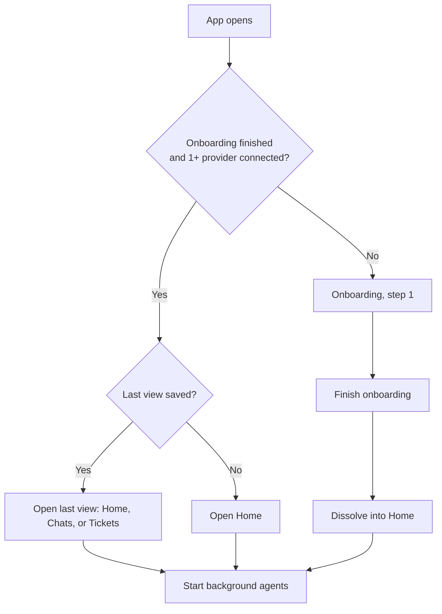
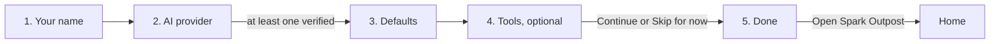
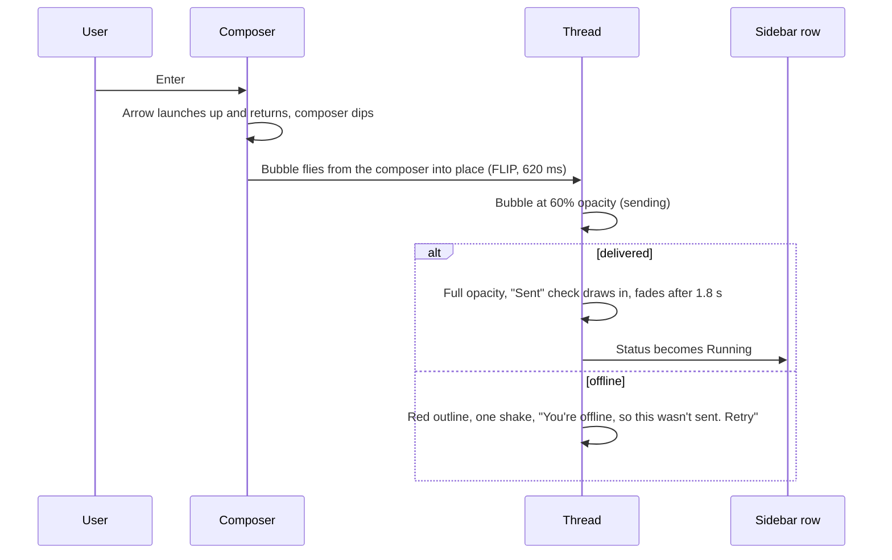
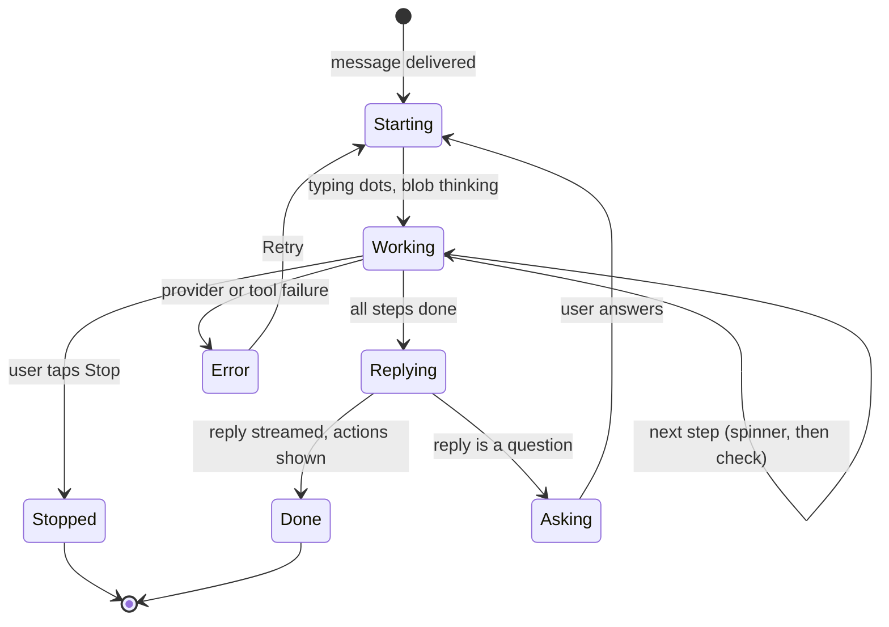
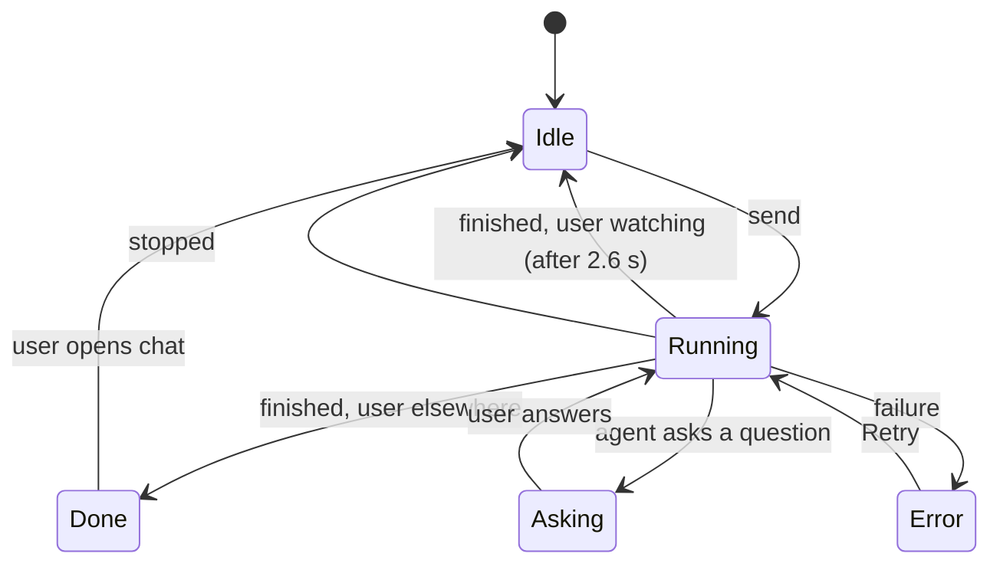

# Spark Outpost: UX flow and interaction spec

This document describes every screen, state, and interaction in the Spark Outpost prototype, from first launch through daily use. It is the source of truth for design and engineering. Where the prototype fakes something (verification, agent runs, OAuth), the spec says what the real product should do.

Prototype: https://claude.ai/artifact/W5Qf2DCCqSniE1TmQ235kJ
Logo sheet: https://claude.ai/artifact/LFG2pU3oTRZ1SjBRXD936c

---

## 1. Principles

These rules decide every open question in this document.

1. **Quiet by default, complete on demand.** Every reply shows what happened, what changed, and what to do next. Detail sits one tap away and is never removed.
2. **Status has one language.** A chat's state (running, needs input, done, error) looks the same in the sidebar, on Home, in the rail badge, on the mascot, and in the browser tab.
3. **Motion answers the user.** Animation confirms an action or shows progress. The only ambient motion is the mascots idling.
4. **Errors say what happened and how to fix it.** No apologies, no vague "something went wrong."
5. **Personality lives in the mascots.** The chrome stays calm so Blob Scout and the provider blobs can carry the character.

---

## 2. Glossary

| Term | Meaning |
|---|---|
| Provider | An AI backend. Today: Claude (Anthropic) and Codex (OpenAI). At least one must be connected. |
| Connector | An optional tool integration: Jira, GitHub, Linear, Slack. |
| Project | A folder of chats tied to a codebase. Chats can live in a project or in the loose "Chats" list. |
| Chat | One conversation with one agent run history. Has a status, a context window, and a provider. |
| Run | One agent turn: steps, then a reply, then optional next actions. |
| Blob Scout | The app logo and mascot. Its mood reflects the whole app. |
| Provider blob | Each provider's mascot (Claude: coral round blob, Codex: cyan cloud). Its mood reflects one run. |
| User blob | The user's avatar, generated from their name. |

---

## 3. App launch and routing

**Persisted locally**

| Key | Contents |
|---|---|
| Account | Name, providers (method, masked detail, default model, permission, effort), default provider, connectors, onboarding done |
| Theme | Selected theme id |
| Last view | home, chats, or tickets |

**Rules**

- If the provider list becomes empty (for example, keys revoked outside the app), the app routes back to onboarding step 2 on next launch. The prototype enforces this by requiring 1+ connected provider to skip onboarding.
- Theme applies before first paint to avoid a flash.
- The browser tab icon is Blob Scout, recolored to the current theme (see section 12).

---

## 4. Onboarding

Full-screen, centered card over a soft accent glow. No close button, and Escape does nothing.

> **Revised 2026-09-25 (implemented):** onboarding is a full page, not a card. A left rail shows Blob Scout, the wordmark, and a vertical step list with labels; the content sits on the raised panel with the footer pinned at the bottom. Below 800 px the rail becomes a top bar with numbered dots. There are three steps: Your name, AI provider, Done. Defaults (model, permission, effort) moved into each connected provider card, and "New chats start with" sits under the cards when two providers are connected. The Tools step is not built because connectors do not exist yet. The user cannot reach the app until at least one provider is connected.

### 4.1 Structure

**Card header:** Blob Scout (28 px) + "spark outpost" wordmark on the left, the stepper on the right.

**Stepper:** five pills. The current step is a wide accent pill, visited steps are tinted, and future steps are grey.
- Click a visited step to jump back.
- Steps after step 2 are disabled until a provider is connected.
- Width change between pills animates with a spring (450 ms).

**Footer**

| Element | Behavior |
|---|---|
| Back | Hidden on step 1. Goes to the previous step with a slide-from-left transition. |
| Status text | Explains why Continue is disabled, or confirms progress. On phones it moves above the buttons. |
| Skip for now | Only on step 4. Jumps to step 5. |
| Continue | Primary. Disabled until the step's rule is met. Label becomes "Open Spark Outpost" on step 5. |

**Step transition:** new content slides in 28 px from the right (forward) or left (back), with a fade, 450 ms.

### 4.2 Step 1: Your name

**Content**
- Blob Scout, large (76 px), eyes following the pointer.
- Title "Welcome to Spark Outpost", subtitle "Your base camp for building with AI agents. Setup takes about two minutes."
- Field "What should we call you?", autofocused, 40 characters max.
- Greeting row below the field.

**Interactions**

| Action | Result |
|---|---|
| Type the first character | Greeting row fades in with the user blob (44 px) and "Nice to meet you, {first name}. This little one is you. It's made from your name. Next, let's connect an AI." Blob Scout turns happy for 1.6 s. |
| Keep typing | User blob regenerates each keystroke with a small bump. Blob Scout's eyes follow the caret. |
| Clear the field | Greeting returns to "This is how you'll appear in chats." |
| Enter | Same as Continue. |

**Rules:** Continue is disabled while the name is empty, with status text "Enter your name to continue." Name saves on every keystroke.

**Ambient:** ten faint accent particles drift upward in the background of this step only.

### 4.3 Step 2: Connect your AI providers

**Content:** title "Connect your AI providers", subtitle "Connect at least one provider and pick its defaults. If you connect more than one, the default starts new chats. You can add others anytime." (Revised 2026-09-25: the copy no longer names two providers, so it holds as the catalog grows. The separate "New chats start with" switch was removed; when two or more providers are connected, the default carries a "Default" tag in its card header and every other connected card offers "Make default" beside "Send test message". A Theme step now sits between the name step and this one.) Two provider tiles, both collapsed so neither provider is favored (revised 2026-09-25; the mockup opened Claude by default). Choosing a tile expands it and collapses the other; collapsing a tile also closes its terminal.

**Provider card, collapsed:** provider blob (42 px, idling), name, "by Anthropic" or "by OpenAI", chevron. Click anywhere on the header to expand; the chevron rotates 90° and the body opens with a height transition (350 ms).

**Provider card, expanded:** a three-way segmented control, then the method panel, then the verification log.

| Method | Panel copy | Button |
|---|---|---|
| Local CLI | "Uses the `claude` CLI on this machine and its own login. Spark Outpost runs the CLI but never reads or stores your credentials." (Revised 2026-09-25: the embedded terminal passes keystrokes through the local server, so the original "never sees your password" was no longer strictly true.) | Detect and verify |
| Sign in | "Opens your browser to sign in with your Anthropic account, then brings you back here." | Sign in with Claude / Sign in with ChatGPT |
| API key | Masked key field + Show/Hide, hint line | Verify key |

The segmented indicator slides between options with a spring (400 ms). Switching methods swaps the panel with a fade and clears the log.

#### API key validation (live, as you type)

| Input | Hint (color) | Verify button |
|---|---|---|
| Empty | "Find it in the Claude Console under API keys. It's stored in your system keychain." (grey) | Disabled |
| Wrong prefix | "Claude keys start with sk-ant-" (red, red field ring) | Disabled |
| Anthropic key pasted into Codex | "This looks like an Anthropic key. Paste it under Claude instead." (red) | Disabled |
| Fewer than 24 characters | "This key looks too short. Make sure you copied all of it." (red) | Disabled |
| Valid shape | "Looks right. Verify to finish connecting." (accent) | Enabled; Enter also verifies |

#### Verification sequences

Every attempt shows a live log. Each line appears with a spinner, then resolves to a check (success) or a red X (failure). All card controls are disabled while it runs.

| Method | Steps |
|---|---|
| Local CLI | Looking for `claude` on your PATH → Found `claude 2.4.1` at `/usr/local/bin/claude`. Checking your CLI login → Logged in to your Anthropic account. Sending a test request → Test request succeeded in 412 ms. |
| Sign in | Opening Anthropic sign-in in your browser → Browser opened. Waiting for you to finish signing in → Signed in as {first name}. Sending a test request → Test request succeeded. |
| API key | Checking key format → Format looks right. Verifying with Anthropic → Key accepted. Checking model access → Opus, Sonnet, and Haiku are available. |

**Failure cases**

| Case | Message | Recovery |
|---|---|---|
| CLI not installed (Codex, first attempt in prototype) | "The `codex` CLI isn't installed or isn't on your PATH. Install it with `npm i -g @openai/codex`, run `codex login`, then try again." | Button relabels to "Try again" |
| Key rejected | "Anthropic rejected this key (401 Unauthorized). Check that it's active and copied in full." | Edit the key; Verify re-enables when valid |

**Motion and mascots during verification**

| Moment | Card | Provider blob | Blob Scout (header) |
|---|---|---|---|
| Verification starts | Controls disabled | Thinking | Working (spark spins) |
| Failure | Shakes once | Sad | Sad for 2.6 s |
| Success | Accent glow ring pulses out; sparks burst from the "Connected" pill | Happy, then idle after 3 s | Happy for 2.4 s |

**Connected card:** header shows a "Connected" pill (pops in) and "Connected with API key / local CLI / sign-in". The body is a summary strip:
- API key: "API key `sk-ant-…4f2a` verified with Anthropic."
- CLI: "Using `claude 2.4.1` and your terminal login."
- Sign in: "Signed in with your Anthropic account."

| Action | Result |
|---|---|
| Change | Shows the method picker again with "Connected with {method}. Verifying a new method replaces it." and a "Keep current" link. The old connection stays until a new one verifies. |
| Disconnect | Disconnects, including the last connected provider (revised 2026-09-25 so people can switch accounts or methods). An API key is deleted from the keychain; a CLI connection is forgotten without logging the CLI out. With no provider left, Continue is disabled, and after onboarding the app returns to the provider step. |

**Footer status:** "Connect at least one provider to continue." until one connects, then "{Claude and Codex} connected" in accent.

### 4.4 Step 3: Set your defaults

Title "Set your defaults", subtitle "Every new chat starts with these. You can still change them per chat from the composer."

**Default provider** (only if both are connected): "New chats start with" segmented control, Claude / Codex.

**Per provider section** (header shows provider blob + name):

| Setting | Claude options | Codex options | Default |
|---|---|---|---|
| Model (cards) | Opus 5.5 (most capable), Sonnet 5 (everyday), Haiku 4.5 (fastest) | GPT-5 Codex, GPT-5, GPT-5 mini | First option |
| Permissions (radio list) | Ask before edits, Auto-accept edits, Plan only, Skip all checks | Read only, Auto, Full access | First option |
| Effort (segmented) | Low, Medium, High, Max | Low, Medium, High | Claude High, Codex Medium |

- Risky permissions ("Skip all checks", "Full access") show their description in amber: "…Use only in a sandbox."
- Selecting a model card fills it with a tinted accent background. Radio dots scale in with a spring.
- Effort description updates under the control with a fade, and notes the level count ("Claude offers four levels.").
- Every change saves immediately and updates the composer picker.

Codex model names are placeholders until the real integration defines them.

### 4.5 Step 4: Bring in your tools (optional)

Title "Bring in your tools", subtitle "Optional. Connectors let Spark read tickets, pull requests, and threads when you ask it to." Two-column grid (one column on phones).

**Revised 2026-09-25 (preview build):** connectors are not built yet, so the step ships as a preview. Subtitle: "Connectors will let Spark read tickets, pull requests, and threads when you ask it to. They aren't ready yet, so there's nothing to connect today. Here's what's coming." Each tile shows a dashed "Coming soon" chip instead of Connect. Tiles rise in with a staggered spring; on hover a tile lifts 3 px, gains an accent glow, and its icon tilts. Footer status: "Nothing to connect yet." The connect flow below applies once connectors exist.

| Connector | Description | Result after connect |
|---|---|---|
| Jira | Read and update tickets, and link them to chats. | your-team.atlassian.net |
| GitHub | Open pull requests, read diffs, and check CI. | 3 repositories |
| Linear | Pull issues into chats and move them through a cycle. | Team Web |
| Slack | Read threads you share and post updates back. | Your workspace |

**Connect flow:** button disables → "Waiting for authorization" (spinner) → "Checking access" → card border turns accent, "Connected" pill pops, small spark burst, result text shows. **Disconnect** returns the card to its initial state.

Footer status: "Connectors are optional." or "{n} connected". "Skip for now" is visible.

In production, Connect opens the provider's OAuth window; the card waits in "Waiting for authorization" until the callback returns or the user closes the window (then: "Authorization was cancelled. Connect to try again.").

### 4.6 Step 5: Done

**Revised 2026-09-25:** Blob Scout (96 px) springs up from below inside a softly pulsing accent halo, follows the pointer, and fires another spark burst when clicked; a second, smaller burst follows the first. The title ends with a waving hand. The summary is one bordered list with rows for you (user blob and name), your theme (swatch and description), each provider ("{Claude} via {local CLI}", a Default tag when two or more are connected, then model, effort, and permission), and "Tools coming soon". Rows slide in with a staggered spring. The original spec follows.

- Blob Scout (92 px), happy, hops twice. A spark burst fires from it 350 ms after the step opens.
- Title "You're all set, {first name}", subtitle "Here's your setup. You can change any of it in Settings."
- Summary list, items staggered in:
  - Each provider: happy provider blob, "{Claude} connected with {API key}" (+ "(default)" if two), and "{Opus 5.5}, {high} effort, {ask before edits}".
  - Tools: "{n} tools connected" with names, or "No tools yet. Add Jira, GitHub, Linear, or Slack anytime in Settings."

**Open Spark Outpost:** two spark bursts from the card → the onboarding layer blurs, scales up 4%, and fades (700 ms) while the app scales in from 96% → lands on Home → background agents start → toast "Welcome aboard, {first name}. Two agents are already at work."

### 4.7 Replay

Settings → Profile → Replay onboarding. Closes Settings and reopens onboarding at step 1 with all steps unlocked and all existing data kept. Finishing returns to Home.

---

## 5. App shell

### 5.1 Layout

| Width | Layout |
|---|---|
| Over 1000 px | Rail (70 px) · Chat sidebar (268 px, Chats view only) · Main panel |
| 641–1000 px | Same, sidebar narrows to 232 px |
| 640 px and below | Bottom tab bar replaces the rail. Chat sidebar becomes a drawer. |

The main panel is a raised card with rounded corners; on phones it goes edge to edge.

### 5.2 Rail

| Item | Behavior |
|---|---|
| Blob Scout (top) | See 5.3. |
| Home, Chats, Tickets | Switch views. The active item gets a raised background with an accent bar that slides between items (spring, 500 ms); its icon turns accent. Hover lifts the icon 2 px; press scales it down. |
| Chats badge | Amber count of chats that need input. Pops in when it appears; hidden at zero. |
| Settings | Opens Settings at Profile. The gear rotates 60° on hover. |
| Avatar (user blob) | Opens Settings at Profile. Scales up slightly on hover. |

**View switch:** the new view fades up 8 px (450 ms). Open menus and popovers close. The choice is saved.

**Phone tab bar:** Home, Chats, Tickets, Settings, each with icon and label. The active tab gets an accent bar on top that pops in. Content is padded so nothing sits under the bar.

### 5.3 Blob Scout (logo mascot)

Always: breathes, blinks every ~5 s, the antenna spark twinkles, and the eyes follow the pointer (up to about 3 units of travel, smoothed). Uses the theme accent (body) and warn color (spark), so it recolors with the theme.

**App-wide mood** (rail, Home greeting, favicon):

| Priority | Condition | Mood |
|---|---|---|
| 1 | A run just finished (2.6 s window) | Happy: arc eyes, cheeks, hops twice, sparks burst from the rail |
| 2 | Any chat needs input | Alert: antenna wiggles, spark pulses, eyes wide |
| 3 | Any agent running | Working: spark spins and glows, eyes scan side to side |
| 4 | Otherwise | Idle |

**Tap Blob Scout (desktop):** squish animation, small spark burst, and a speech bubble beside it for 4.5 s.

| State | Bubble text | Tapping the bubble |
|---|---|---|
| One chat needs input | "{Chat} needs your input. Tap to answer." | Opens that chat |
| Several need input | "{n} chats need your input. Tap to see them." | Opens Home |
| Agents running | "{n} agents are working. I'll let you know when they're done." | Opens Home |
| Nothing going on | One of: "Hi {name}. All quiet out here." / "Nothing needs you right now, {name}." / "Scouting done. No news is good news." | Dismisses |

**Unprompted bubble:** when a chat the user isn't viewing starts asking a question: "{Chat} has a question for you. Tap to answer." Desktop only.

Any Blob Scout elsewhere (Home, empty chat, onboarding) squishes when tapped.

### 5.4 Theme

Two entry points: the round theme button in the chat header (popover list) and Settings → Appearance (preview cards).

Themes: Match system, Graphite (default), Apricot, Void, Fjord, Moss, Lagoon, Plum, Sage, High contrast.

Switching reveals the new theme in a circle expanding from the control that was clicked (600 ms, using view transitions; instant where unsupported or with reduced motion). The favicon recolors.

### 5.5 Toasts

Bottom of the chat sidebar (visible in all views on desktop). Dark pill, 5 s lifetime with a shrinking accent progress bar. Hovering pauses the timer. Only one toast at a time; a new one replaces the old.

| Trigger | Text | Action |
|---|---|---|
| Archive | Archived {chat} | Undo |
| Delete | Deleted {chat} | Undo |
| Restore | Restored {chat} to Active | — |
| Move | Moved to {project} / Removed from {project} | Undo |
| Remove project | Removed {project}. Its chats moved to Chats. | Undo |
| Create project | Created project {name} | New chat |
| Send in archived chat | Moved back to Active | — |
| Compact | Freed {n}K tokens in {chat} | — |
| Disconnect provider | Disconnected {provider} | — |
| Ticket status | Moved {key} to {status} | — |
| Start chat from ticket | Started a chat for {key} and moved it to In progress | — |
| Connect from Tickets | Connected {Jira} | — |
| Onboarding finished | Welcome aboard, {name}. Two agents are already at work. | — |

---

## 6. Home

The landing view. Answers "what needs me, and what's happening?"

### 6.1 Header

- Blob Scout (54 px) beside the greeting, same mood as the rail.
- Greeting by local time: before 5:00 "Working late", before 12:00 "Good morning", before 18:00 "Good afternoon", otherwise "Good evening", followed by ", {first name}".
- Summary: "{n} agents are working and {n} chats need your input." or either half alone, or "All quiet. Start something new below."

### 6.2 Quick start

Input "Start a new chat", project dropdown (all projects plus "No project", defaults to the current chat's project), send button (disabled while empty).

Enter or send: switches to Chats → creates a new chat in the chosen project → sends the text as the first message → the agent starts.

### 6.3 Sections

All sections update live as statuses change.

| Section | Contents | Card action |
|---|---|---|
| Needs you | Chats that are asking, errored, or finished-unread, in that order. Each card: provider blob in the matching mood with a status dot, title, project, reason. Asking cards have an amber border and a filled button. | Answer / See error / Review → opens the chat |
| Running now | Running chats with a thinking blob, pulsing dot, "Step 2 of 3: …", and a progress bar. | Watch → opens the chat |
| Your tickets | Up to 4 open tickets assigned to the user, with status pills. If no tracker is connected: "Connect Jira or Linear to see your tickets here." + Connect. | Opens Tickets with that ticket selected |
| Recent chats | Up to 5 other active chats with project names. "View all" opens Chats. | Opens the chat |

Empty states: "Nothing needs you right now." (with a check), "No agents running. Start a chat and it shows up here.", "No open tickets assigned to you.", "No other chats yet."

Cards lift 1 px on hover. On first open, sections stagger in once; live refreshes don't re-animate.

---

## 7. Chats

### 7.1 Sidebar

**Top:** "Chats" title and a New chat button (pencil). New chat creates an untitled chat outside any project and focuses the composer.

**Search:** filters chat titles in the current tab as you type. ⌘K / Ctrl+K opens the sidebar (or drawer) and focuses search. No match: "No chats match."

**Tabs:** Active and History, each with a count. The indicator slides (spring). While on History, the Active tab shows an amber dot if any chat needs input. Switching tabs cross-fades the list.

**Attention banner** (Active tab): amber strip when a chat other than the open one needs input. "{Chat} needs your input" or "{n} chats need your input". Click opens the first one. Expands and collapses with a height transition.

#### Projects

| Element | Behavior |
|---|---|
| + next to "Projects" | Shows an inline name field ("Enter to create, Esc to cancel"). Enter creates the project (expanded, pops in) and shows a toast with "New chat". Esc or blurring an empty field cancels. |
| Project row | Chevron, folder icon, name, chat count. Click toggles collapse (height animation 350 ms, chevron rotates). |
| + on hover | New chat in that project. The empty state names the project: "New chat in {project}. Spark can read and edit this project's files." |
| ⋯ on hover | Menu: New chat in project, Rename, Remove project (red). |
| Rename | Name becomes an inline field, text selected. Enter or blur saves; Esc cancels. |
| Remove project | Its chats move to Chats. Toast with Undo. |
| Empty project | "No chats yet. Start one or drag one here." |

On touch devices, row actions are always visible.

#### Chat rows

Row: status icon (14 px), title, optional second line, ⋯ on hover.

| State | Icon | Title | Second line |
|---|---|---|---|
| Idle | none | normal | — |
| Running | spinning accent ring | shimmering text | "Step 2 of 3: {step}" |
| Needs input | amber dot with two rippling rings | normal | "Needs your input" (amber) |
| Done, unopened | check draws in, then becomes an accent dot | bold | "Finished. Open to review." |
| Error | red "!" pops in and shakes | normal | reason, e.g. "Stopped: rate limit reached" (red) |

- The open chat has a raised background and an accent bar on the left that grows in.
- Opening a done chat clears it to idle. Needs input and error stay until resolved.
- Hover tooltip: title plus status.
- Rows are keyboard-focusable; Enter or Space opens.

**Row menu (⋯):** "Move to project" with each project (check on the current one), Remove from project (if in one), Archive, Delete (red). Opens with a spring scale from the button; flips upward near the bottom edge; first item focused.

#### Drag and drop (desktop)

| Moment | Feedback |
|---|---|
| Drag starts | Dragged row fades to 30%. All drop zones (each project, and the Chats section) get a subtle outline. |
| Over a zone | Zone fills with accent tint and an accent ring. |
| Over a collapsed project for 550 ms | Project expands. |
| Drop | Chat moves. Other rows glide to new positions (380 ms). The moved row flashes accent. Toast "Moved to {project}" or "Removed from {project}" with Undo. |

Touch devices use the ⋯ menu instead.

#### Archive, delete, restore

- **Archive / Delete:** the row slides left 16 px while collapsing (260 ms), then the list reflows. Toast with Undo restores it in place with a flash.
- Deleting the open chat opens the next active chat, or a new chat if none remain.
- **History tab:** archived chats grouped Today, This week, Last month. Hover shows Restore and Delete icons. Restore returns the chat to Active with a toast. Empty: "Nothing archived. Archive a chat from its menu and it moves here."
- Opening an archived chat is allowed. Sending a message in it restores it automatically ("Moved back to Active").

#### Collapse and mobile

- The panel icon in the chat header collapses the sidebar to zero width (350 ms) on desktop. When collapsed and a chat needs input, the icon shows an amber dot.
- On phones the sidebar is a drawer: open with the panel icon or by swiping in from the left edge; close by tapping the dimmed backdrop, swiping left, or choosing a chat.

### 7.2 Chat header

Breadcrumb "{project} /" (muted), chat title, git branch in mono (hidden on phones), theme button on the right.

### 7.3 Thread

Centered column, 700 px max.

**Date dividers:** small centered label ("Yesterday", "Today") whenever the day changes.

**Grouping:** consecutive messages from the same author stack 4 px apart; a new author starts 20 px below.

**User messages:** right-aligned tinted bubbles. Hover shows the time.

**AI messages:** plain text, no bubble. The first message of a turn starts with a header: provider blob (30 px), provider name, and a mood label. Hover shows the time, model and effort ("Opus 5.5, high effort"), Copy, and Retry response.

| Provider blob mood | Label | When |
|---|---|---|
| Thinking | thinking | Run in progress |
| Unsure | has a question | Run ended with a question |
| Happy (then idle after 3.2 s) | done | Run finished |
| Sad | hit a problem | Run errored |
| Sleepy | stopped | User stopped the run |

**Reply building blocks**

| Block | Collapsed | Expanded |
|---|---|---|
| Work log | "Worked for 18s" / "Read 3 files" with chevron | Each step with a check |
| Diff card | File path (mono), +N in accent, −N in red, chevron | Diff lines, removed lines red-tinted, added lines accent-tinted, horizontal scroll |
| Result line | Check + "42 passed, 0 failed" | — |
| Question | Amber-tinted block with an amber left edge | — |
| Error line | Red-tinted block, e.g. "The run stopped because the API rate limit was reached. Nothing was saved. Try again in a minute." | — |
| Next actions | 1–2 pills; first is filled (primary). Clicking sends that prompt; the row fades to 40% and stops responding. | — |

Expand/collapse animates height (350 ms) and rotates the chevron.

**Jump to latest:** if the user has scrolled up when new content arrives, the thread doesn't move and a pill appears at the bottom: "New reply" or "{n} new". Click scrolls smoothly to the bottom. The pill disappears when the user reaches the bottom on their own. While the user is at the bottom, new content keeps them pinned there.

**Empty chat:** Blob Scout (64 px, watching the pointer), "What should we work on, {first name}?", and a line about the project or about dragging the chat into one later.

### 7.4 Composer

**Layout:** attachment chips (if any), text area, then a bar: + · keyboard hint · model button · context ring · send.

**Text area:** "Ask anything". Grows with content up to 5 lines, then scrolls. Enter sends; Shift+Enter adds a line. The hint "Enter to send, Shift + Enter for a new line" fades in only while focused (hidden on phones). Focus adds an accent ring around the whole composer.

**+ menu:** Upload a file, Add a screenshot, Add from repo. Each adds a chip (name, size, remove ×) that pops in; removing shrinks it out. Chips alone make the message sendable.

**Model button:** provider blob (18 px), model name, effort meter (3 or 4 bars, filled to the current level), chevron (flips when open). The popover opens upward:

1. Models grouped by provider (headers only when two are connected), each with a description and a check that springs in. Picking a model from the other provider switches effort and permission lists to that provider's options.
2. Effort: segmented control with a sliding indicator and a description that fades on change. The meter bars bump.
3. Permissions: collapsed row showing the current mode; expands to the provider's radio list.
4. Footer: "Applies to this chat. Change defaults in Settings."

Closes on outside click or Escape.

**Context ring:** a small ring (with percentage on desktop) showing how much of the model's context window the chat uses.

| Used | Ring color |
|---|---|
| Under 60% | Accent |
| 60–84% | Amber |
| 85% and above | Red, soft glow pulse |

The percentage bumps each time it changes. The ring animates between values (800 ms spring). It updates when switching chats and when switching models (window size changes: Claude 200K, Codex 400K, placeholders).

Tapping the ring opens a breakdown:
- "{179K} of {200K} tokens ({89}%)"
- Stacked bar: system and tools, files read, conversation, attachments (segments grow in).
- Legend with counts and free space.
- Note by level: "Plenty of room left in this chat." / "Getting full. Compacting summarizes older messages and keeps replies sharp." / "Almost full. Replies can lose track of early details. Compact now, or Spark compacts automatically at 95%."
- "{Opus 5.5} holds {200K} tokens per chat."
- Compact button (outlined normally, filled when amber or red; disabled under 8K of conversation or while running).

**Compact:** button shows "Compacting" with a spinner → conversation shrinks to about 16% and attachments clear → a divider appears in the thread: "Compacted. Older messages summarized, {n}K tokens freed" → the ring animates down → toast.

**What grows context:** each user message (about text length ÷ 3.6), attachments (PDF ~12K, image ~1.6K, code file ~0.9K), each file the agent reads (1–4K), each reply.

**Send button:** accent square with an up arrow. Disabled (25% opacity) when there's nothing to send. Hover scales up; press scales down.

### 7.5 Sending a message

- The first message in an untitled chat becomes its title (first line, 40 characters).
- Messages sent from an action pill or Home pop in instead of flying.
- Retry on a failed message returns it to sending and tries again.

### 7.6 Agent run lifecycle

| Phase | Thread | Sidebar row | Blobs |
|---|---|---|---|
| Starting | AI header + three wave dots | Running, "Starting" | Provider blob morphs to thinking |
| Working | "Working" log, open; each step appears with a spinner, then a check | "Step n of m: {step}" | Thinking; Blob Scout working |
| Replying | Log collapses to "Worked for {n}s"; reply fades in word by word (blur to sharp) | Running | Thinking |
| Done | Next-action pills | Done (or idle if the user is watching, after 2.6 s) | Provider blob happy, then idle. Blob Scout hops. |
| Asking | Reply in an amber question block with answer pills | Needs your input | Provider blob unsure; Blob Scout alert; bubble if the user is elsewhere |
| Stopped | Log says "Stopped"; "Stopped. Nothing after the last checked step was changed." | Idle | Provider blob sleepy |
| Error | Red error line + Retry pill | Error with reason | Provider blob sad |

- While running, the send button becomes a Stop button (dark square). Its icon morphs with a spin.
- High and Max effort add a first step, "Thought through the approach".
- Run time scales with effort and model speed.
- Chats run independently: switching away doesn't stop a run, and each chat has its own Stop.

---

## 8. Tickets

### 8.1 No tracker connected

Centered: ticket icon, "See your tickets here", "Connect Jira or Linear and Spark lists the tickets assigned to you. Start a chat from any ticket and the details come along." Buttons: Connect Jira (primary), Connect Linear. Connect shows "Waiting for authorization", then a spark burst, a toast, and the list.

### 8.2 List

**Header:** "Tickets", source switch (Jira / Linear, only when both are connected; otherwise the source name), filter (Assigned to me / All open), search.

**Row:** priority bars (1–3; high priority bars are amber), key (mono), title, linked-chat icon (if a chat exists), status pill.

| Status | Pill |
|---|---|
| To do | Grey |
| In progress | Accent |
| In review | Amber |
| Done | Faint, struck through |

- Rows stagger in. Hover raises the background; the selected row is accent-tinted.
- Search matches key and title as you type. No results: "No tickets match. Try a different search or filter."

### 8.3 Detail

Right panel (430 px) that slides in from the right. Below 900 px it covers the list, with an "All tickets" back button.

- Source and key, title.
- Primary action: **Start a chat from this ticket**, or **Open linked chat** if one exists. Secondary: **Open in Jira** (prototype shows a toast; production opens the tracker).
- Properties: Status (segmented, changes in place), Priority, Project, Assignee (user blob + name, or "Unassigned"), Labels, Updated.
- Description and Acceptance criteria.
- If linked: a strip with the chat's status icon, "Linked to {chat}, {status}".
- No selection (desktop): "Select a ticket to see its details and start a chat from it."

**Change status:** indicator slides, the row's pill pops, toast "Moved {key} to {status}". Moving to Done adds a small spark burst.

**Start a chat from this ticket:**
1. Creates a chat titled "{key}: {title}" in the ticket's project (the project expands in the sidebar).
2. Adds the ticket as context (about 2.4K tokens).
3. Moves the ticket from To do to In progress.
4. Switches to Chats and sends "Work on {key}: {title}" plus the description. The agent starts.
5. Toast: "Started a chat for {key} and moved it to In progress."

The ticket now shows the linked-chat icon and "Open linked chat".

---

## 9. Settings

A modal panel (840 × 660 max) over a dimmed backdrop; full screen on phones. Opens with a spring scale; closes with a fade via the ×, a backdrop click, or Escape.

**Navigation:** Profile, AI providers (badge: connected count), Connectors (badge: connected count), Appearance. Phones show these as a horizontal tab strip. Content fades in on switch.

| Section | Contents |
|---|---|
| Profile | User blob (regenerates as the name changes), name field ("Changes save automatically."), Setup → Replay onboarding |
| AI providers | "Connect Claude, Codex, or both. Spark Outpost needs at least one." Both provider cards (same behavior as onboarding) and "Defaults for new chats" (same controls as onboarding step 3) |
| Connectors | Same grid and flows as onboarding step 4 |
| Appearance | Theme cards with a small preview; the selected card has an accent ring. Hover lifts. Click reveals the theme in a circle from the card. |

Changes apply immediately everywhere: rail avatar, composer picker, context window size, favicon colors.

---

## 10. Mascots

### 10.1 Provider blobs

Generated with blobatar (MIT) from a fixed seed and hue per provider, so they look the same everywhere. They idle with breathing, bobbing, blinking, and glancing. Mood changes morph smoothly (about 300 ms).

| Where | Size | Moods used |
|---|---|---|
| AI turn header | 30 px | thinking, unsure, happy, sad, sleepy, idle |
| Provider cards (onboarding, Settings) | 42 px | idle, thinking, sad, happy |
| Defaults headers | 28 px | idle (animates on hover) |
| Home cards | 34 px | unsure (asking), sad (error), happy (done), thinking (running) |
| Composer model button | 18 px | idle (animates on hover) |
| Onboarding summary | 26 px | happy |

### 10.2 User blob

Generated from the user's name (lowercased, trimmed). Changes when the name changes. Shown on the name step, rail avatar, Settings, and ticket assignee.

### 10.3 Blob Scout moods

| Mood | Eyes | Antenna and spark | Body |
|---|---|---|---|
| Idle | Blink every ~5 s, follow pointer | Spark twinkles | Breathes |
| Working | Scan left and right | Spark spins and glows | Breathes |
| Alert | Wide | Antenna wiggles, spark pulses | Breathes |
| Happy | Arcs, cheeks appear | — | Hops twice |
| Sad | Droop | Antenna tilts, spark dims | Breathes |
| Tapped | — | — | Squish and rebound |

---

## 11. State reference

**Chat status**

**Message delivery:** sending (60% opacity) → sent (check, fades) or failed (red, Retry).

**Provider connection:** not connected → verifying → connected, or failed (retryable). Connected → changing (old stays active) → connected. Connected → disconnected, including the last provider.

**Connector:** not connected → authorizing → checking access → connected → disconnected.

**Context level:** ok (under 60%) → warm (60–84%) → hot (85%+) → auto-compact at 95% (production).

---

## 12. Browser tab

- Title "Spark Outpost".
- Favicon: Blob Scout in the theme's accent and warn colors. Happy eyes briefly when a run finishes. An amber dot appears when any chat needs input.

---

## 13. Motion spec

| Token | Value | Use |
|---|---|---|
| Ease out | cubic-bezier(.2,.8,.2,1) | Most transitions, entrances |
| Spring | cubic-bezier(.3,1.4,.5,1) | Indicators, pops, presses, popovers |

| Motion | Duration |
|---|---|
| Message enter (fade + 10 px rise) | 450 ms; 45 ms stagger on first load only |
| Sent bubble flight | 620 ms |
| Expand / collapse (height) | 350 ms |
| Segmented and rail indicators | 400–500 ms spring |
| Popover open | 240–280 ms spring |
| View switch | 450 ms |
| Theme reveal | 600 ms |
| Onboarding step | 450 ms |
| Onboarding exit | 700 ms |
| Toast in / out | 450 ms / 250 ms |
| Row remove | 260 ms |
| List reflow (FLIP) | 380 ms |
| Word stream | 34 ms per word, 350 ms fade each |

With reduced motion on, all animation and transitions are off, the theme switches instantly, and mascots stay still.

---

## 14. Keyboard and accessibility

| Key | Action |
|---|---|
| Enter | Send (composer), continue (name step), verify (API key field), create (new project field), open (focused chat row) |
| Shift + Enter | New line in the composer |
| Escape | Close popovers, menus, theme list, Settings; cancel project create or rename |
| ⌘K / Ctrl+K | Open the sidebar and focus search |

- Every control shows a 2 px accent focus ring (text fields show the composer or field ring instead).
- Segmented controls and pickers use radio roles with checked state; tabs use tab roles.
- Status icons carry text labels ("Running", "Needs your input", …).
- The context ring's label reads "Context window: 34% used, 68K of 200K tokens."
- Mascots are decorative and hidden from screen readers; their meaning is always also in text.
- Toasts and verification logs announce politely.
- Text meets contrast in every theme; High contrast swaps mascot eyes to white.

---

## 15. Copy rules

- Sentence case everywhere. No all-caps labels.
- Buttons say what happens: "Detect and verify", "Start a chat from this ticket", "Open linked chat", "Compact".
- One name per action across the flow: the button "Archive" produces the toast "Archived".
- Errors name the cause and the fix; no apologies.
- Empty states invite the next action.

---

## 16. Not yet in the prototype

- Real persistence and sync of chats, projects, and tickets.
- Real OAuth windows, cancelled-authorization handling, and token refresh.
- Automatic compaction at 95%.
- Per-chat permission prompts during runs ("Ask before edits" approvals).
- Notifications when the app is in the background.
- Mascot customization (reroll look per provider).
- Real Codex model names and context sizes.
