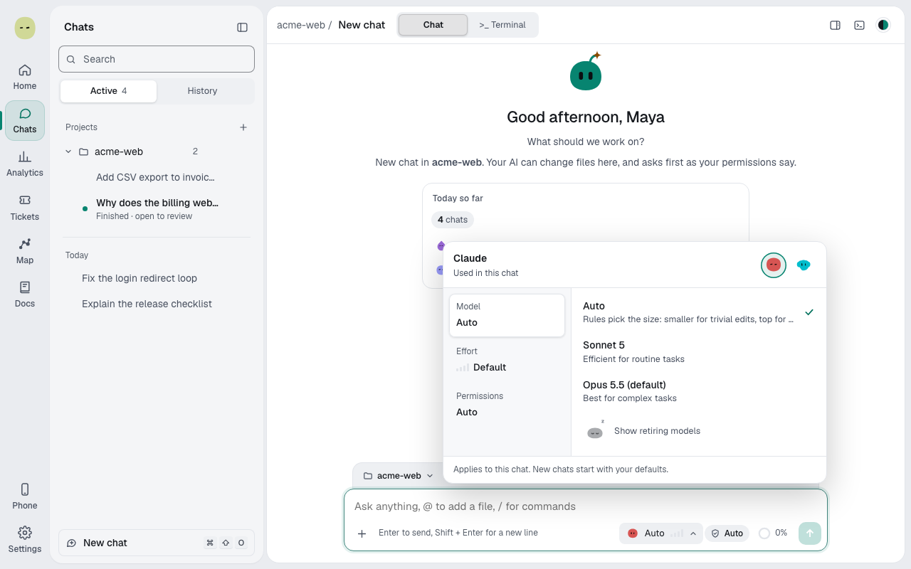
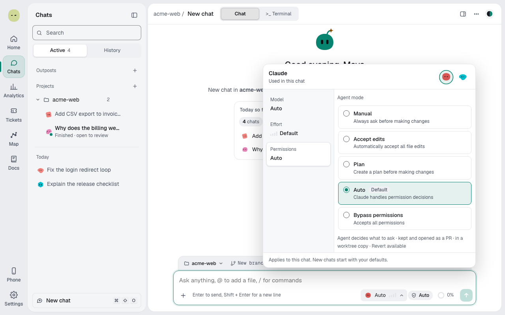

Choose the model, effort and permissions for one chat. About 1 minute.

## Pick a model

1. Select the model button in the message box. The picker opens on **Model**.
2. With several providers connected, switch **AI provider** at the top.
3. Pick a model; until you do, the chat runs your [default model](providers-and-models.md#change-defaults-or-the-default-provider).

Models your sign-in can't use are left out; a pinned one shows **Unavailable** and **Switch to …**.

A pinned name such as `sonnet` runs the agent's current model of that name; the button shows the model that ran.

The agent picks models for its sub-agents.

## Set the effort

1. Select the **Effort** tab.
2. Pick a level, from **Low** (quick) to **Max** (deepest, slowest and costliest).

## Pick the agent's mode

1. Select the **Permissions** tab, or the mode chip under the box.
2. Pick a mode under **Agent mode**. The provider's default has a **Default** tag.

What each mode allows: [Agent modes](modes-and-levels.md#agent-modes). A read-only mode never changes files: switch modes, then ask.

> **Important:** No mode switches off the [protected paths](protected-paths.md).

These choices apply to this chat only.

**Next:** [Choose how much Spark does alone](spark-autonomy.md)
