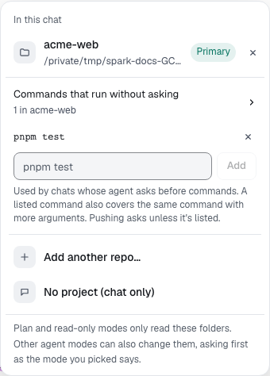

You'll stop the same approval card from coming back for a command you trust. About 1 minute.

## From an approval card

1. When a **Run a command?** card appears, read the command.
2. Select **Always allow in this project**.

The button isn't offered for commands that touch [protected paths](protected-paths.md), push or send data out. Those ask every time.

## From the project menu

1. In a chat with the project linked, select the project name above the message box.
2. Open **Commands that run without asking**.
3. Type a command and select **Add**. To remove one, select the **×** next to it.

## How the list matches

- A listed command also covers the same command with more arguments. Allowing `pnpm test` also allows `pnpm test -- api`.
- The list applies to every chat in the project whose agent mode asks before commands.
- It never overrides a protected path.

> **Tip:** Allow your test and lint commands first. They're the ones agents run most.

**Next:** [Keep files away from agents](sparkignore.md)
