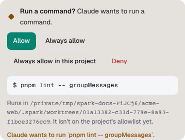
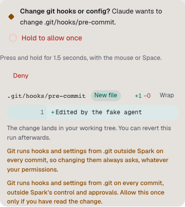
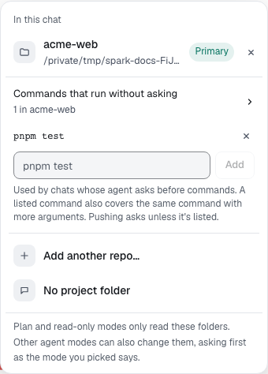

Answer an agent waiting for your permission. About 1 minute.

1. Find the card at the end of the turn, or press **⌘⇧Y**.
2. Read the command or diff; **Details** shows where it runs and why. A sub-agent's card names it.

   

3. Select a button; labels vary by agent.

| Button           | Does                                                           |
| ---------------- | -------------------------------------------------------------- |
| **Allow** (⏎)    | Runs it this once.                                             |
| **Always allow** | For the rest of this run, or **Always allow in this project**. |
| **Deny** (Esc)   | Doesn't run it; the agent tries another way.                   |

## Hold to confirm

**Change git hooks or config?** and **Force push?** have no ordinary allow button.

1. Read the whole change.
2. Hold **Hold to allow once** or **Hold to force push** for 1.5 seconds, with the mouse or **Space**.
3. Let go early to cancel.

## Let a command run without asking

1. Select the project name in the message box.
2. Open **Commands that run without asking**.
3. Type a command and select **Add**. Select **×** to remove one.

A listed command covers longer forms too: `pnpm test` allows `pnpm test -- api`. Commands that touch [protected paths](protected-paths.md), push or send data out always ask.

## Where waiting cards show

Cards wait in the chat, on **Home** under **What needs you today**, in the chat list as a **Waiting for you** dot, and on [Spark Island](desktop-companion.md#answer-a-card).

Once answered, a command's card folds into its step: open it for **You allowed it once** or **You denied it** and the time. For what was allowed, select **Audit this chat** in the chat's **…** menu.

**Next:** [Plan before building](plan-card.md)
