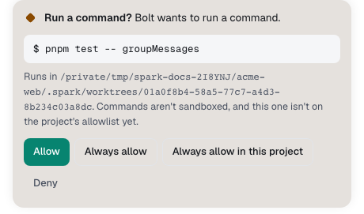
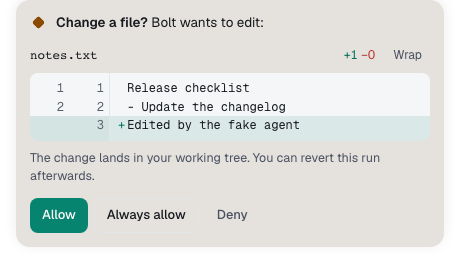
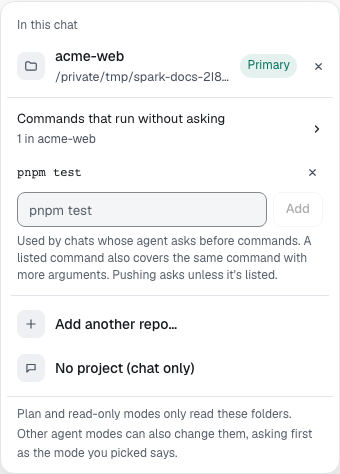
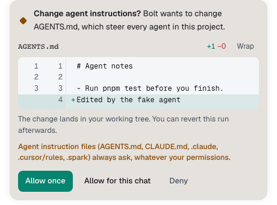
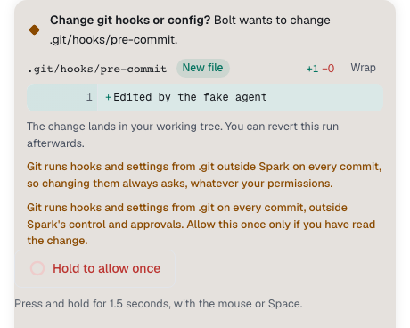

Before an agent runs a command or changes a file, Spark checks the request. Depending on the agent's mode, your Spark autonomy level and the file involved, Spark lets it through, refuses it, or shows you an **approval card** and waits.

The approval checks run in Spark Outpost itself, not in the model. Nothing an agent says can approve its own request.

## What asks first

- **The agent's mode** sets the baseline. For example, Claude's **Manual** asks before edits and commands, while **Accept edits** lets edits through and asks before commands. See [Pick the agent's mode](chats-and-modes.md#pick-the-agents-mode).
- **Spark autonomy** sets what happens to the results. With **Review each step**, you also get a card before risky work starts. See [Spark autonomy](chats-and-modes.md#spark-autonomy).
- **Protected paths** and a few risky actions always ask, in every mode and at every level. See [Protected paths](#protected-paths).

## Answer an approval card

When an agent needs you, its card appears in the chat and docks above the message box under **Waiting for you**. The chat list shows **Asking permission**, and the **Chats** button in the rail shows a count.



A card shows:

- **The question**, such as **Run a command?**, **Change a file?** or **Change these files?**
- **Who asks and what for**, for example "Claude wants to run a command."
- **The details**: the command, or a diff of each file. Select **Wrap** to wrap long lines.
- **Where it runs**: the folder and branch, and whether the command runs in a sandbox.
- **Why it asks**, when a safety rule applies, for example "Secret files always ask, whatever your permissions."



To answer:

1. Read the command or the diff.
2. Select one of the buttons. The labels come from the agent, so they vary a little between Claude and Codex. Typical choices:
   - **Allow**: run it this once.
   - **Always allow**: allow this kind of request for the rest of this run.
   - **Deny**: don't run it. The agent is told and tries another way.

With the keyboard: where the card sat in the conversation, a **Waiting for your answer** button stays behind. Focus it and press **Enter** to jump to the docked card; its first button gets focus. Press **Tab** to move between buttons and **Enter** to choose.

The card then shows your answer, for example "Chose: Allow." or "Denied. The command didn't run."

### Allow a command in the whole project

Command cards can also offer **Always allow in this project**. It adds the command to the project's allowlist, so chats whose agent asks before commands run it without asking. A listed command also covers the same command with more arguments: allowing `pnpm test` also allows `pnpm test -- api`.

To see or edit the list:

1. In a chat with the project linked, select the project name above the message box.
2. Open **Commands that run without asking**.
3. To add a command, type it and select **Add**. To remove one, select the **×** next to it.



**Always allow in this project** isn't offered for commands that touch protected paths, push or send data out. Those ask every time.

### Agent instruction files

Changes to agent instruction files, such as `AGENTS.md` or `CLAUDE.md`, get their own card, **Change agent instructions?**, because these files steer every agent in the project. Its buttons are:

- **Allow once**
- **Allow for this chat**: allow later changes to instruction files in this chat without asking.
- **Deny**



## Hold to confirm

Two actions can do damage that's hard to undo, so their cards have no ordinary **Allow** button:

| Card                            | Why                                                                              | Button                 |
| ------------------------------- | -------------------------------------------------------------------------------- | ---------------------- |
| **Change git hooks or config?** | Git runs hooks and settings from `.git` on every commit, outside Spark's checks. | **Hold to allow once** |
| **Force push?**                 | It rewrites history on the remote.                                               | **Hold to force push** |

To allow one of these:

1. Read the change. On a git hooks card, allow it only if you've read the whole change.
2. Press and hold the button for 1.5 seconds, with the mouse or **Space**.
3. Let go early to cancel. Nothing changes.

**Deny** works as usual. These cards never offer an "always" option.



## Protected paths

These always ask or are refused, whatever the agent's mode and your autonomy level.

| What                         | Examples                                                                                                                                                                                       | What happens                                                                                           |
| ---------------------------- | ---------------------------------------------------------------------------------------------------------------------------------------------------------------------------------------------- | ------------------------------------------------------------------------------------------------------ |
| **Secret files**             | `.env` and `.env.*` (but not `.env.example`), SSH keys such as `id_rsa`, `*.pem`, `*.key`, `*.p12`, `*.pfx`, `.npmrc`, `.netrc`, `.pgpass`, `.pypirc`, `.git-credentials`, `credentials` files | Commands that touch them ask. Agents can't read or write them directly.                                |
| **Files in `.sparkignore`**  | Anything you list in the repo's `.sparkignore`                                                                                                                                                 | Treated exactly like secret files.                                                                     |
| **Agent instruction files**  | `AGENTS.md` and `CLAUDE.md` at any depth, `.github/copilot-instructions.md`, anything under `.claude/`, `.cursor/rules/` or `.spark/`                                                          | Always ask, with **Allow once** or **Allow for this chat**.                                            |
| **Git hooks and config**     | `.git/hooks/*`, `.git/config`, `git config` commands                                                                                                                                           | Ask with hold to confirm. Other files inside `.git` can't be changed.                                  |
| **Outside the linked repos** | Changing or deleting files outside the project                                                                                                                                                 | Always asks. Reading files outside the project is refused.                                             |
| **Installing packages**      | `npm install`, `pnpm add` and similar                                                                                                                                                          | Always asks.                                                                                           |
| **Pushing**                  | `git push`                                                                                                                                                                                     | Asks, unless the command is on the project's allowlist. A force push always asks with hold to confirm. |

A few more rules hold everywhere:

- **Builders never publish.** Builders in a Spark crew don't push, open pull requests or change remotes. Spark commits, pushes and opens the PR itself when the task is done.
- **Modes Spark can't check run in a copy.** Codex's **Approve for me** and **Full access** act without Spark's approval checks, so those chats run only in a worktree copy, never on your checkout.

### Keep files away from agents with .sparkignore

To protect more files, add a `.sparkignore` file at the root of the repo:

```text
# One pattern per line. Lines starting with # are ignored.
secrets/
*.sqlite
config/production.yml
```

- `*` matches within a folder name, `**` matches across folders, and `?` matches one character.
- A pattern without `/` matches that name anywhere in the repo. A pattern with `/` starts from the repo root.
- `!` lines (exceptions) aren't supported.

Files that match are handled like secret files. They're also left out of the **@** file picker and never sent to Jev when the Map labels areas. See [Privacy and secrets](privacy-and-secrets.md#sparkignore).

## Sending data out after reading secrets

If a chat has read sensitive data, such as a secret file you allowed, Spark asks before anything in that run sends data off your computer. The card says what was read and where the data would go, for example "This run read .env earlier; sending data to example.com needs your OK".

This check applies at every autonomy level and can only be allowed once at a time.

## If you don't answer

Approval cards wait for you. If nobody answers within 30 minutes, the request is declined and the card says **Expired**.

The **If you don't answer a question** setting in **Settings → Spark** doesn't apply to approvals. It covers Spark's other questions, such as an unclear request or a stuck step. After the time you pick (**Off**, **10s**, **30s** or **60s**), Spark picks the safe option.

## Where waiting cards show

- In the chat, docked above the message box under **Waiting for you**. With more than one, use **Previous waiting card** and **Next waiting card**.
- On **Home**, under **What needs you today**. Select **Answer** to jump to the card.
- In the chat list (**Asking permission**) and as a count on **Chats** in the rail.
- In the chat's **Work** panel, under **Waiting for you**, with a **Review** button.
- In the desktop app's companion under the notch, where you can press **Y** to allow or **N** to deny. See [The desktop companion](desktop-companion.md).

## See what was allowed

Each turn's steps record what happened to every request, for example "Allowed pnpm test (you allowed it)", "Allowed … (on the project allowlist)" or "Declined: … (Secret files always ask)". Requests a safety rule refused show as steps, not cards.

For the full record, open the chat's **…** menu and select **Audit this chat**. The **Timeline** tab shades the time each run waited for your approval.
