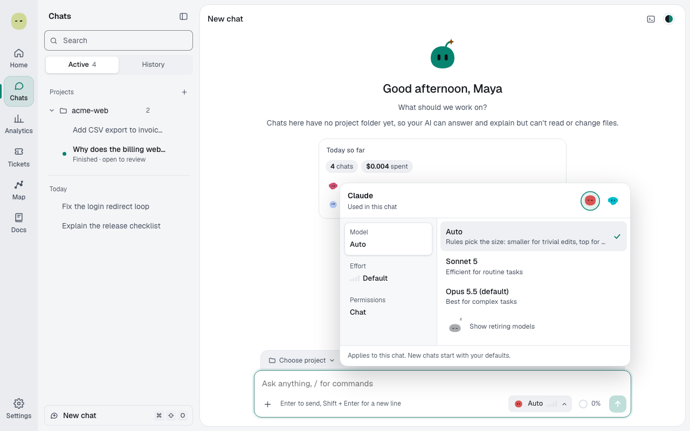

You'll choose a model and effort for one chat, and learn how **Auto** picks a model when you let it. About 3 minutes.

A new chat starts on your default provider's model, for example Claude Opus 5.5, with its default mode, for Claude **Auto**. That model is pinned: Spark uses it until you change it.

## Pin a model or choose Auto

1. Select the model button in the message box. **Model, effort, and permissions** opens on **Model**.
2. If you have more than one provider connected, switch provider at the top.
3. Pick a model to pin it, or pick **Auto** to let Spark choose for each request.

These choices apply to this chat only. New chats start with your defaults from **Settings → AI providers**. See [Providers and models](providers-and-models.md).

## Set the effort

1. In the same picker, select the **Effort** tab.
2. Pick a level. The list comes from the model:
   - **Low**: quick replies, light reasoning.
   - **Medium**: balanced for most tasks.
   - **High**: thinks longer on hard problems.
   - **Max**: deepest reasoning, slowest replies.

Higher effort is slower and costs more. Claude offers Low to Max, Codex Low to High, and Z.ai Low, High and Max. Some models have no effort levels.

## How Auto picks a model

On **Auto**, Spark picks from the chat provider's models for each request. Rules come first:

- **Destructive work**, such as deleting data, always goes to the top model.
- **Trivial edits** go to a middle model.
- **Everything else** is scored.

The score weighs each model's chance of getting it right against its cost, including the cost of fixing a failed attempt. It also counts the cost of leaving a warm session, so Spark doesn't switch models mid-task for nothing.

## With Jev and without

The score needs four ratings of the request, from 1 to 5: complexity, ambiguity, stakes and context.

- **With Jev connected**, Jev rates the request. Ratings it's unsure about fall back to the rules.
- **Without Jev**, the rules estimate all four from the request and the code.

Either way, code calculates the score and picks the model. Jev never picks it. See [Jev, Spark's advisor](jev.md).

## What Auto never does

- It never picks a model for a chat you pinned. Your model stays, and the why-line says "pinned in this chat".
- It never runs a Builder on a small, fast model. If one would be picked, Spark raises it to the next model up and says so.
- With the **Spark** switch off, there's no Auto routing: the chat uses your pick.

## Read why Spark chose a model

Above the crew, a line such as "Build it · 87% sure" says how Spark handled the request.

1. Hover the line, or focus it with **Tab**. A tip opens.
2. Read **Model**: "model by rules" on Auto, or "pinned model".
3. Read each Builder's why-line, for example "Why Sonnet 5: rule chat model · mid tier", with the score and budget after it.

The Builder's header also shows its model and any note, for example "raised to Sonnet 5: Builders don't run on the fast tier".

> **Tip:** Not sure? Leave the chat pinned to your default model. Pick **Auto** when a chat mixes small fixes and bigger work, so small requests run cheaper.

**Next:** [The Spark crew](spark-crew.md)
