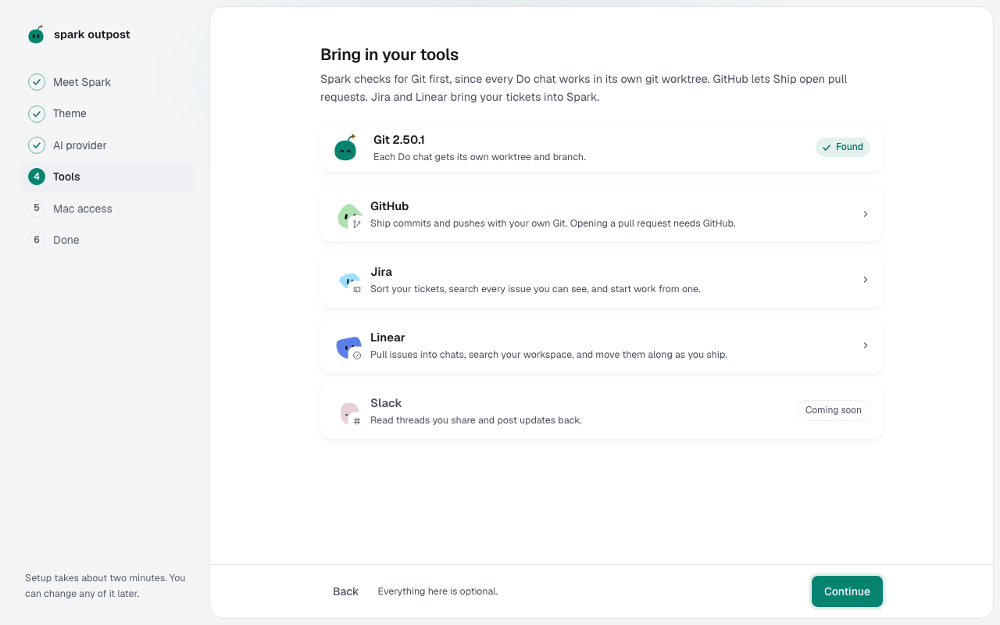

You'll check that Git is ready and connect any other tools you use. About 1 minute.

1. Check the **Git** card. If Git is missing, select **Install Xcode Command Line Tools**, then **Check again**.
2. Optionally connect **GitHub** (to open pull requests), **Jira** or **Linear** (to bring in tickets).
3. Select **Continue**.
4. In the Mac app, an optional **Mac access** step follows. Skip it, or see [Full Disk Access](mac-privacy.md#full-disk-access).

Spark needs Git because each chat that changes code works in its own git worktree. Chats that only answer work without it.

Everything here is optional. Connect tools later in **Settings → Connectors**. See [Connect GitHub, Jira or Linear](tickets-and-github.md).

**Next:** [Send your first message](first-chat.md)
