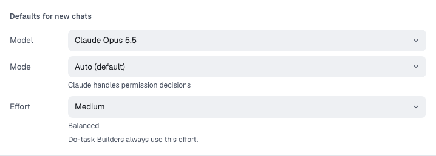

You'll choose how new chats start. About 1 minute.

## Set the defaults

Each connected provider's screen has **Defaults for new chats**.

1. **Model**: pick the model new chats use. The list comes from the provider.
2. **Mode**: pick what the agent may do without asking. The provider's own default is marked **(default)**. See [Agent modes](modes-and-levels.md#agent-modes).
3. **Effort**: pick how hard the agent thinks, or **Per chat** to let each chat keep its own.
4. With more than one provider connected, select **Make default** on the one that should start new chats.

## Change them later

| For            | Where                                                                     |
| -------------- | ------------------------------------------------------------------------- |
| Every new chat | **Settings → AI providers**, the provider's tile                          |
| One chat       | The model button in the message box. See [Pick a model](auto-routing.md). |

> **Tip:** Not sure? Keep the defaults. Any chat can change them without touching the rest.

**Next:** [Connect Jev (optional)](meet-jev.md)
