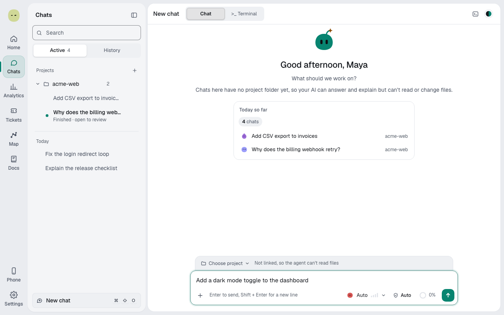
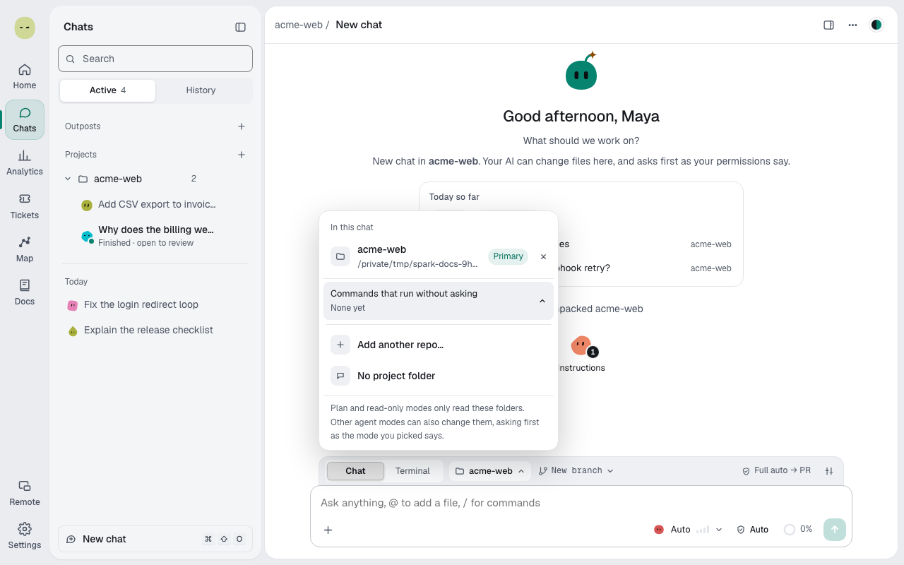
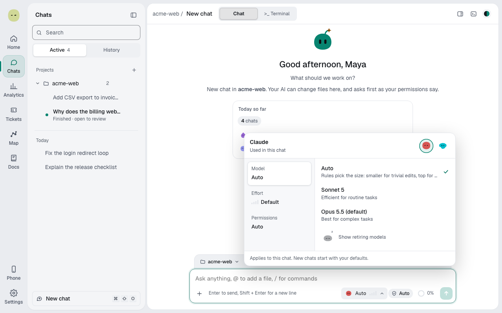
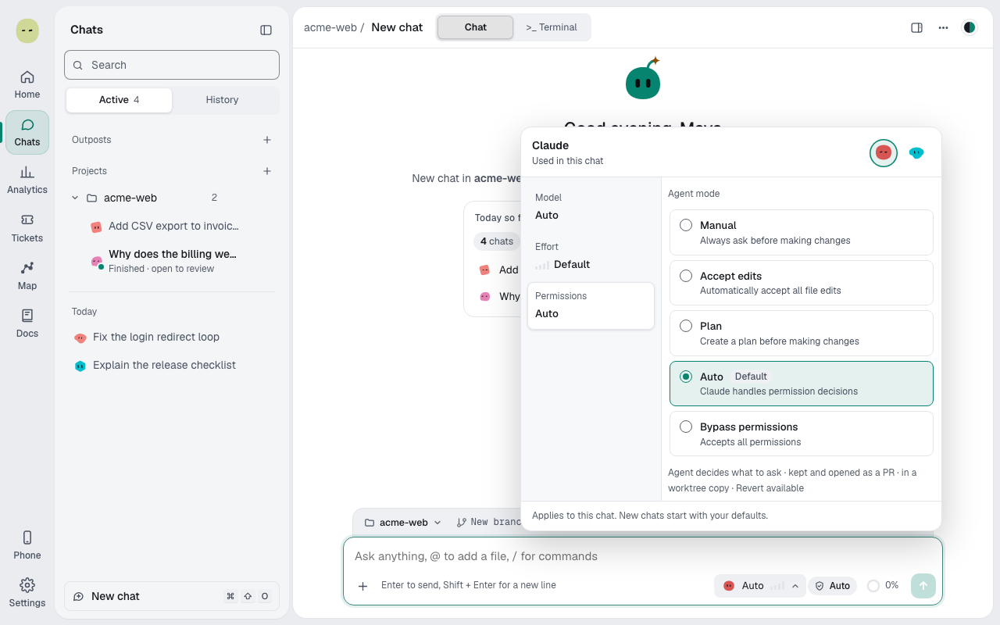
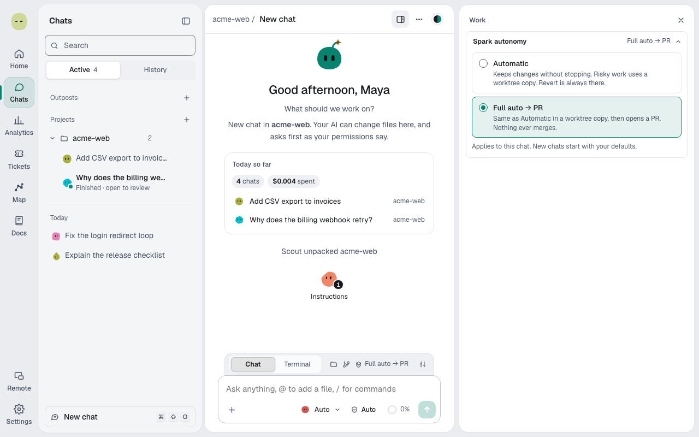

A chat is where you give an AI agent a task and follow its work. Three settings shape every chat:

- The **project**: which folder the agent can read and change.
- The agent's **mode**: what the agent may do without asking you.
- **Spark autonomy**: how much Spark keeps, checks and ships on its own.

New chats start with your defaults. Each chat can change all three.

## Start a chat

1. Select **Chats** in the rail.
2. Select **New chat** at the top of the chat list, or press **⌘⇧O** (Ctrl+Shift+O on Windows and Linux).
3. Type your message in the box at the bottom and press **Enter**.

You can also start a chat from **Home**: type in **Start a new chat** and send. Home shows a link to open the new chat.

To start a chat inside a project, select **+** next to the project's name in the chat list.

## Link a project

Without a project, the agent can answer and explain but can't read or change files. To let it work on code:

1. Above the message box, select **Choose project**.
2. Pick a folder under **Recent**, or select **Choose a folder…** and then **Use this folder**.
3. To add a second repo, open the same menu and select **Add another repo…**. The first repo is **Primary**.

To remove the project, open the menu and select **No project (chat only)**.

### Where the chat works

When a chat changes code, Spark works in a separate git worktree on a new branch, so your own checkout stays untouched. The branch chip next to the project shows where the chat works. Select it to:

- start from another branch: **New branch from** _branch_;
- continue an existing branch under **Or continue a branch**;
- skip the worktree: **Edit my files directly instead**.

To change the default for a project, open **Settings → Projects** and change **Where Spark works**. See [The Spark crew](spark-crew.md#where-spark-works).

## Write a message

- Press **Enter** to send and **Shift+Enter** for a new line.
- Type **@** to add a file from the project.
- Type **/** for commands, such as `/plan` (ask for a plan first), `/review` (review the changes), `/model`, `/effort`, `/mcp` and `/fresh` (start a new agent session for this chat). The menu also lists your repo's skills and the agent's own commands.
- Select **+** (**Add files and context**) to **Upload a file**, **Add a screenshot** or **Add from repo**. You can also paste or drag files into the box.

## Pick the model and effort

The model button in the message box shows the provider, model and effort. Select it to open **Model, effort, and permissions**.

- At the top, switch **AI provider** (Claude, Codex or Z.ai), if you have more than one connected.
- **Model**: pick a model, or **Auto**. With Auto, the rules pick the size for each request: smaller for trivial edits, the top model for destructive work.
- **Effort**: how hard the agent thinks. Higher effort is slower and costs more.

These choices apply to this chat only. New chats start with your defaults from **Settings → AI providers**.

## Pick the agent's mode

The mode is the agent's own permission setting. Spark shows each provider's modes with the provider's names. The permissions chip next to the model button shows the current mode with an icon for how much it allows, for example **Auto**. **Bypass permissions** (shown as **Bypass**) and **Full access** are tinted as a warning. On a narrow window the chip shows only its icon.

To change the mode:

1. Select the permissions chip. The model picker opens on the **Permissions** tab.
2. Pick a mode under **Agent mode**. The provider's default has a **Default** tag, and a line under the list sums up the result, for example "Agent only reads · nothing changes".

| Provider | Modes                                                                                                                                                                                               | Default            |
| -------- | --------------------------------------------------------------------------------------------------------------------------------------------------------------------------------------------------- | ------------------ |
| Claude   | **Manual** (asks before edits and commands), **Accept edits** (edits go through, commands ask), **Plan** (only reads), **Auto** (the agent decides what to ask), **Bypass permissions** (won't ask) | **Auto**           |
| Codex    | **Read-only**, **Ask every time**, **Approve for me**, **Full access**                                                                                                                              | **Approve for me** |
| Z.ai     | Same as Claude                                                                                                                                                                                      | **Manual**         |

A few rules hold in every mode:

- Read-only modes (**Plan**, **Read-only**) never change files. If you ask for a change, the agent answers instead. Select **Make the change** under its answer to run the same request with changes allowed.
- Codex's **Approve for me** and **Full access** act without Spark's approval checks, so they run only in a worktree copy, never on your checkout.
- Whatever the mode, secret files and agent instruction files still ask first, and agents publish only the chat's own branch. See [Approvals and protected paths](approvals.md).

For how the mode and Spark autonomy work together, see [Permissions and autonomy](permissions-and-autonomy.md).

## Spark autonomy

Spark autonomy decides what Spark does with the agent's work: whether you review each step, whether passing changes are kept, and whether Spark opens a pull request.

| Level                | What happens                                                                                                                |
| -------------------- | --------------------------------------------------------------------------------------------------------------------------- |
| **Review each step** | You decide what to keep, and you get a card before risky work starts.                                                       |
| **Automatic**        | Spark runs commands and keeps passing changes. Risky work uses a worktree copy. You can always revert. This is the default. |
| **Full auto → PR**   | Like Automatic, in a worktree copy, and then Spark opens a pull request. Nothing ever merges.                               |

To change it for one chat:

1. Link a project. The autonomy chip (a shield with the level name) appears in the context bar.
2. Select the chip. The **Work** panel opens at **Spark autonomy**.
3. Pick a level.

To change the default for new chats, open **Settings → Spark** and change **How much Spark does alone**.

> **Note:** Autonomy never skips the safety rules. Approvals for protected files, force pushes and sending data out still wait for you at every level. **Full auto → PR** lets Spark push the chat's own branch, open the PR and push follow-up fixes to it. It never merges.

## While a turn runs

- To stop the agent, select **Stop**. It replaces the send button while a turn runs.
- When Spark splits the work into pieces, the message box becomes a steering box. Pick who gets your message under **Steer to**: **Auto**, **All pieces**, one piece, or **Coordinator**. See [The Spark crew](spark-crew.md).
- To see the plan, the crew, the files changed and the cost, select **Show work panel** in the chat header.
- When the agent needs you, a card waits above the message box under **Waiting for you**. See [Approvals and protected paths](approvals.md#answer-an-approval-card).

## After a turn

- Copy a message or a reply with its copy button.
- Select text in a reply to **Add to chat**, **Ask about this**, **Comment** or **Copy**.
- Rate the result with **Good result** or **Bad result**. Ratings and comments stay on this computer.
- To start the agent over without the old context, type `/fresh` or open the chat's **…** menu and select **Start fresh**.

## Keyboard shortcuts

| Keys                        | Action                            |
| --------------------------- | --------------------------------- |
| **⌘⇧O**                     | New chat                          |
| **⌘K**                      | Search chats                      |
| **⌘B**                      | Show or hide the chat list        |
| **⌃\`**                     | Terminal                          |
| **⌘⇧A**                     | Add the selected text to the chat |
| **Enter** / **Shift+Enter** | Send / new line                   |

On Windows and Linux, use **Ctrl** for **⌘**.
