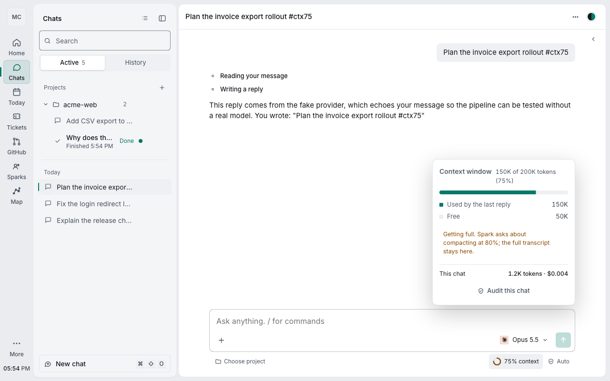
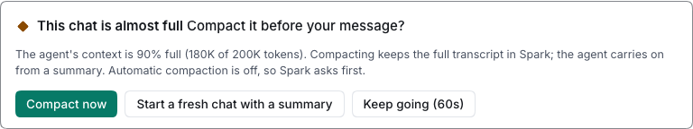

Keep a long chat inside the model's context. About 2 minutes.

Near full, Spark compacts the chat: the agent carries on from a summary; your transcript stays.

## Check how full the chat is

1. Past half full, **N% context** shows under the box: amber at 60%, red at 80% by default.
2. Select it for numbers and the **Prompt cache** timer.

Past red, Spark compacts before your next message, never mid-reply or with a card waiting.

Past amber, it also compacts after a finished plan or a newly opened pull request.

The work log says why it compacted.

## Read the summary

Select **View summary** on the **Compacted** divider.

It reads as a handoff: goal, state, next steps, **Your decisions** and open questions, plus the branch and pull request.

**Exact identifiers** lists PR numbers, commits, files and links, never secrets.

## Change when Spark compacts

1. Open **Settings → Chats & autonomy** and find **Context compaction**.
2. Set **Warn when context is** (30% to 90%). It only colours the ring.
3. Set **Compact automatically at** (40% to 95%), or switch it off.
4. Switch off **Compact at a natural break** to wait for it.

## Compact idle chats

Claude can compact a chat idle for about an hour, so your next message isn't sent uncached. Off by default.

1. In **Context compaction**, switch on **Compact idle conversations**.
2. Chats use it from their next message; Claude [Terminal](terminals.md) sessions follow `idleCompaction`.

Summaries can drop detail; Spark doesn't count their cost.

## Answer the card

With auto-compaction off, **This chat is almost full** asks first, also at a natural break.

| Choice                                | Result                                                    |
| ------------------------------------- | --------------------------------------------------------- |
| **Compact now**                       | Carries on in this chat from a summary.                   |
| **Start a fresh chat with a summary** | A linked new chat, "… (continued)", gets your message.    |
| **Keep going**                        | Sends as is; the card returns 10 points later, up to 95%. |

**Next:** [Open a terminal](terminals.md)
