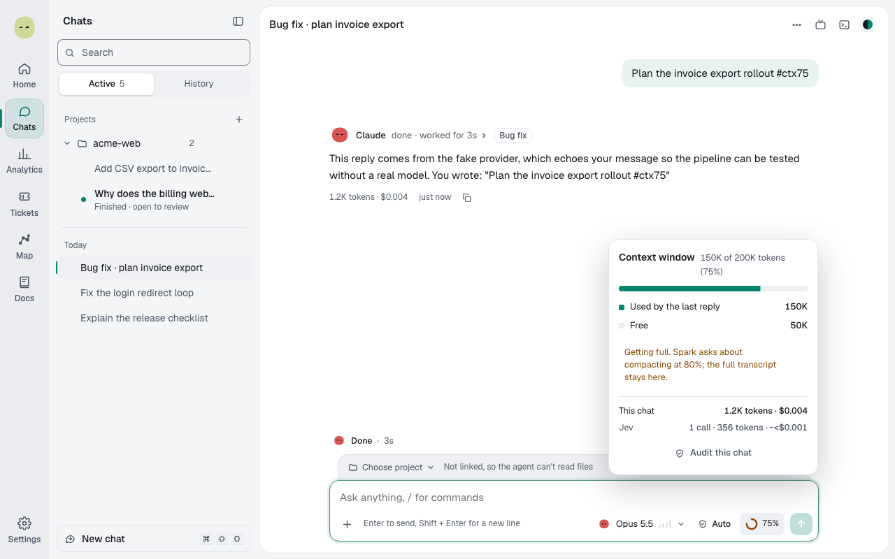
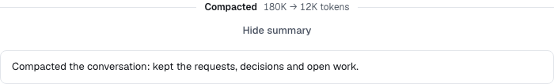
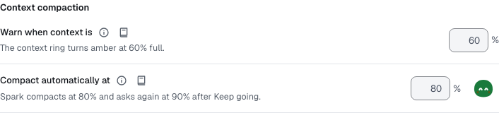
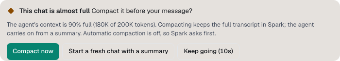

You'll keep a long chat inside the model's context. About 2 minutes.

When a chat's context is nearly full, Spark compacts it: the agent carries on from a summary. Your full transcript stays in the chat.

## Check how full the chat is

1. Look at the context ring in the message box. It turns amber at 60% and red at 80% by default.
2. Select it for the numbers, such as "150K of 200K tokens (75%)".

Past the red point, Spark compacts before your next message. It checks only between messages, never mid-reply or while a card waits.

## Read the summary

1. Find the divider above your message, such as "Compacted · 180K → 16K tokens".
2. Select **View summary** to read what the agent now carries.

## Change when Spark compacts

1. Open **Settings → Spark** and find **Context compaction**.
2. Set **Warn when context is** (30% to 90%). It only colours the ring.
3. Set **Compact automatically at** (40% to 95%), or turn its switch off to be asked each time.

## Answer the card

With automatic compaction off, **This chat is almost full** asks before your message is sent.

| Choice                                | Result                                                                      |
| ------------------------------------- | --------------------------------------------------------------------------- |
| **Compact now**                       | The agent carries on in this chat from a summary.                           |
| **Start a fresh chat with a summary** | A new chat, "… (continued)", gets your message. The two link to each other. |
| **Keep going**                        | Sends as is. The card returns 10 points later, at most at 95%.              |

> **Tip:** Nothing is lost. Agents can still look up earlier turns with `spark_chat_history`.

**Next:** [Open a terminal](terminals.md)
