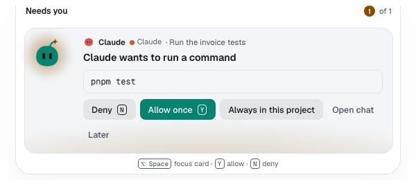

You'll answer an agent that's waiting for you without switching to Spark Outpost. About 1 minute.

When an agent asks before running a command or changing files, the island opens a card under **Needs you**. It shows who asks, the chat, and the command or files.

## Allow or deny a request

1. Press **⌥Space** to focus the card, or click it.
2. Press **Y** to allow it once, or **N** to deny it. You can also select **Allow once** or **Deny**.
3. For a plain command, select **Always in this project** to add it to the project's allowlist.

**Y** and **N** work only once the card has focus, so a stray key press can't answer it. The buttons also wait a moment after a card appears.

The card then says what happened, for example **Allowed once** or **Denied**, and the agent carries on.

## Other choices

- **Open chat**: open the chat in Spark Outpost, for example to read a whole diff.
- **Later**: put the card aside. Select Scout to come back to the chats that need you.
- With more than one card, the top right shows where you are, such as **1 of 3**.

Cards that need the whole chat, such as plans or changes to agent instruction files, only offer **Open chat** and **Later**.

## Answer a question

When Spark asks a question, the card shows one button per answer. The first is the default.

If **If you don't answer a question** is set in **Settings → Spark**, the card counts down and then uses the default. Point at the card to pause the countdown.

## Confirm a force push

A force push rewrites history, so its card has no **Y** shortcut.

1. Read which branches it rewrites.
2. Press and hold **Hold to force-push** for about a second. Let go early to cancel.
3. The push waits 10 seconds. Select **Undo** to stop it.

**N** still denies it.

> **Tip:** Every card on the island is the same card as in the chat. Answering in one place answers it everywhere. See [Approvals and protected paths](approvals.md).

**Next:** [Updates](updates.md)
