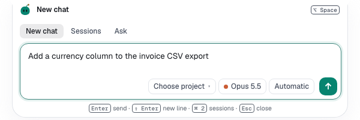
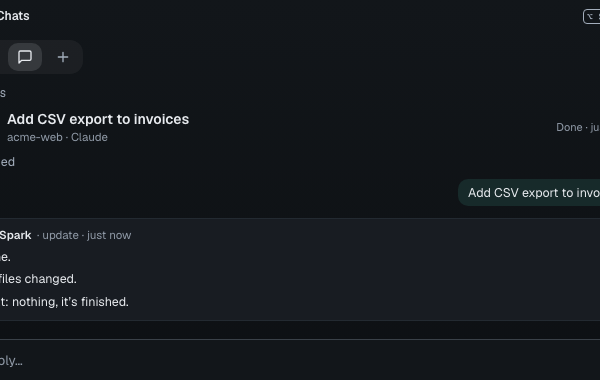

You'll start, check and ask about chats from any app. About 2 minutes.

## Start a chat

1. Press **⌥Space** anywhere on your Mac. The panel opens on **New chat**.
2. Type your task in **Start a new chat…**.
3. Optionally select **Choose project**, or the autonomy chip to change it.
4. Press **Enter**. **Esc** closes the panel and keeps your draft.

## Drop files or a folder

1. Drag files or a folder from Finder onto the island. Scout reaches for them.
2. Files join a new chat, or your reply when a chat is open in **Chats**. Secret files such as `.env` are skipped.
3. For a folder, pick **Start a chat here** or **Add as project**. **Esc** cancels.

**Add a project…** under **Choose project** opens Spark's folder picker inside the island.

## Check on a chat

1. Press **⌥⇧Space**, or select **Chats** in the panel.
2. Type part of a title or project, pick a chat with **↑** and **↓**, and press **Enter**.
3. Select **Ask for update**, **Reply** or **Open in Spark**.

Updates never interrupt the agent.

## Ask Spark

1. In the panel, select **New chat**, then **Ask Spark**, or press **⌘4**.
2. Type a question, such as "Who needs me?", and press **Enter**.

Who needs you, what's running and today's spend answer at once; others use a [fast model](settings.md#spark-assistant).

## Change a shortcut

1. Open **Settings → Notifications** and scroll to **Spark Island**.
2. Select **Change** next to **Quick chat shortcut** or **Sessions shortcut**.
3. Press the new keys, with at least one modifier. **Reset** restores the default.

**Next:** [Update the app](updates.md)
