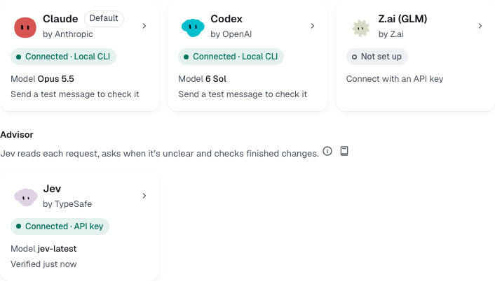
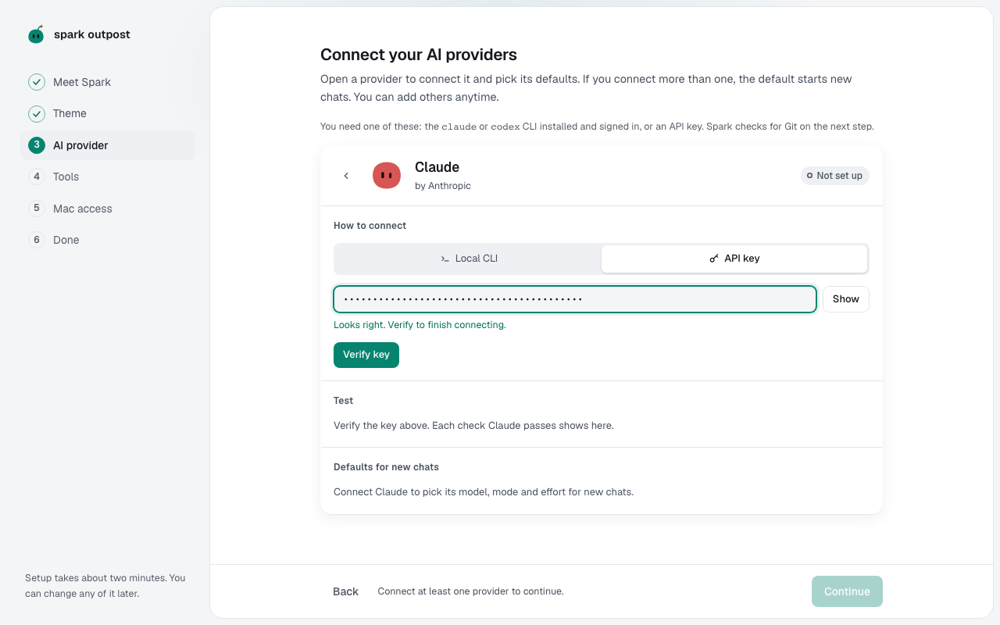

You'll connect at least one provider and check that it answers. About 2 minutes.

## Which provider and which way

Spark Outpost runs coding agents from three providers. Connect at least one; you can add the others later.

| Provider       | Made by   | How it connects                                                                           |
| -------------- | --------- | ----------------------------------------------------------------------------------------- |
| **Claude**     | Anthropic | **Local CLI** (your `claude` login) or **API key**                                        |
| **Codex**      | OpenAI    | **Local CLI** (your `codex` login) or **API key**                                         |
| **Z.ai (GLM)** | Z.ai      | **API key** only, run through the `claude` CLI. Z.ai bills it, never your Claude account. |

Pick the way that fits how you already work:

| Way           | Choose it if                                        | Where your sign-in lives                         |
| ------------- | --------------------------------------------------- | ------------------------------------------------ |
| **Local CLI** | You already use Claude Code or Codex in a terminal. | In the CLI. Spark never reads or stores it.      |
| **API key**   | You have a key from the provider, or you use Z.ai.  | In your system keychain, never in Spark's files. |

## Open a provider

Each provider has a tile. The tile shows its status, such as **Not set up**, **CLI not installed**, **Needs sign-in**, **Connected · Local CLI** or **Error**, its default model once connected, and what to do next.

Select a tile to open that provider's screen. It has four parts: **How to connect**, **Test**, **Defaults for new chats** and, once connected, **Danger zone**. Select **Back** (the arrow next to the name), **Done** or press **Esc** to return to the tiles.

## Install the CLI first

Spark doesn't ship the agents. It runs the `claude` and `codex` CLIs installed on your computer, whichever way you connect. Claude and Z.ai need `claude`; Codex needs `codex`.

| CLI      | Install it with                                                                         |
| -------- | --------------------------------------------------------------------------------------- |
| `claude` | `npm i -g @anthropic-ai/claude-code`, or Anthropic's native installer                   |
| `codex`  | `npm i -g @openai/codex`, `brew install --cask codex`, or OpenAI's standalone installer |

If a CLI is missing, the provider's tile says **CLI not installed** with the install command, and its screen opens a terminal with it. Select **Run it**, and Spark checks again on its own.

## Connect with the local CLI

1. Select the provider's tile to open it.
2. Under **How to connect**, select the **Local CLI** tab.
3. Select **Detect and verify**. Spark looks for the CLI on your computer and checks that you are signed in. Each check appears under **Test**.
4. If the CLI isn't installed or isn't signed in, Spark opens a terminal with the command to fix it. Run the command, and Spark checks again on its own.

Spark Outpost runs the CLI but never reads or stores your credentials.

## Connect with an API key

1. Select the provider's tile to open it.
2. Under **How to connect**, select the **API key** tab. Z.ai shows the key field straight away.
3. Paste the key into the key field. The hint under the field tells you if the key looks wrong, for example "Claude keys start with sk-ant-".
4. Select **Verify key**, or press **Enter**.

Spark first checks that the provider's CLI is installed (API key mode also needs it), then checks the key with the provider and stores it in your system keychain. It never saves keys in its database or logs.

> **Important:** Paste keys only into this key field. Don't paste them into a chat message; chat text is sent to the agent and saved with the chat.

## Send a test message

1. Wait until the screen says **Connected**.
2. Under **Test**, select **Send test message**.

Spark asks the provider to reply with one word. It shows how long the answer took and which model sent it.

**Next:** [Choose defaults for new chats](chat-defaults.md)
