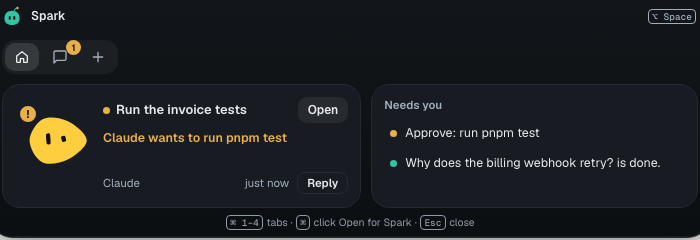
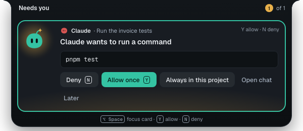

You'll answer agents from Spark Island. About 2 minutes.

## Turn it on and size it

1. Open **Settings → Spark** and scroll to **Around the app**.
2. Switch **Show Spark Island** on or off (on by default).
3. Pick **Spark Island size**. Every size rests as blobs.
4. **Island chimes** play when a chat needs you or finishes.

Drag the island to any display; it stays there.

## Open it

1. Point at Scout: **Home** opens until the pointer leaves.
2. Click inside to keep it open. **Esc** closes it.

Select a Spark to chat, right-click to edit, or select **New Spark**.

Steps show verbs and file names, never secrets. See [Spark Island states](statuses-and-limits.md#spark-island-states).

Select an edit to see the change; **Open chat** jumps to that turn. Terminal sessions have a **>_** blob; **Open terminal** or **Open terminal in Spark** opens the native agent. Answer its questions there.

## Answer a card

Requests mark the blobs. With **Open requests by themselves** on, a card opens once, without the keyboard, then returns to blobs.

1. Press **⌥Space** to focus it.
2. Press **Y** to allow once or **N** to deny.

Edit cards show the first changed lines, never secret files.

| Choice                     | Does                                                              |
| -------------------------- | ----------------------------------------------------------------- |
| **Always in this project** | Adds a plain command to the project's list.                       |
| **Open chat**              | Plans and instruction-file changes offer only this and **Later**. |
| **Later**                  | Puts the card aside under **Needs you**.                          |

## Inside the app

In Spark, **Status companion** shows session status.

**Next:** [Start and check chats from anywhere](companion-quick-chat.md)
