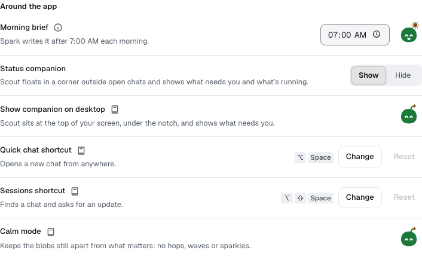

You'll get to know the companion at the top of your Mac's screen and set it up the way you like. About 2 minutes.

The companion is the desktop app's island: Scout, Spark's blob, sits under the notch and shows what your chats are doing, even when Spark Outpost is in the background. It's in the Mac app only.

## Turn the companion on or off

The companion is on by default. To change it:

1. Open **Settings → Spark** and scroll to **Around the app**.
2. Switch **Show companion on desktop** on or off.

You can also select the Spark Outpost icon in the menu bar and choose **Show companion**.

## What the island shows

When nothing is going on, Scout peeks out from under the notch. Point at it to see more. The island changes with your work:

- **Working**: a running chat shows its current step, for example "editing upload.ts".
- **Needs you**: an approval or a question opens as a card. See [Answer approvals from the island](companion-approvals.md).
- **Finished** or **Couldn't finish**: a short note when a chat ends, with **Reply**.

Select Scout to open the panel you used last.

### Session blobs

Next to Scout, a small blob stands for each active chat: running, waiting for you, or updated in the last 20 minutes. Up to five show; **+N** opens the rest.

- A wobbling blob is working. A **!** means it's waiting for you.
- A small sparkle means it's done. A grey blob means it failed.
- Point at a blob to see the chat's title and state. Select it to open that chat in **Sessions**.

## Notch or no notch

- **With a notch**: the island wraps around the notch and grows down from it.
- **Without a notch**, such as an external display: only Scout peeks from the top edge. Point at it to see a small pill, such as **New chat** or **2 need you**, and select it to open the panel.

To move the island, drag it by any part that isn't a button, to any display. Drop it near the top centre to dock it again. Spark remembers where you put it.

## Calm mode

**Calm mode** keeps the blobs still apart from what matters: no hops, waves or sparkles. It's on by default. Switch it off under **Settings → Spark → Around the app**. The row shows only while the companion is on.

## The status companion in the app

Inside Spark Outpost, Scout also floats in a corner outside open chats. Select it to see **Needs you**, **Failed**, **Running** and **Just finished**, or **All quiet**.

- To move it, drag it to another corner, or pick one under **Position**.
- To hide it, select **Hide companion**, or set **Status companion** to **Hide** under **Settings → Spark → Around the app**.

> **Tip:** The companion only shows what Spark already tracks. Opening it, or asking for an update, never interrupts an agent.

**Next:** [Quick chat and Sessions](companion-quick-chat.md)
