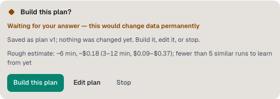

You'll learn the three guardrails that deal with time, money and model choice. About 3 minutes.

They work alongside the two on the keep card. See [Guardrails (universal laws)](guardrails.md).

## Estimates on plan cards

Before Spark builds a plan, the **Build this plan?** card shows what the work is likely to take.

- **Learned estimate**: after 5 or more finished runs of the same kind and size, for example "Usually ~6 min, ~$0.40 for a task like this (5–7 min, $0.38–$0.46 over 7 similar runs)".
- **Rough estimate**: before that, a rule-based guess, for example "Rough estimate: ~6 min, ~$0.40 (…); fewer than 5 similar runs to learn from yet".

Tasks often take longer than planned, so Spark compares its past estimates with what really happened. If it keeps guessing low, it pads the next estimate and says so, for example "padded ×1.4".

## Budgets and the budget card

When a Builder starts, Spark gives it a budget of tool calls and minutes, sized to how complex the task is. A small fix gets a small budget, for example "budget 18 tool calls · 4.5 min". The Builder's header shows it.

When a Builder reaches its budget, Spark stops it and shows the card **Continue past the budget?**. It says how much the Builder used and why it was stopped, "so the change doesn't sprawl".

1. Look at what the Builder has done so far.
2. Select **Continue** to let it finish. The Builder then has no budget for the rest of this run.
3. Or select **Stop** and look at the work, or ask for something smaller.

This card never continues by itself, whatever your autonomy level. Your spend cap in **Settings → Spark** still applies.

## Model demotions

Spark keeps track of how each model does on each kind of task in your workspace, such as bug fixes. If a model's recent pass rate falls well behind other models of its tier, Spark stops sending that kind of task to it.

You need at least 10 finished runs of a kind before this happens. The Builder's header then says why, for example "Sonnet 5 has passed 55% of recent bug fixes here (11/20; its mid tier peers 90%), so Spark routed this work elsewhere".

- This only happens when the chat's model is **Auto**. If you picked a model yourself, Spark keeps it and the note ends "pinned, so Spark kept it".
- It isn't permanent. As new runs pass, the rate recovers and the note goes away.

## Find the why-line

The line above the crew, such as "Build it · by rules", says how Spark handled the request. Hover it or focus it with **Tab** to read the why-line for each Builder: the model, why it was picked, its budget and any demotion.

> **Tip:** Ask any agent "what were the estimate and budget for this run?". It can read them with the `spark_laws` tool.

**Next:** [Tickets and GitHub](tickets-and-github.md)
