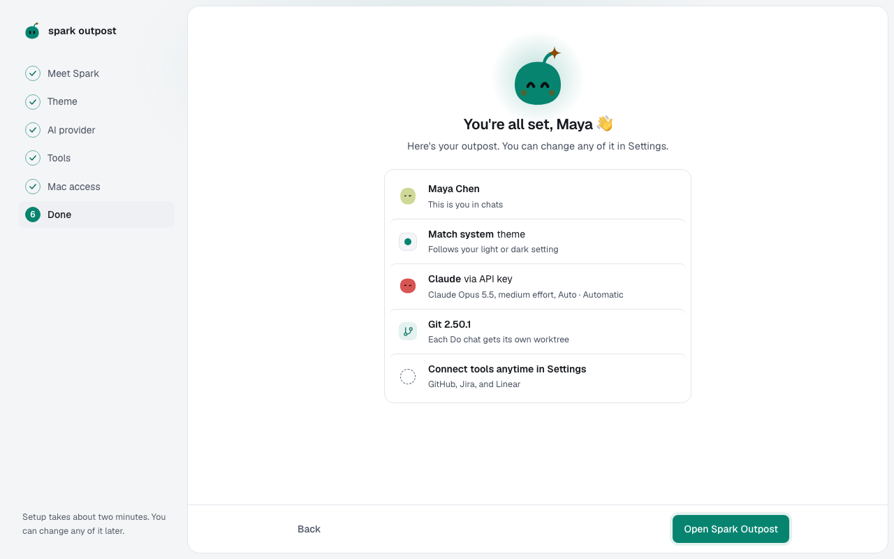

You'll finish setup and give an agent its first task. About 1 minute.

1. On **You're all set**, read the summary and select **Open Spark Outpost**.

   

2. Select **Chats** in the rail, then **New chat** (**⌘⇧O**).
3. Select **Choose project** above the message box and pick a folder. Without a project, the agent can answer but can't read or change files.
4. Type a small, concrete task, such as `Add a dark mode toggle to the dashboard`, and press **Enter**.

With the defaults, the agent works in its own copy of the project and Spark keeps the change when its checks pass. You can always revert.

## What to read next

- [Start a chat and link a project](start-a-chat.md)
- [Answer an approval card](answer-approvals.md)
- [Spark at a glance](how-spark-works.md)

**Next:** [Start a chat and link a project](start-a-chat.md)
