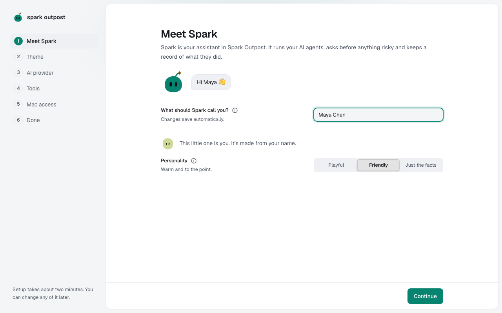
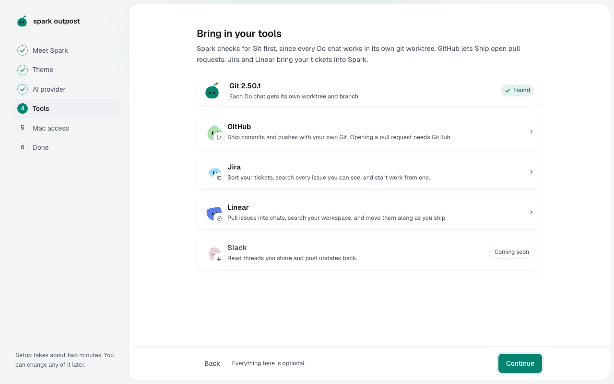
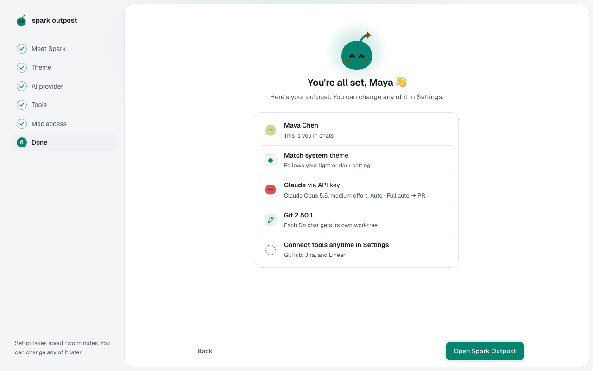

You'll go from first launch to your first chat. About 5 minutes.

Only your name and one provider are required. Change the rest later in **Settings**.

## Meet Spark and pick a theme

1. Type your name under **What should Spark call you?**.
2. Pick a **Personality**: **Playful**, **Friendly** (the default) or **Just the facts**.
3. Leave the **Spark** switch on and select **Continue**.
4. Select a theme card, then **Continue**. **Graphite** is the default.

## Bring in your tools

1. [Connect an AI provider](connect-a-provider.md): Claude, Codex or Z.ai.
2. On **Tools**, check the **Git** card. If Git is missing, select **Install Xcode Command Line Tools**, then **Check again**.
3. Optionally connect **GitHub**, **Jira** or **Linear**, then select **Continue**.

Spark needs Git to change code. The Mac app adds an optional **Mac access** step for [Full Disk Access](mac-privacy.md#full-disk-access).

## Send your first message

1. On **You're all set**, select **Open Spark Outpost**.
2. Select **Chats** in the rail, then **New chat** (**⌘⇧O**).
3. Select **Choose project** and pick a folder.
4. Type a small task, such as `Add a dark mode toggle to the dashboard`, and press **Enter**.

The agent works in its own copy of the project, and you can always revert.

**Next:** [Connect an AI provider](connect-a-provider.md)
