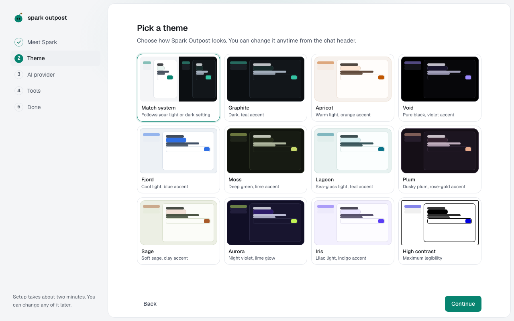
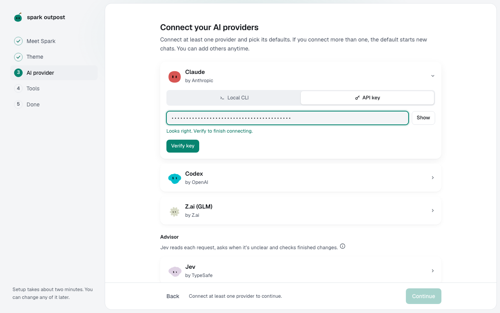
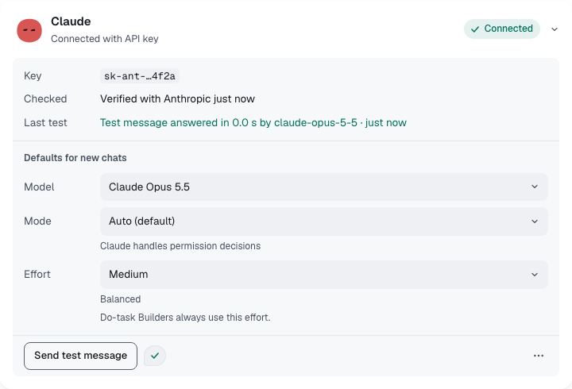

The first time you open Spark Outpost, a short setup walks you through five steps: **Meet Spark**, **Theme**, **AI provider**, **Tools** and **Done**. Only two things are required: your name and one connected provider. You can change everything later in **Settings**.

> **Tip:** Use **Back** at the bottom of the window to return to an earlier step. If you close the app after saving your name, setup reopens at **AI provider**.

## Step 1: Meet Spark

Spark is the assistant inside Spark Outpost. It keeps your AI agents on task, asks when something is unclear, and checks the work before you see it.

To introduce yourself:

1. Under **What should Spark call you?**, type your name. Spark saves it as you type, and your avatar is made from it.
2. Under **Personality**, pick how Spark talks to you:
   - **Playful**: warm, a little humour, celebrates your wins.
   - **Friendly**: warm and to the point. This is the default.
   - **Just the facts**: short answers, no small talk.
3. Leave the **Spark** switch on. With Spark on, Spark reads, routes and reviews your work. With Spark off, chats go straight to the agent you pick.
4. Press **Enter** or select **Continue**.

## Step 2: Pick a theme

1. Select a theme card. The app changes right away so you can compare.
   - **Match system** follows your computer's light or dark setting.
   - **Graphite** (dark, teal accent) is the default.
   - **High contrast** gives the most legible text.
2. Select **Continue**.

You can change the theme anytime in **Settings → Appearance**.

## Step 3: Connect an AI provider

Spark Outpost runs coding agents from three providers. Connect at least one; you can add the others later.

| Provider       | Made by   | How it connects                                                              |
| -------------- | --------- | ---------------------------------------------------------------------------- |
| **Claude**     | Anthropic | **Local CLI** (your `claude` login) or **API key**                           |
| **Codex**      | OpenAI    | **Local CLI** (your `codex` login) or **API key**                            |
| **Z.ai (GLM)** | Z.ai      | **API key** only. Z.ai uses your Z.ai billing and never your Claude account. |

### Connect with the local CLI

Use this if you already use Claude Code or Codex in a terminal.

1. Select the provider's card to open it.
2. Select the **Local CLI** tab.
3. Select **Detect and verify**. Spark looks for the CLI on your computer and checks that you are signed in.
4. If the CLI isn't installed or isn't signed in, Spark opens a terminal with the command to fix it. Run the command, and Spark checks again on its own.

Spark Outpost runs the CLI but never reads or stores your credentials.

### Connect with an API key

1. Select the provider's card to open it.
2. Select the **API key** tab. Z.ai shows the key field straight away.
3. Paste the key into the key field. The hint under the field tells you if the key looks wrong, for example "Claude keys start with sk-ant-".
4. Select **Verify key**, or press **Enter**.

Spark checks the key with the provider and stores it in your system keychain. It never saves keys in its database or logs.

> **Important:** Paste keys only into this key field. Don't paste them into a chat message; chat text is sent to the agent and saved with the chat.

### Send a test message

When a card says **Connected**, select **Send test message**. Spark asks the provider to reply with one word and shows how long the answer took and which model sent it.

### Choose defaults for new chats

Each connected card has a **Defaults for new chats** area. New chats start with these settings, and each chat can change them later.

- **Model**: the model new chats use. The list comes from the provider. For Claude, the default is the one your Claude CLI uses (Opus 5.5 at the time of writing).
- **Mode**: how much the agent may do without asking. The provider's own default is marked **(default)**. For Claude this is **Auto**. See [Chats, modes and autonomy](chats-and-modes.md#pick-the-agents-mode).
- **Effort**: how hard the agent thinks. **Per chat** lets each chat keep its own effort. Pick Low, Medium, High or Max to fix it for every chat.

If you connect more than one provider, open the **…** menu on a card and select **Make default** to choose which one starts new chats.

### Jev, the advisor

Under **Advisor**, you can also connect **Jev** with a TypeSafe API key. Jev helps Spark decide how to handle each request and checks finished changes. It's optional and doesn't count as your provider. See [Jev, Spark's advisor](jev.md).

When at least one provider is connected, select **Continue**.

## Step 4: Bring in your tools

1. Check the **Git** card. Spark needs Git because every chat that changes code works in its own git worktree. If Git is missing, select **Install Xcode Command Line Tools**, then **Check again**.
2. Optionally, connect your other tools:
   - **GitHub** lets Ship open pull requests.
   - **Jira** and **Linear** bring your tickets into Spark.
3. Select **Continue**.

Everything on this step is optional. You can connect tools later in **Settings → Connectors**. See [Tickets and GitHub](tickets-and-github.md).

## Step 5: You're all set

The last step sums up your name, theme, providers and tools. Select **Open Spark Outpost** to go to **Home**.

## What to do next

- Start your first chat: see [Chats, modes and autonomy](chats-and-modes.md).
- Learn what Spark asks before it acts: see [Approvals and protected paths](approvals.md).
- Change anything you set up here in **Settings**, at the bottom of the rail on the left.

## Run setup again

Setup has no replay button. It comes back in two cases:

- You disconnect every provider. Spark Outpost needs at least one, so setup reopens at **AI provider**.
- You reset Spark in **Settings → Reset**. This deletes your chats, projects and settings, so read the lists on that screen first.
