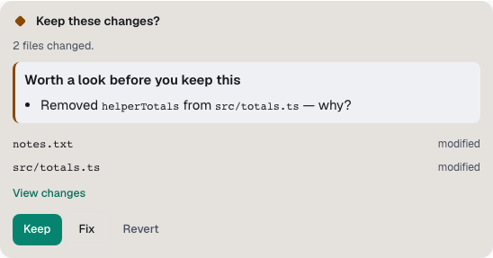

You'll learn the five guardrails Spark applies to every Builder and how to read the ones on the keep card. About 3 minutes.

A guardrail is a rule Spark enforces itself, in every chat and whatever the agent's mode. Agents can't switch them off. They don't block your decisions either: they point out what's worth a look, and you still decide.

## The five guardrails

| Guardrail                       | What Spark does                                                                        | Where you see it                   |
| ------------------------------- | -------------------------------------------------------------------------------------- | ---------------------------------- |
| **No unexplained removals**     | Flags code a Builder removed without being asked and without saying why.               | Keep card and the final reply      |
| **Checks Spark runs itself**    | Trusts its own check run over the Builder's word, and flags weakened tests.            | Keep card and the final reply      |
| **Estimates from your history** | Estimates time and cost from your own past runs.                                       | **Build this plan?** card          |
| **Budgets that fit the task**   | Gives each Builder a tool-call and time budget sized to the task, then stops and asks. | Builder header and the budget card |
| **Models that keep passing**    | Stops sending a kind of task to a model whose recent pass rate fell behind.            | Builder header and the why-line    |

This page covers the first two. For the rest, see [Estimates, budgets and model demotions](estimates-and-budgets.md).

## Read the keep card

When a Builder finishes, the **Keep these changes?** card can show a list under **Worth a look before you keep this**. The final reply lists the same points.

1. Read each line. Names in code style are files, functions or commands.
2. Select **View changes** to check the diff, or ask the agent in the chat.
3. Select **Keep**, **Fix** or **Revert** as usual. The list never blocks you.

## "Removed X — why?"

Spark reads the Builder's diff for removed files, functions, classes, exports, tests and safety checks, and for big blocks of deleted lines. Each one becomes a line, for example "Removed `helperTotals` from `totals.ts` — why?".

A removal isn't flagged when:

- your request asked for it, for example "delete src/legacy.ts" or "remove dead code";
- the Builder said why in its reply, for example "Removed helperTotals because nothing calls it";
- the code only moved: the same name shows up in the added lines.

When a Critic reviews the change, it makes the call on each removal instead of the rules.

## Checks Spark runs itself

After every Builder turn, Spark runs the project's checks itself. The keep card and the reply report Spark's run, never the Builder's claim. If the Builder says the tests pass and Spark's run failed, you see a line such as "Bolt said the checks pass, but Spark's own run failed: `pnpm test` exited 1."

Spark also flags changes that make checks easier to pass, unless you asked for them:

- **Weakened tests**: a test that gains `skip` or `only`, loses assertions, or swaps a strict matcher for a loose one.
- **Updated snapshots**: check that they match the behaviour you want.
- **Check config**: changed lint, typecheck, test or CI config, or a changed `test`, `lint` or `build` script.
- **Files nobody named**: a changed file that the request, the plan and the Builder never mentioned.

> **Tip:** If a flag is expected, say so in your request next time, for example "update the snapshots". Spark then leaves it out.

**Next:** [Estimates, budgets and model demotions](estimates-and-budgets.md)
