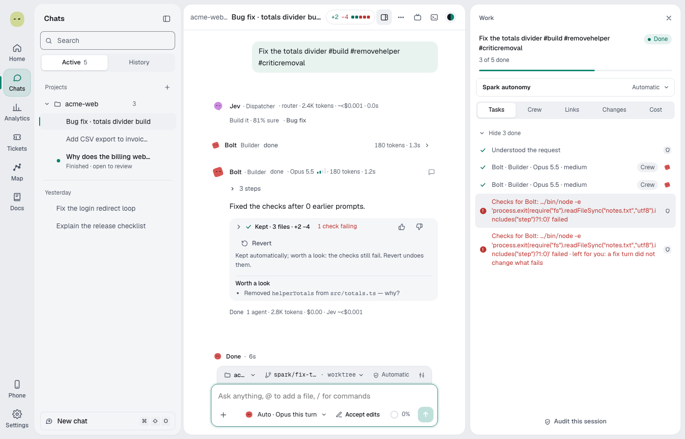

Claude Code, Codex and Z.ai are the agents that read and write code. Spark is the layer around them: it picks who works on a request, checks the work, keeps you in charge and ships the result.

## What happens to a message

Most requests skip most steps. A question stops after step 1.

| Step      | What happens                                                                                                                                 | Without Jev             |
| --------- | -------------------------------------------------------------------------------------------------------------------------------------------- | ----------------------- |
| 1. Read   | Spark names the kind of request, shown as a chip such as **Bug fix**. Questions get an answer.                                               | Rules read the wording. |
| 2. Plan   | Big, destructive or `/plan` requests get [**Build this plan?**](plan-card.md).                                                               | Same                    |
| 3. Build  | A [Builder](spark-crew.md) changes code in the chat's [worktree](where-spark-works.md), on your model or one [Auto picks](model-routing.md). | Rules rate the request. |
| 4. Check  | Spark runs your tests and lint itself. The Builder gets up to 2 turns to fix failures.                                                       | Same                    |
| 5. Review | [Jev](jev.md) checks the diff. A Critic reviews bigger or riskier changes.                                                                   | No Jev check            |
| 6. Keep   | Spark keeps the change and lists concerns under [**Worth a look**](guardrails.md#worth-a-look). You can revert.                              | Same                    |
| 7. Ship   | You [ship](ship-and-pull-requests.md), or **Full auto → PR** opens the PR. Spark then [handles PR feedback](pr-follow-up.md).                | Rules sort comments.    |

Hover the line above the crew to see how Spark handled each step. For where a card can stop a request, see [Cards](cards.md).

## With Spark off

Turn off the **Spark** switch in **Settings → Spark** and chats go straight to the agent and model you pick. There's no reading step, crew, Critic or Jev call. Approvals and protected paths still apply.
