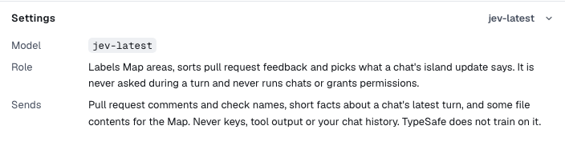

Jev is an optional advisor from TypeSafe. It answers short questions about each request, and Spark's rules take over whenever Jev is unsure or not connected.

## What Jev decides

| Job         | With Jev                                                    | Without Jev                        |
| ----------- | ----------------------------------------------------------- | ---------------------------------- |
| **Intake**  | Names the kind of request; flags vague or destructive ones. | Rules read the wording.            |
| **Routing** | Rates the request for [model choice](model-routing.md).     | Rules estimate the ratings.        |
| **Pieces**  | Picks how many Builders a plan needs.                       | Rules decide whether to split.     |
| **Checks**  | Verifies the finished change and sorts review findings.     | Your checks and the Critic decide. |
| **Triage**  | Sorts pull request comments.                                | Keyword rules sort them.           |
| **The Map** | Labels each area.                                           | Rules label the areas.             |

Jev never answers a chat, edits files, runs code, answers an approval card, loosens a mode or picks the model. To add it, see [Connect Jev](providers-and-models.md#connect-jev).

## Check changes with Jev

The switch is in **Settings → AI providers**, on by default. With it on, Jev verifies the final diff; if a change is incomplete, a stronger model redoes it once.

Jev also reads short previews of likely files, only to compare rankings. Turn it off to keep diffs and previews on your computer.

## What Jev reads

| Sent                                                                               | Never sent                      |
| ---------------------------------------------------------------------------------- | ------------------------------- |
| Your request, the previous request and a short task summary                        | Keys and tokens                 |
| The text of files you attach                                                       | Tool output                     |
| Diffs and short file previews, with **Check changes with Jev** on                  | Your full chat history          |
| Some file contents for the Map. See [what Jev reads there](map.md#what-jev-reads). | Secret and `.sparkignore` files |

Everything is redacted first. TypeSafe doesn't train on it.

## What it costs

TypeSafe bills your account by input tokens, well under $0.0001 a call. **Settings → Usage** shows the cost.

With the **Spark** switch off, Jev isn't called for chats. The Map still uses it. To check a reply, see [Jev on a reply](statuses-and-limits.md#jev-on-a-reply).
