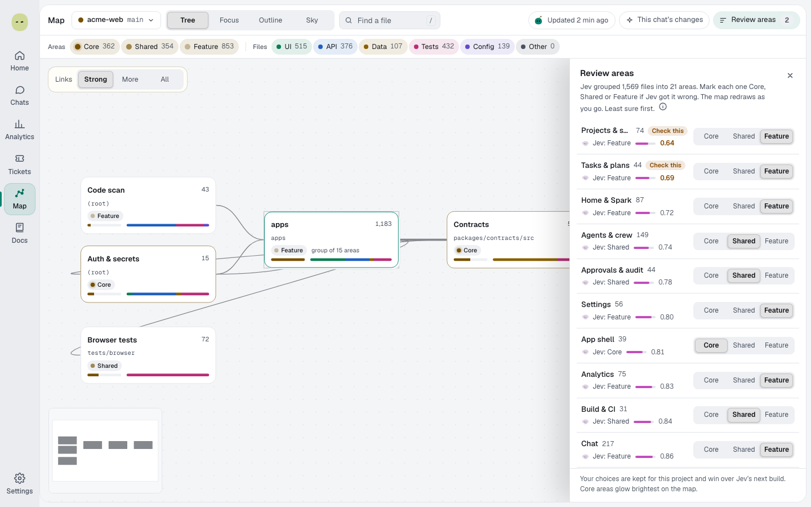

You'll fix any area the Map labelled wrongly. About 2 minutes.

An area is a group of related files. Each gets one category: **Core** (much of the project depends on it), **Shared** (used across several parts) or **Feature** (one part of the product).

1. Select **Review areas** at the top of the Map. The badge counts the areas to check.
2. Read the list. **Check this** marks a label Jev is less than 0.70 sure of.
3. For a wrong area, pick **Core**, **Shared** or **Feature**. The map redraws as you go.
4. To undo your choice, select **Use Jev's**.

Each label says who set it: **Jev**, **Rules** or **You**. Your choices are kept and win over the next build.

## What Jev reads

| Sent to Jev, if connected                                                       | Never sent                                      |
| ------------------------------------------------------------------------------- | ----------------------------------------------- |
| The area's facts, such as its folder and file counts                            | [Secret files](protected-paths.md#secret-files) |
| Up to 120 file paths per area                                                   | Anything in [`.sparkignore`](sparkignore.md)    |
| The most important files' contents: about 6,000 tokens per area, 1,500 per file | Binary files                                    |

Spark redacts keys and tokens in the text before it's sent.

Without Jev, Spark's own path and import rules label every area, and nothing leaves your computer for the Map.

**Next:** [Watch and message the crew](agent-tv.md)
