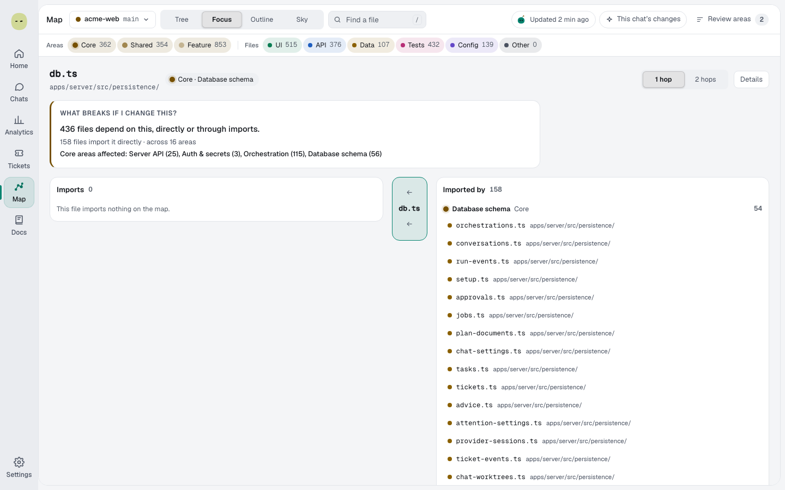

You'll find a file on the Map, narrow what it shows and check what depends on it. About 2 minutes.

## Find a file

1. Select **Find a file** at the top of the Map, or press **/**.
2. Type part of the file's name or path.
3. Pick a result. The Map moves to the file.

Select a file on the map to open its details: what it imports, what depends on it, and the buttons **Open in chat**, **Focus** and **Copy path**.

## Filter what the Map shows

The bar under the header has a chip for each kind of thing, with a count:

- **Areas**: **Core**, **Shared** and **Feature**.
- **Files**: **UI**, **API**, **Data**, **Tests**, **Config** and **Other**.
- **Links**: **HTTP API**, **GraphQL**, **Shared packages** and **Env vars**. These show only when you map two or more projects.

To filter:

1. Select a chip to hide or show that kind.
2. To show only one kind, **Shift**-click its chip. The other chips in that group turn off.
3. To bring the whole group back, **Shift**-click the same chip again.

## Light up a chat's changes

1. Select **This chat's changes** at the top. The files that the most recent chat in this project changed in its last run light up. Point at the button to see which chat.
2. To also light up the files that import them, select **Include dependents**.

The button is greyed out until a chat has changed files in the project.

## What breaks if I change this?

1. Select **Focus** in **Show the map as**.
2. Pick a file: press **/** to search, or select one of the suggested busy files.
3. Read **What breaks if I change this?**. It says how many files depend on this one, directly or through imports, and which **Core** areas they're in.
4. To look further, switch from **1 hop** to **2 hops**.

The two columns list **Imports** and **Imported by**, grouped by area. Select a file in either column to focus on it.

> **Tip:** Agents can ask the same question. Spark's map tool answers "what breaks if this file changes" in any chat. See [Spark tools for agents](spark-tools.md).

**Next:** [Map areas and what Jev reads](map-areas.md)
