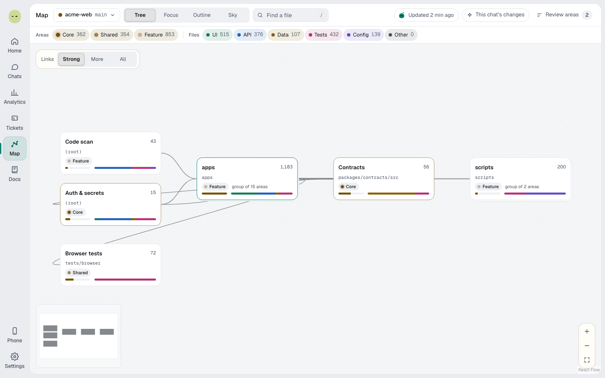
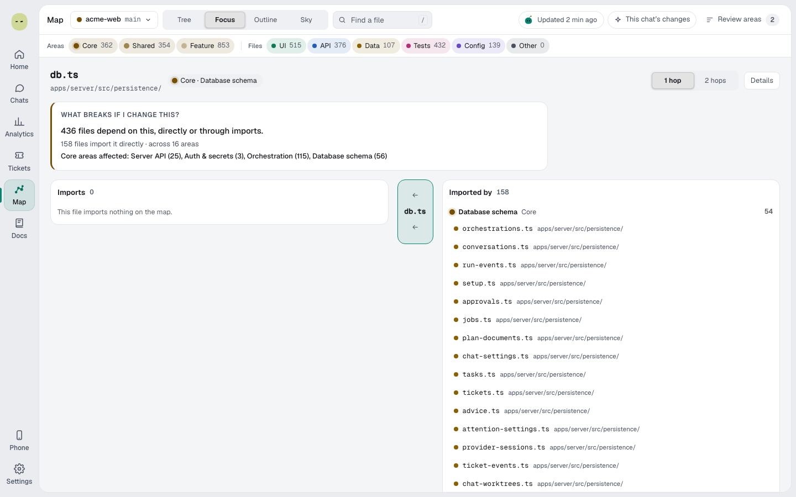

You'll open a project's Map, find a file and check what depends on it. About 2 minutes.

## Open the Map

1. Select **Map** in the rail.
2. In the project menu, tick projects under **Map these projects**. Two show their links.
3. Pick a view under **Show the map as**.

| View        | Shows                                                         |
| ----------- | ------------------------------------------------------------- |
| **Tree**    | Groups of areas as boxes.                                     |
| **Focus**   | One file: what it imports, what imports it, what could break. |
| **Outline** | Every group, area and file in one list.                       |
| **Sky**     | The whole map as stars; brighter ones matter more.            |

It builds in the background ([Map status](statuses-and-limits.md#map-status)).

## Find and filter

1. Select **Find a file**, or press **/**.
2. Select the file for **Open in chat**, **Focus** and **Copy path**.
3. Select a chip to hide or show a kind of area, file or link; **Shift**-click shows only that kind.
4. Select **This chat's changes** to light up changed files; add **Include dependents**.
5. Select **Running chats** to mark files chats are changing now; select a chat to show only its files.
6. In an area, select **Open in chat** to draft a message. Nothing sends until you do.

## See what breaks if a file changes

1. Select **Focus** in **Show the map as** and pick a file.
2. **What breaks if I change this?** counts dependent files and names their **Core** areas.
3. Switch **1 hop** to **2 hops** to look further.

## Correct area labels

1. Select **Review areas**. **Check this** marks a label Jev is under 0.70 sure of.
2. Pick **Core**, **Shared** or **Feature** for a wrong area, or **Use Jev's** to undo. Choices are kept.

### What Jev reads

With Jev connected, Spark sends each area's facts, up to 120 file paths and redacted parts of its main files, never secret, `.sparkignore` or binary files. Without Jev, rules label areas and nothing is sent.

**Next:** [Ship a change](ship-and-pull-requests.md)
