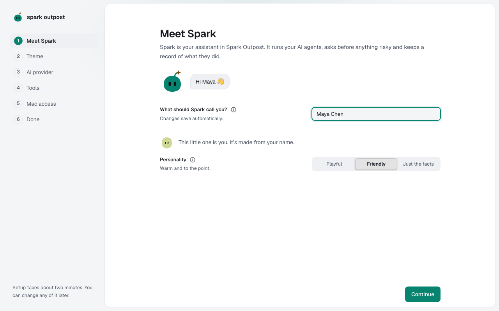
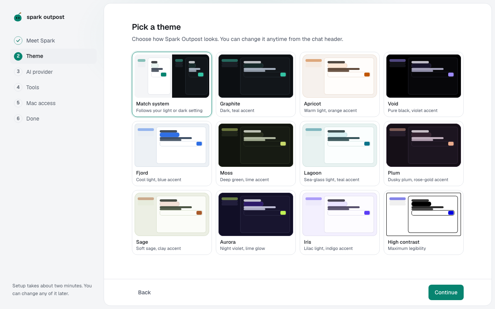

You'll introduce yourself to Spark and choose how the app looks. About 1 minute.

## Introduce yourself

1. Under **What should Spark call you?**, type your name. Spark saves it as you type, and your avatar is made from it.
2. Under **Personality**, pick how Spark talks to you:
   - **Playful**: warm, a little humour, celebrates your wins.
   - **Friendly**: warm and to the point. This is the default.
   - **Just the facts**: short answers, no small talk.
3. Leave the **Spark** switch on. With Spark on, Spark reads, routes and reviews your work. With Spark off, chats go straight to the agent you pick.
4. Press **Enter** or select **Continue**.

## Pick a theme

1. Select a theme card. The app changes right away so you can compare.
   - **Match system** follows your computer's light or dark setting.
   - **Graphite** (dark, teal accent) is the default.
   - **High contrast** gives the most legible text.
2. Select **Continue**.

> **Tip:** You can change the theme anytime in **Settings → Appearance**.

**Next:** [Connect an AI provider](connect-a-provider.md)
