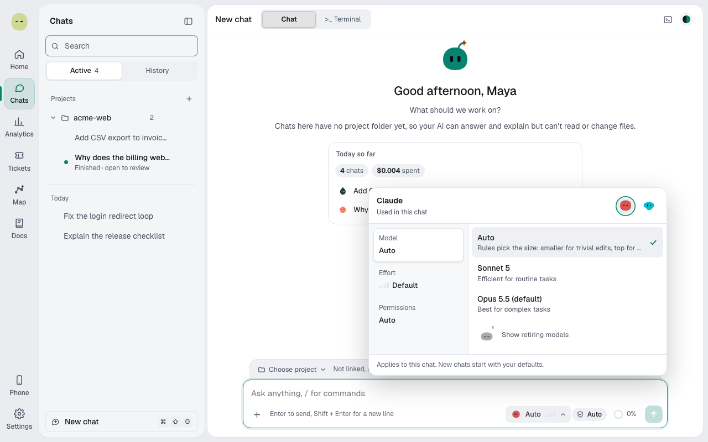

The model you pin is the chat's own model: it reads, plans and coordinates, and never changes during the chat. **Auto** picks models only for the helpers, such as Builders and the Critic, per request.

| Chat is       | The chat's own model         | Builders, pieces, Critic                                         |
| ------------- | ---------------------------- | ---------------------------------------------------------------- |
| Pinned        | Your pick                    | Your pick for Builders and pieces; the Critic is picked by rules |
| **Auto**      | The provider's default model | Picked per request by rules and a score                          |
| **Spark** off | Your pick                    | None. There's no routing.                                        |

To set it, see [Pick the model, effort and mode](agent-mode.md).

## How Auto picks

| Request          | Goes to                                                                   |
| ---------------- | ------------------------------------------------------------------------- |
| Destructive work | The provider's top model                                                  |
| Trivial edits    | A middle model                                                            |
| Everything else  | The best score: each model's chance of getting it right, against its cost |

Destructive means deleting data, files or history; a `delete` method isn't.

Builders and pieces keep the chat's provider and agent mode.

Spark never runs a Builder on a small, fast model; it raises it one model up and says so. Auto skips models your sign-in can't use.

## With Jev and without

The score uses four ratings of the request, from 1 to 5: complexity, ambiguity, stakes and context.

| Setup       | Who rates the request                                  |
| ----------- | ------------------------------------------------------ |
| With Jev    | Jev. Ratings it's unsure about fall back to the rules. |
| Without Jev | Rules estimate all four from the request and the code. |

Either way, code picks the model; Jev never does.

## Builders in a pinned chat

Every Builder and every piece runs on your pinned model, for simple, hard and destructive work alike, and a retry stays on it.

When Jev would have picked another model, the why-line says "Jev would have used" and names it. Nothing moves until you choose **Auto**.

## Read the why-line

Each Builder's why-line names the model and the reason. For models Spark stopped using, see [Model demotions](guardrails.md#model-demotions).
