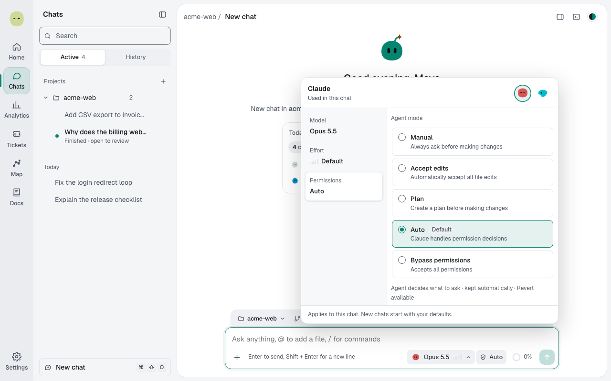
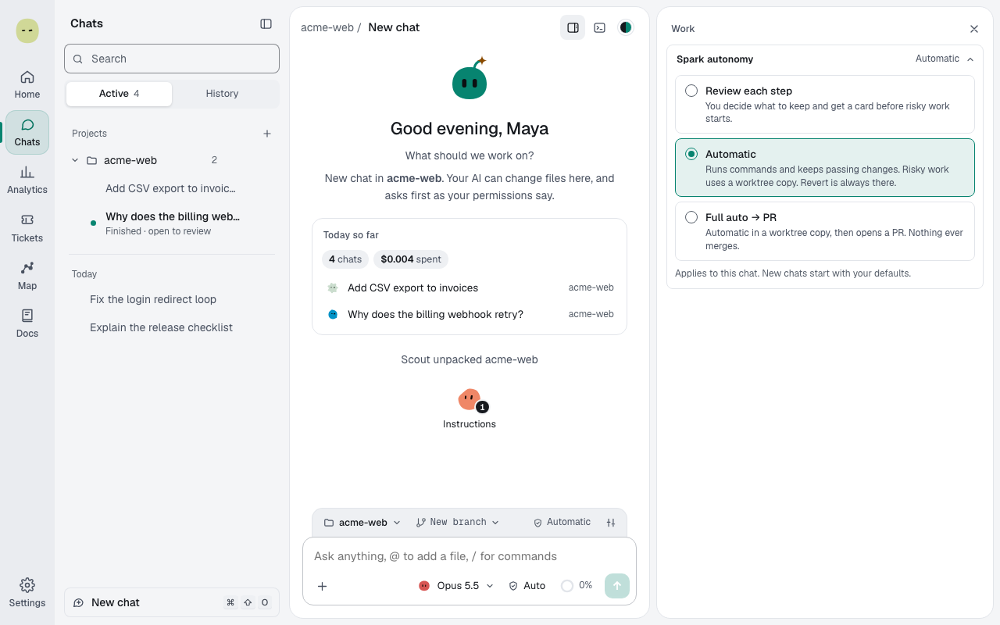

You'll learn the two settings that decide how much happens without you, and how they combine. About 4 minutes.

## Two separate dials

- **The agent's mode** decides what the agent may do without asking: read, edit, run commands. It's the provider's own setting, with the provider's names.
- **Spark autonomy** decides what Spark does with the agent's work: whether you review each step, whether passing changes are kept, and whether Spark opens a pull request.

Each chat has both. New chats start with your defaults.

## Dial 1: the agent's mode

Select the permissions chip next to the model button in the message box. It shows the current mode and opens the **Permissions** tab. See [Pick the agent's mode](chats-and-modes.md#pick-the-agents-mode).

| What it allows                  | Claude and Z.ai           | Codex                        | Approval cards you see                                         |
| ------------------------------- | ------------------------- | ---------------------------- | -------------------------------------------------------------- |
| Reads only                      | **Plan**                  | **Read-only**                | None. The agent answers; **Make the change** runs it for real. |
| Asks before edits and commands  | **Manual**                | **Ask every time**           | A card for each edit and each command.                         |
| Edits freely, asks for commands | **Accept edits**          | none                         | A card for each command.                                       |
| Decides what to ask             | **Auto** (Claude default) | **Approve for me** (default) | Only what the agent asks about.                                |
| Never asks                      | **Bypass permissions**    | **Full access**              | None from the agent.                                           |

Z.ai starts on **Manual**. Codex's **Approve for me** and **Full access** act outside Spark's approval checks, so those chats run only in a worktree copy.

## Dial 2: Spark autonomy

Select the shield chip in the context bar, or set the default in **Settings → Spark → How much Spark does alone**.

| Level                   | Plans                   | Risky work                   | Keeping changes                             | Shipping                                 |
| ----------------------- | ----------------------- | ---------------------------- | ------------------------------------------- | ---------------------------------------- |
| **Review each step**    | Wait for you            | A card asks before it starts | You decide, unless you approved every edit  | You ship with **Open PR**                |
| **Automatic** (default) | Build after a countdown | Runs in a worktree copy      | Kept if checks pass and the Critic is happy | You ship with **Open PR**                |
| **Full auto → PR**      | Build after a countdown | Runs in a worktree copy      | Kept by itself                              | Spark opens a PR, a draft if checks fail |

## How the dials combine

The mode decides the **approval cards** while the agent works. Autonomy decides the **Spark cards** around the work: plans, keep, ship and follow-up. They don't change each other. Some examples:

| Mode + autonomy                             | What you see                                                                          |
| ------------------------------------------- | ------------------------------------------------------------------------------------- |
| **Manual** + **Review each step**           | A card for every edit and command, then the plan and keep cards. The most control.    |
| **Accept edits** + **Review each step**     | Edits go through; commands ask; you decide what to keep.                              |
| **Auto** + **Automatic**                    | The agent asks when it judges it needs to; Spark keeps passing changes. The defaults. |
| **Bypass permissions** + **Full auto → PR** | No agent cards; Spark builds, checks and opens a PR. Protected paths still ask.       |
| **Plan** + any level                        | Answers only. Nothing changes, so no keep or ship cards.                              |

## What never goes on without you

Whatever the mode and level, these wait for your answer:

- **Approval cards.** They expire after 30 minutes if nobody answers, and the request is declined.
- **Protected paths**: secret files, agent instruction files, git hooks and config, force pushes, and sending data out after reading secrets. See [Approvals and protected paths](approvals.md).
- **Destructive work.** Its plan card waits at every level. Work counts as destructive when it deletes, drops or truncates data. Creating a table whose foreign key says `ON DELETE CASCADE` doesn't count.
- **Continue past the budget?** See [Budgets and the budget card](estimates-and-budgets.md#budgets-and-the-budget-card).
- **Pushing PR fixes** at **Review each step** and **Automatic**: the **Address PR feedback?** card.

The model you pin is the chat's own model, the one that reads, plans and coordinates; Builders start from it. See [Builders in a pinned chat](auto-routing.md#builders-in-a-pinned-chat).

**Full auto → PR** has firm limits too. It pushes only the chat's own branch and opens or updates its PR. It never merges, never force-pushes, and Builders never push or open PRs themselves.

## If you don't answer

**If you don't answer a question** in **Settings → Spark** sets how long Spark waits on its own questions: **Off**, **10s** (default), **30s** or **60s**. After that, Spark picks the safe option:

| Card                                             | Spark picks                            |
| ------------------------------------------------ | -------------------------------------- |
| **A few questions first** (Automatic, Full auto) | The agent's best guesses               |
| **Build this plan?** (Automatic, Full auto)      | **Build this plan**                    |
| A stuck or failing step                          | **Stop and report**                    |
| **Jev could not verify the change**              | **Finish as it is**, marked unverified |
| **This chat is almost full**                     | **Keep going**                         |

With **Off**, these wait for you, except that **Full auto → PR** still builds a plan after 30 seconds. Approval cards never use this setting.

## Allow once, for this chat, or always

Approval cards offer the agent's own buttons, typically **Allow**, **Always allow** and **Deny**. The card for agent instruction files, such as `AGENTS.md`, offers:

- **Allow once**: this change only.
- **Allow for this chat**: later instruction file changes in this chat go through.
- **Deny**: the agent is told no and tries another way.

Command cards can also offer **Always allow in this project**. See [Answer an approval card](approvals.md#answer-an-approval-card).

> **Tip:** Start with the defaults (**Auto** and **Automatic**). Switch a chat to **Review each step** for work you want to watch closely, without touching the agent's mode.

**Next:** [Use cases](use-cases.md)
