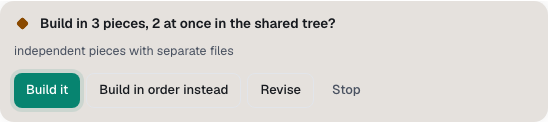

You'll learn how Spark handles work too big for one Builder, and how to steer it. About 4 minutes.

## When Spark splits the work

For a big change, a Coordinator splits the work into pieces, each small enough for one Builder. It does this when:

- you ask for it, for example "split this up";
- the agreed plan has 4 or more steps across 2 or more parts of the project;
- the change likely touches 12 or more files, or 3 or more packages;
- the change is too big for one Builder session.

Otherwise one Builder does the whole job.

## Pieces and the coordinator

Each piece has a title, a key such as **P1**, a Builder and the files it owns. A Builder may change only its own files, and it can't commit, merge or switch branches. The Coordinator joins the pieces, runs the full checks once, and the Critic reviews the whole change.

The piece board in the chat shows every piece with its Builder, where it runs, its model, its state and its checks.

## Shared tree or worktrees

Spark decides where each piece runs:

| Where                | What it means                                                            | When Spark uses it                                                                                     |
| -------------------- | ------------------------------------------------------------------------ | ------------------------------------------------------------------------------------------------------ |
| **in order**         | One Builder at a time, one piece after another.                          | The pieces depend on each other, or running them together saves little time.                           |
| **shared tree**      | Builders work side by side in the chat's folder, each on its own files.  | Independent pieces with no risky files.                                                                |
| _Builder_**'s copy** | Each Builder works in its own worktree copy, merged back when it's done. | Data or migration work, a piece that touches lockfiles or manifests, or another task in the same repo. |

Pieces in a copy land one by one as their checks pass. If two copies clash, Spark tries to merge them. If it can't, you get a card; at **Full auto → PR**, Spark stops and reports the clash instead of guessing.

## Choose how many Builders run at once

1. Open **Settings → Projects** and find the project.
2. Under **Builders at once**, pick **1 at a time, in order**, **Up to 2 at once** or **Up to 3 at once**. The default is 3.

More at once finishes sooner and spends faster.

## Answer the pieces card

At **Review each step**, Spark asks before it builds side by side, or before 5 or more pieces. The card asks, for example, "Build in 3 pieces, 2 at once in the shared tree?".

1. Read the board under the card: each piece, its Builder and the model Spark picked for it.
2. Select **Build it**, **Build in order instead**, **Revise** (type what should change) or **Stop**.

At **Automatic** and **Full auto → PR**, Spark builds without this card.

## Steer the pieces while they run

While pieces run, the message box becomes a steering box. Under **Steer to**, pick:

- **Auto**: Spark routes your message by its words, for example a piece's key or Builder name.
- **All pieces**: every piece still open.
- One piece, such as **P2 · API**.
- **Coordinator**: read when the pieces are joined.

Write "skip P3" to skip a piece, or "use Codex for P2" to move one. The reply above the message box says when it arrives, for example "Queued for Rivet: … (next turn)".

## Watch the crew in Agent TV

Select **Agent TV** in the chat to see the Coordinator in the middle and the Builders around it. **Stage** shows them as a map, **List** as rows. Select a Builder to see its piece, model and state.

## One PR or separate PRs

At **Full auto → PR**, when 2 or more pieces were built in their own copies, Spark asks **One PR or separate PRs?**:

- **One PR**: everything in one pull request. If you don't answer, Spark picks this after the time in **If you don't answer a question** (**Settings → Spark**). With that setting **Off**, the card waits for you.
- **Separate PRs**: one pull request per piece. Pieces built in the shared tree always go in the main PR.
- **Always one PR here** or **Always separate PRs here**: remember the choice for this project and skip the card next time.

> **Tip:** To keep things simple on a busy repo, set **Builders at once** to **1 at a time, in order**. Spark still splits big work, but builds one piece at a time.

**Next:** [Jev, Spark's advisor](jev.md)
