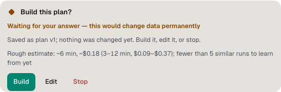

You'll review a plan before anything changes. About 1 minute.

Spark plans first when you ask for a plan, or when the work is big or destructive. Type `/plan` to ask for one.

1. Read the plan on the **Build this plan?** card. It also shows a time and cost [estimate](estimates-and-budgets.md).

   

2. Select one:
   - **Build**: the work starts and runs by itself from here.
   - **Edit**: change the plan first.
   - **Stop**: nothing is built.

## When the card waits

| Autonomy           | Ordinary plan                                                 | Destructive plan |
| ------------------ | ------------------------------------------------------------- | ---------------- |
| **Automatic**      | Waits for you, in every agent mode                            | Waits for you    |
| **Full auto → PR** | Builds after a countdown, such as "Building this plan in 10s" | Waits for you    |

At **Full auto → PR**, select **Edit** or **Stop** before the countdown ends to hold it. The countdown is the time in **If you don't answer a question**, or 30 seconds when that setting is **Off**.

A destructive plan is marked "this would change data permanently". Work counts as destructive when it deletes, drops or truncates data.

While a plan waits, the message box and Spark Island say "Waiting for you · plan to review".

> **Tip:** A reply that reads as a plan shows **Save as agreed plan** under it. Select it to make that reply the chat's plan.

**Next:** [Review, keep or revert changes](review-changes.md)
