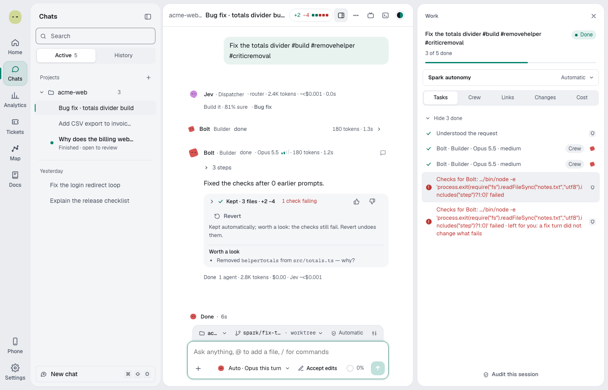

You'll follow one request through Spark, step by step. About 4 minutes.

Not every request takes every step. A question stops after step 1; a small fix skips the plan and the Critic.

## The steps

1. **Spark reads the request.** It decides: answer, ask a few questions first, plan first, or build. A line above the crew says what it chose, for example "Build it · 87% sure". See [How Spark decides what to do](spark-crew.md#how-spark-decides-what-to-do).
2. **A plan, if needed.** Big or destructive work, or a request for a plan, gets the **Build this plan?** card with a time and cost estimate. Nothing changes until it's agreed.
3. **Spark picks the model.** A pinned model stays for the chat itself, and the Builder starts from it, moving down only for clearly simple work or up for hard work. On **Auto**, the chat itself stays on the provider's default model and Spark picks a model for each helper, such as the Builder, for this request. The why-line says why. See [Pick a model for a chat](auto-routing.md).
4. **A Builder makes the change** in the chat's worktree, within a budget of tool calls and time. Big work splits into pieces with several Builders. See [Big work in pieces](pieces.md).
5. **Spark runs the checks itself**, such as your tests and lint. If they fail, the Builder gets up to 2 turns to fix them. Spark reports its own run, never the Builder's claim.
6. **Jev checks the result**, if **Check changes with Jev** is on. A change Jev finds incomplete is redone once on a stronger model.
7. **The Critic reviews** bigger or riskier changes. A Builder fixes its findings, up to 3 rounds.
8. **You keep or revert.** The **Keep these changes?** card shows the files and anything [worth a look](guardrails.md#read-the-keep-card).
9. **Ship.** You commit, push or open a PR, or **Full auto → PR** opens one by itself. See [Ship and pull requests](ship-and-pull-requests.md).
10. **PR follow-up.** Spark fixes failing checks and answers review comments on its PR. See [Follow up on pull requests](pr-follow-up.md).

## Where cards can appear

| Step          | Card                             | Review each step               | Automatic                                      | Full auto → PR                      |
| ------------- | -------------------------------- | ------------------------------ | ---------------------------------------------- | ----------------------------------- |
| 1. Read       | **A few questions first**        | Waits for you                  | Waits, then uses best guesses                  | Uses best guesses after a countdown |
| 2. Plan       | **Build this plan?**             | Waits for you                  | Waits, then builds                             | Builds after a countdown            |
| 2. Plan       | Destructive work                 | Waits for you                  | Waits for you                                  | Waits for you                       |
| 4. Build      | Approval cards (commands, files) | Per the agent's mode           | Per the agent's mode                           | Per the agent's mode                |
| 4. Build      | Pieces card                      | When building side by side     | Never                                          | Never                               |
| 4. Build      | **Continue past the budget?**    | Waits for you                  | Waits for you                                  | Waits for you                       |
| 7. Review     | Critic findings                  | You choose to fix              | Fixed by itself                                | Fixed by itself                     |
| 8. Keep       | **Keep these changes?**          | Unless you approved every edit | Only if checks fail or the Critic has concerns | Never: it ships                     |
| 10. Follow-up | **Address PR feedback?**         | Waits for you                  | Waits for you                                  | Never: it pushes and replies        |

"Waits, then" means Spark goes on after the time in **If you don't answer a question**, or waits for you when that's **Off**. Full auto's countdown is 30 seconds when that setting is **Off**. See [If you don't answer](permissions-and-autonomy.md#if-you-dont-answer).

## Without Jev

Everything above still runs. The differences:

- **Step 1**: rules decide. Vague requests aren't caught, and no category shows.
- **Step 3**: on **Auto**, rules estimate the ratings Jev would give.
- **Step 6** is skipped. Your checks and the Critic decide.
- **Step 10**: rules sort review comments.

With the **Spark** switch off, there's no reading step, Jev, Critic or extra agents: the agent and model you pick work directly. Approvals and safety rules still apply.

> **Tip:** Hover the line above the crew to see how Spark handled each step for that request.

**Next:** [Permissions and autonomy](permissions-and-autonomy.md)
