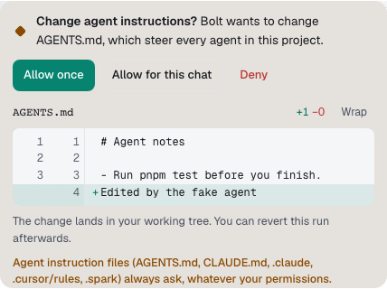

These hold in every agent mode, at both autonomy levels, for every agent including Builders. No setting turns them off.

## What always asks

| What                         | Examples                                                                                                                              | What happens                                                                              |
| ---------------------------- | ------------------------------------------------------------------------------------------------------------------------------------- | ----------------------------------------------------------------------------------------- |
| **Secret files**             | See the list below                                                                                                                    | Commands that touch them ask. Agents can't read or write them directly.                   |
| **Files in `.sparkignore`**  | Anything you [list](sparkignore.md)                                                                                                   | Treated exactly like secret files.                                                        |
| **Agent instruction files**  | `AGENTS.md` and `CLAUDE.md` at any depth, `.github/copilot-instructions.md`, anything under `.claude/`, `.cursor/rules/` or `.spark/` | Always ask, with **Allow once** or **Allow for this chat**.                               |
| **Git hooks and config**     | `.git/hooks/*`, `.git/config`, `git config` commands                                                                                  | Ask with hold to confirm. Other files in `.git` can't be changed.                         |
| **Outside the linked repos** | Changing or deleting files outside the project, including `cp` or `>` into another folder                                             | Always asks. Temporary folders such as `/tmp` are fine. Reading outside files is refused. |
| **Force pushes**             | `git push --force-with-lease` to a named, non-default branch                                                                          | Asks with hold to confirm, with no "always" option.                                       |
| **Sending data out**         | Any network send after the run read secrets                                                                                           | Asks, once at a time.                                                                     |

Claude's session also carries Spark's deny rules, so it can't read or edit secret files or force push even in **Bypass permissions**. Its plan files in the project's ignored `.spark/plans` folder don't count as instruction files.

## What is always refused

- Pushing any branch but the chat's own `spark/` branch, including the base branch.
- Plain `--force`, `+refspec`, mirror and default-branch force pushes.
- Changing remotes.
- Merging a pull request.
- Hosting tools other than `gh pr create`, `gh pr view` and `gh pr edit` for the chat's own pull request.

## Secret files

| Kind             | Patterns                                                                                       |
| ---------------- | ---------------------------------------------------------------------------------------------- |
| Environment      | `.env` and `.env.*`, except `.env.example`                                                     |
| Keys             | SSH keys such as `id_rsa` and `id_ed25519`, `*.pem`, `*.key`, `*.p12`, `*.pfx`                 |
| Credential files | `.npmrc`, `.netrc`, `.pgpass`, `.pypirc`, `.git-credentials`, `credentials` files, `api-token` |

Ship also leaves these out of commits. Naming a secret file in your request doesn't make the request destructive; the file still asks.

## When an agent may publish

An agent may push the chat's own `spark/` branch and open its pull request only when one of these is true:

- your message asks for it, such as "open a PR" or "push it";
- the chat is at **Full auto → PR**;
- the agent's mode is **Auto**, **Bypass permissions** or **Full access**.

Otherwise Builders don't publish, and Spark [ships](ship-and-pull-requests.md) when you ask.

## How commands are read

Spark reads shell commands with a real parser. Loops, `$(…)` and pipes of read-only commands such as `git log`, `rg` and `ls` count as reads. In a read-only run, a command Spark can't take apart asks, since it might change files.

When Spark's own policy blocks a tool call, the step says "Spark's policy blocked", so you can tell it from your own **Deny**.
