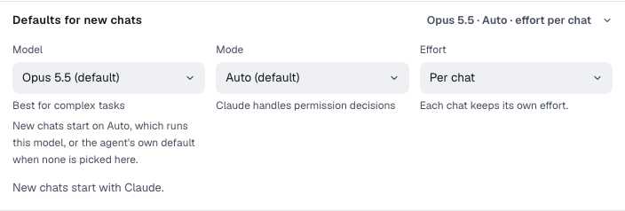
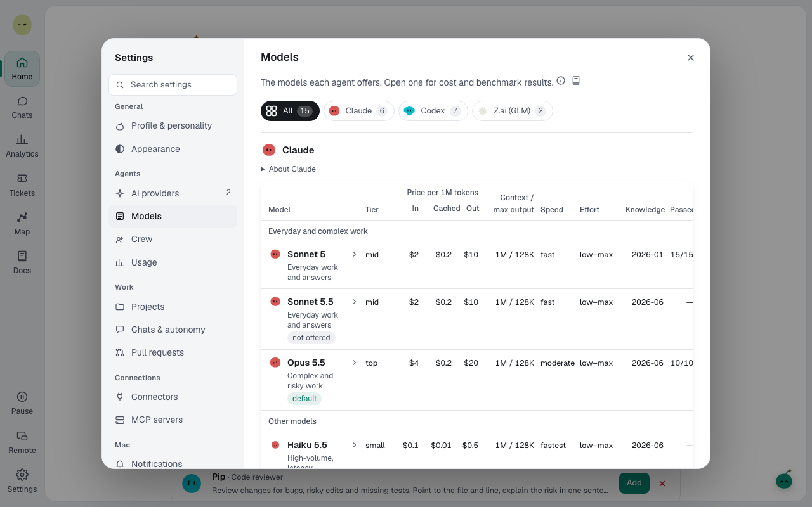

You'll manage your connected providers and learn what each model is for. About 3 minutes.

To connect a provider for the first time, see [Connect an AI provider](connect-a-provider.md). Everything here lives in **Settings → AI providers** and **Settings → Models**.

## The three providers

| Provider       | Connects with                | Models                                                               | Default mode       | Default effort |
| -------------- | ---------------------------- | -------------------------------------------------------------------- | ------------------ | -------------- |
| **Claude**     | **Local CLI** or **API key** | What your Claude CLI offers. Claude Opus 5.5 at the time of writing. | **Auto**           | High           |
| **Codex**      | **Local CLI** or **API key** | What your Codex CLI offers.                                          | **Approve for me** | Medium         |
| **Z.ai (GLM)** | **API key** only             | GLM-5.3 (default) and GLM-5.3-Flash                                  | **Manual**         | High           |

New chats start with your default provider's model, mode and effort. For the modes, see [Pick the agent's mode](chats-and-modes.md#pick-the-agents-mode).

## Change the defaults for new chats

1. Open **Settings → AI providers** and select a connected provider's card.
2. Under **Defaults for new chats**, change **Model**, **Mode** or **Effort**.

**Effort** has an extra choice, **Per chat**: each chat keeps its own effort. Pick a fixed level instead and every chat, and every Builder, uses it.

Changes apply to new chats. To change one chat, use the model picker. See [Pick a model for a chat](auto-routing.md).

## Make a provider the default

With more than one provider connected:

1. Open the **…** menu on the provider's card.
2. Select **Make default**. The card gets a **Default** tag, and new chats start with that provider.

## Sign in again or disconnect

Open the **…** menu on a connected card:

- **Sign in again** (local CLI only) opens a terminal to sign in. Your settings stay as they are.
- **Change how it connects** switches between **Local CLI** and **API key**, or replaces the key.
- **Disconnect** removes the connection.

To check a connection, select **Send test message**. The card's **Last test** row shows how long the answer took and which model sent it.

## Read the model cards

**Settings → Models** shows a card for each model: what it costs, how it did on Spark's benchmark, and when Spark uses it.

1. Pick a provider at the top, or **All**.
2. Read the card's line:
   - **mid tier**: "Everyday Builder, Critic, answers".
   - **top tier**: "Complex and risky work".
   - Other models say **Only when you pick it**, or that they're retiring.
3. Select **Details** for effort levels, **Good at**, **Watch out for**, benchmark results and sources.

Spark never runs a Builder on a small, fast model, even when you pick one. It raises the Builder to the next model up and says so.

The model you pick for a chat is the chat's own model, and it never changes during the chat. On **Auto**, the chat runs on the provider's default model and Auto only picks models for the helpers. Builders start from the chat's model and can move a tier down for clearly simple work or up for hard work. See [Builders in a pinned chat](auto-routing.md#builders-in-a-pinned-chat).

> **Tip:** A provider marked **not connected** on Settings → Models still shows its cards, so you can compare before you connect it.

**Next:** [Pick a model for a chat](auto-routing.md)
