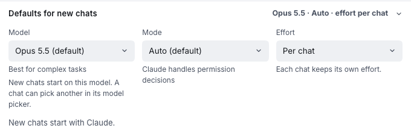
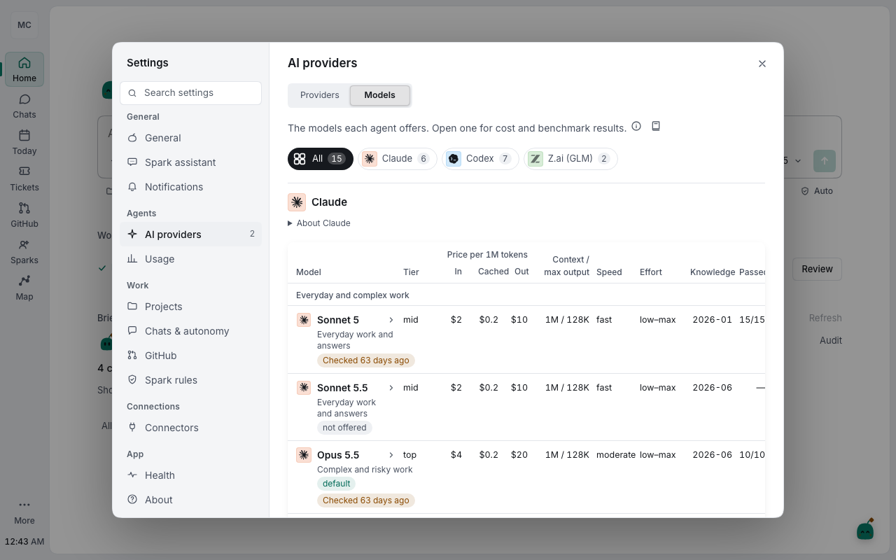

You'll change a provider's defaults, reconnect it, read the model cards and connect Jev. About 2 minutes.

## Change defaults or the default provider

1. Open **Settings → AI providers** and select the provider's tile. Providers you've set up are listed first.
2. Under **Defaults for new chats**, change **Model**, **Mode** or **Effort**.
3. Select **Make default** to start new chats with this provider.

**How to connect** shows the **Account** and usable **Models**. If the default isn't usable, select **Switch to …**.

Changes apply to chats that haven't picked their own. **Per chat** effort keeps each chat's own.

## Sign in again, switch or disconnect

1. On the provider's screen, find **How to connect**.
2. Select **Sign in again**, **Use an API key instead** or **Use a new key**.
3. To disconnect, hold **Hold to disconnect** or **Hold to remove the key** under **Danger zone**. You get 10 seconds to **Undo**.

## Read the model cards

1. In Settings, open the **Models** tab and pick a provider, or **All**. In **All**, a provider that isn't connected is folded: select **Show N models**.
2. Select a model's row for its price, effort levels, **Good at**, **Watch out for** and sources.

| Group                         | What it holds                                                                       |
| ----------------------------- | ----------------------------------------------------------------------------------- |
| **Everyday and complex work** | Current mid and top models                                                          |
| **Other models**              | Small, frontier and retiring models                                                 |
| **No card yet**               | Models whose tier comes from the name; past six, the first five and **Show N more** |

## Connect Jev

[Jev](jev.md) is optional; without it, Spark's own rules do its jobs.

1. Get an API key from the **TypeSafe console**.
2. In **Settings → AI providers**, select the **Jev** tile under **Advisor**.
3. Paste the key and verify it, for free; the key goes to your system keychain.

To remove Jev, hold **Hold to remove the Jev key** under **Danger zone**.

**Next:** [How Spark works](how-spark-works.md)
