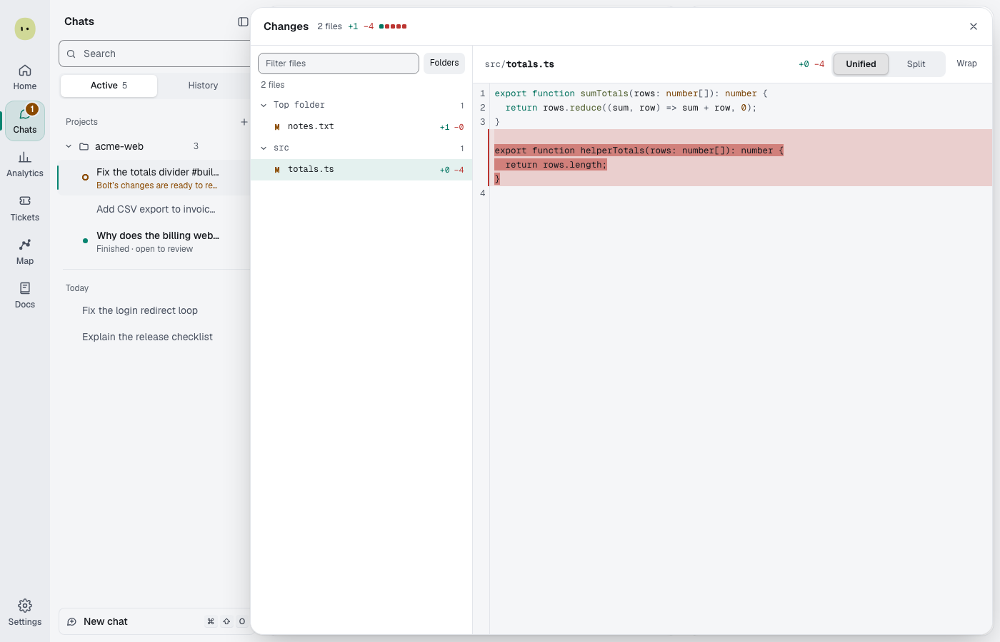

You'll read what the agent changed and decide what to do with it. About 2 minutes.

## Read the diff

1. In the chat header, select the changed-lines chip, such as **+2,550 −21**, or press **⌘⇧D**. The **Changes** drawer opens.
2. Pick a file on the left. Type in **Filter files** to find one.
3. Read the diff. Switch between **Unified** and **Split**, select **Wrap** for long lines, and press **⌘F** to search.
4. Press **Esc** or select **Close changes** to go back.

Big files show their first 2,000 lines; select **Load full file** for the rest. Lockfiles, generated files, files over 1 MB and binary files stay folded until you select **Show diff**.

## Keep or revert

Spark keeps changes by itself at both autonomy levels. The chat shows the **Keep these changes?** card already answered, "Kept automatically", with a **Worth a look** list when checks still fail, the Critic has concerns or a [guardrail](guardrails.md#worth-a-look) flagged something.

- To undo a run, select **Revert to before this run** on the turn.
- To copy kept changes from the chat's worktree into your checkout, select **Bring changes into** _branch_.
- To ship them, see [Ship a change](ship-and-pull-requests.md).

The card waits for you, with **Keep**, **Fix** and **Revert**, only when Spark won't decide alone:

| Autonomy           | The card waits when                                             |
| ------------------ | --------------------------------------------------------------- |
| **Automatic**      | A risky migration was made in your own checkout, not a worktree |
| **Full auto → PR** | Checks fail and you chose **Stop and ask**                      |

Select **Fix**, type what should change, and select **Ask for a fix**.

Files changed counts only the agent's own edits. Changes it pulls in from the main branch aren't counted or reverted.

**Next:** [Manage a long chat](compaction.md)
