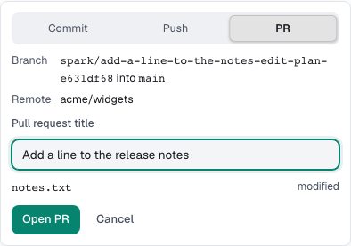

You'll ship a finished change as a commit, a pushed branch or a pull request. About 2 minutes.

1. Select the ship button on the chat's outcome card or in the **Changes** tab of the **Work** panel. It reads **Open PR**, **Push branch** or **Commit**.
2. In **Ship this task**, pick **Commit**, **Push** or **PR** under **How to ship**.
3. Check the branch, the files and the **Pull request title**.
4. Select **Open PR**, **Push branch** or **Commit**.

Ship commits only the task's own files, without secret files. Once a PR exists, the button reads **Update PR**. Nothing merges.

## When the agent publishes

Ask for a pull request in your message, or set **Full auto → PR**. After the checks, the agent pushes the branch and opens the PR.

| The chat says                                               | Meaning                    |
| ----------------------------------------------------------- | -------------------------- |
| **Opened pull request #12**                                 | Spark tracks it.           |
| "The branch was pushed, but no pull request was opened."    | Use the link to create it. |
| **Push stopped by the pre-push check**, with its last lines | Nothing was pushed.        |

The push uses your shell's logins; tokens never reach the agent. Without `gh`, the PR opens through your GitHub sign-in.

Every pull request from the chat or its terminal shows above the message box and under **Links** with checks, reviews and comments.

## Ready for review or draft

In **Settings → Spark**, set **Open pull requests as** to **Ready for review** (the default) or **Draft**.

## When checks still fail in Full auto

**When checks still fail in Full auto** in **Settings → Spark** decides what happens:

| Choice                        | Result                                           |
| ----------------------------- | ------------------------------------------------ |
| **Open a draft PR** (default) | The PR opens as a draft marked "Checks failing". |
| **Stop and ask**              | Spark stops before publishing and asks you.      |

**Next:** [Let Spark handle PR feedback](pr-follow-up.md)
