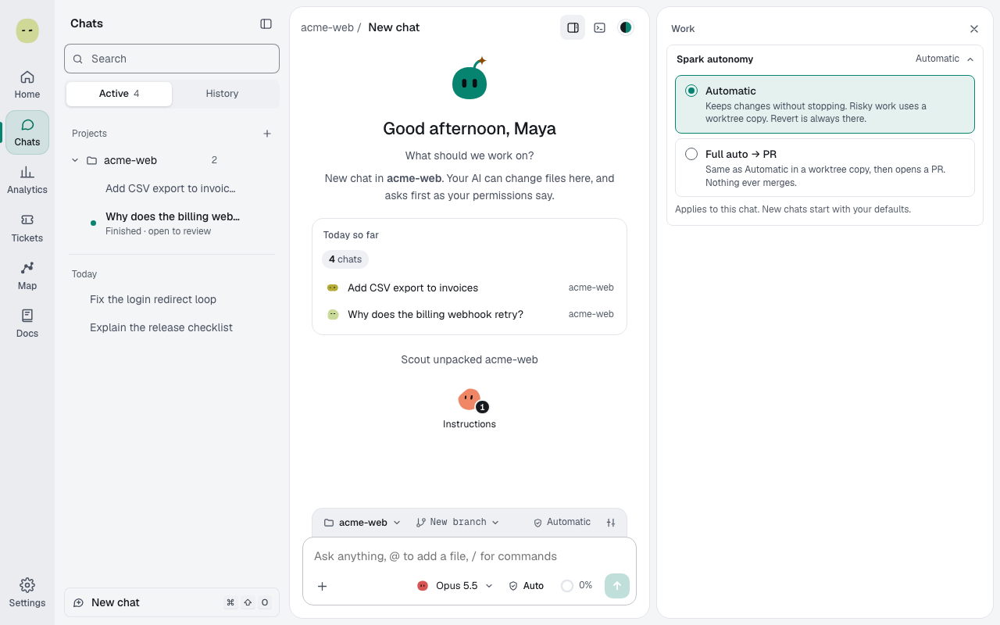

You'll choose what Spark does with finished work: keep it, or keep it and open a pull request. About 1 minute.

## For one chat

1. Link a project. The autonomy chip, a shield with the level name, appears in the context bar.
2. Select the chip. The **Work** panel opens at **Spark autonomy**.
3. Pick a level.

| Level                   | What Spark does                                                                                        |
| ----------------------- | ------------------------------------------------------------------------------------------------------ |
| **Automatic** (default) | Keeps changes without stopping. A plan waits for you to select **Build**. You ship when you're ready.  |
| **Full auto → PR**      | The same in a worktree copy, but a plan builds after a countdown, and Spark then opens a pull request. |

## For every new chat

1. Open **Settings → Spark**.
2. Change **How much Spark does alone**.

## What doesn't change

- You can always undo a run with **Revert to before this run**.
- Nothing ever merges. **Full auto → PR** pushes only the chat's own branch.
- Approval cards and [protected paths](protected-paths.md) still wait for you at both levels.
- To review each step, pick an [agent mode](agent-mode.md) that asks, such as **Manual**.

> **Tip:** Start with **Automatic**. Move a chat to **Full auto → PR** once you trust its checks.

**Next:** [Pick a model and effort](auto-routing.md)
