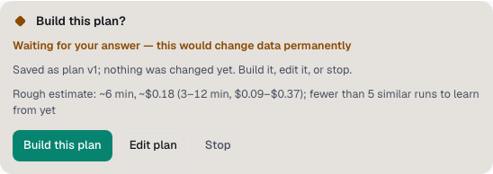

You'll meet the agents Spark puts on a request and learn where their work lands. About 3 minutes.

## Who is in the crew

Spark gives each request the smallest crew that fits. Each agent has a short name, so you can tell them apart in the chat.

| Role            | What it does                                                   | Names                        |
| --------------- | -------------------------------------------------------------- | ---------------------------- |
| **Reader**      | Reads the project and answers in the chat.                     | Pip, Wren, Skye              |
| **Builder**     | Makes the change.                                              | Bolt, Rivet, Tack, Chip, Nut |
| **Critic**      | Reviews the change, on another provider when one is connected. | Hawk, Owl, Lynx              |
| **Coordinator** | Splits big work into pieces and joins them.                    | Atlas, Juno, Vega            |

Most requests need only a Reader or one Builder. After you agree a plan, Jev picks how many Builders it needs, from 1 to 4, and Spark shares the plan's items between them. For big work, see [Big work in pieces](pieces.md).

## How Spark decides what to do

When you send a message, Spark reads it first. A line above the crew says what it chose:

- **Answer directly**: a question or research. A Reader answers and nothing changes. For research, it reads the code and the project map, then lists what it found and suggested next steps.
- **Build it**: a clear change. A Builder makes it.
- **Plan, then build**: a plan or design request, or a big or destructive change. You get a plan first.
- **Plan, build, then review**: the same, with a Critic at the end.

If the request is too vague, the agent first asks 1 to 3 questions with its best guesses. With [Jev](jev.md) connected, Jev helps make these calls; otherwise the rules do.

## Answer the plan card

A plan comes as the card **Build this plan?**, before anything changes.

1. Read the plan. The card also shows an estimate of time and cost.
2. Select **Build this plan**, **Edit plan** or **Stop**.

At **Automatic** and **Full auto → PR**, the button counts down, for example "Building this plan in 30s", and builds unless you edit or stop it.

## When the Critic reviews

A Critic reviews bigger or riskier changes: large diffs, 3 or more source files, migrations, destructive or high-stakes work, a build from an agreed plan, or when you ask for a review. A one-line fix never gets one.

If the Critic finds problems, a Builder fixes them, up to 3 rounds. At **Review each step** you see the findings first and choose **Fix these findings**.

If the Critic itself fails, for example with "Codex encountered an internal error", Spark retries it once, on your chat's provider when the Critic ran on another one. If the retry fails too, the review is skipped with a quiet note, "Review skipped (Critic unavailable: …)", and the change is kept as usual.

After a fix, the Critic only rechecks: it confirms the earlier problems are fixed and looks for anything the fix itself broke. It doesn't start a new review of code the fix didn't touch. Hardening ideas the request didn't ask for, such as rejecting a zero or negative setting, are listed under **Not fixed automatically** instead of starting another round.

## Where Spark works

By default, each chat that changes code gets its own git worktree on a new branch, so your own checkout stays as it is. To change this for a project:

1. Open **Settings → Projects** and find the project.
2. Under **Where Spark works**, pick **Each chat in its own worktree (recommended)** or **In my files**.

One chat can also switch with the branch chip above the message box. See [Where the chat works](chats-and-modes.md#where-the-chat-works).

## Keep or revert the changes

When the Builder finishes, the **Keep these changes?** card lists the changed files and anything [worth a look](guardrails.md#read-the-keep-card).

1. Select **Keep** or **Revert**. To ask for changes, select **Fix**, type what should be fixed and select **Ask for a fix**.
2. In a worktree, kept changes stay on the chat's branch. Select **Bring changes into** _branch_ to copy them into your checkout, or ship them. See [Ship and pull requests](ship-and-pull-requests.md).

At **Automatic**, changes are kept by themselves, without a card. When the checks still fail, the Critic still has concerns or something is worth a look, the final reply says so in a note. To undo a run later, select **Revert to before this run**.

Files changed counts only what the agent changed. If it updates the branch from main during the run, for example with a fetch and fast-forward or a rebase, the changes it brought in from main aren't counted, reviewed or reverted.

> **Tip:** How much of this Spark does alone depends on the chat's [Spark autonomy](chats-and-modes.md#spark-autonomy): **Review each step**, **Automatic** or **Full auto → PR**.

**Next:** [Big work in pieces](pieces.md)
