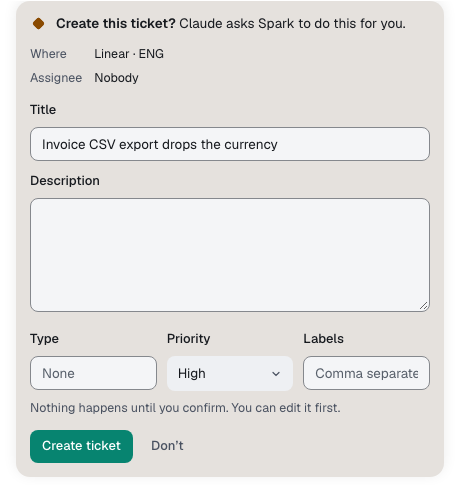

Agents get the `spark_*` tools their chat can use.

Ticket, Slack and pull request tools need their connector; pull request and map tools need a linked project.

## Tools that read

| You ask about                                              | Tool                                                                                                                  |
| ---------------------------------------------------------- | --------------------------------------------------------------------------------------------------------------------- |
| What needs you, failed chats, flagged tickets              | `spark_attention`                                                                                                     |
| Chats, matching lines, a shared chat, runs, queue, turns   | `spark_chats`, `spark_chat`, `spark_chat_history`                                                                     |
| A run or task: plan, files changed, cost                   | `spark_run`, `spark_task`                                                                                             |
| Spend, activity, analytics, the morning brief              | `spark_spend`, `spark_activity`, `spark_analytics`, `spark_brief`                                                     |
| Pull requests, their checks and reviews                    | `spark_pull_requests`, `spark_pr`, `spark_pr_follow_up`                                                               |
| Providers, models, connectors, settings, projects          | `spark_providers`, `spark_models`, `spark_connectors`, `spark_settings`, `spark_projects`                             |
| The Map, and what breaks if a file changes                 | `spark_map`                                                                                                           |
| Where something lives in the code                          | `spark_find`                                                                                                          |
| Your MCP servers and where each is on                      | `spark_mcp_servers`                                                                                                   |
| Open terminals                                             | `spark_terminals`                                                                                                     |
| The Browser pane's tabs, pages, screenshots, logs, preview | `spark_browser_tabs`, `spark_browser_read`, `spark_browser_screenshot`, `spark_browser_logs`, `spark_browser_preview` |
| Saved sign-ins, without their values                       | `spark_browser_signins`                                                                                               |
| Tickets, one in full, or a search of every ticket          | `spark_tickets`                                                                                                       |
| A Slack thread by link, or a search of what you allowed    | `spark_slack`                                                                                                         |
| Your Sparks, and the jobs and replies from an `@` mention  | `spark_sparks`, `spark_chat`                                                                                          |
| The audit log, including actions that ran without review   | `spark_audit`                                                                                                         |
| How Spark works, and this guide                            | `spark_guide`, `spark_docs`                                                                                           |

## Tools that act

Spark does what the agent proposes.

| Action                                      | Tool                                                                                                    |
| ------------------------------------------- | ------------------------------------------------------------------------------------------------------- |
| Create, comment on, move or assign a ticket | `spark_create_ticket`, `spark_comment_ticket`, `spark_transition_ticket`, `spark_assign_ticket`         |
| Post to an allowed Slack channel or thread  | `spark_slack_post`                                                                                      |
| Start a PR follow-up round                  | `spark_pr_follow_up_round`                                                                              |
| Push the chat's branch, open its PR         | `spark_push`, `spark_pull_request` (no card)                                                            |
| Add or change a Spark                       | `spark_create_spark`, `spark_update_spark`                                                              |
| Add, change, switch or remove an MCP server | `spark_add_mcp_server`, `spark_update_mcp_server`, `spark_switch_mcp_server`, `spark_remove_mcp_server` |
| Open a site; act on a page                  | `spark_browser_open`, `spark_browser_act`                                                               |
| Use a saved sign-in (always asks)           | `spark_browser_sign_in`                                                                                 |
| Use a [Mac app](mac-control.md)             | `spark_mac_apps`, `spark_mac_read`, `spark_mac_act`                                                     |
| Keep one command running after the turn     | `spark_terminal_run`                                                                                    |

An MCP server card shows the exact command. Agents pass only variable and header names; you fill values in **Settings → MCP servers**.

## Outpost tools

A chat in an [outpost](outposts.md) gets these. None shows a card.

| The agent wants to                               | Tool                  |
| ------------------------------------------------ | --------------------- |
| Read the outpost: members, requests, answers     | `spark_outpost`       |
| Ask another chat, and wait for its answer or not | `spark_outpost_ask`   |
| Leave a note for the other chats                 | `spark_outpost_note`  |
| Propose sub-task chats that you review and start | `spark_outpost_draft` |

Project chats get `spark_outpost_draft`; a Spark's job gets none. What another chat wrote is never your message.

## When actions ask first

| Agent mode                                                              | Spark                                                    |
| ----------------------------------------------------------------------- | -------------------------------------------------------- |
| **Auto**, **Bypass permissions**, **Approve for me** or **Full access** | Does it at once, with a link.                            |
| **Accept edits**                                                        | Does it when your message asked. Otherwise shows a card. |
| **Manual**, **Plan** and read-only modes                                | Always shows a card.                                     |

Edit any field, then confirm or select **Don't**. Browser and Mac tools report cards you allowed. The card shows the result, or why it failed with **Try again**. Every action is audited.

## Commands after the turn

`spark_terminal_run` runs a command such as a dev server outside the agent's sandbox. Modes that don't ask start it, marked ran without review; others show **Allow once** or **Reject**.

[Protected paths](protected-paths.md) and push rules hold in every mode. Read-only turns and turns with no project are refused.

The agent can read its output and stop it. Stopping the turn or quitting Spark stops it.

## What the tools never return

| Never returned               | Instead                                               |
| ---------------------------- | ----------------------------------------------------- |
| File contents                | `spark_find` gives files, functions and line numbers. |
| Your terminals' output       | A terminal's name, folder and running program.        |
| Password and card fields     | `[masked]`, and painted over in screenshots.          |
| Secrets, API keys and tokens | Redacted before the agent sees them.                  |
| Feedback comments            | Analytics give counts only.                           |

After a tool reads tickets, Slack, other chats or spend, Spark notes [sends elsewhere](approvals.md#sending-data-out-after-reading-secrets).
