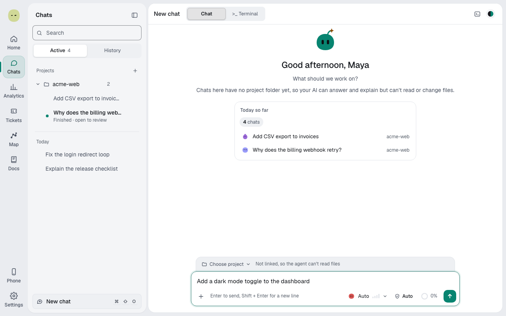
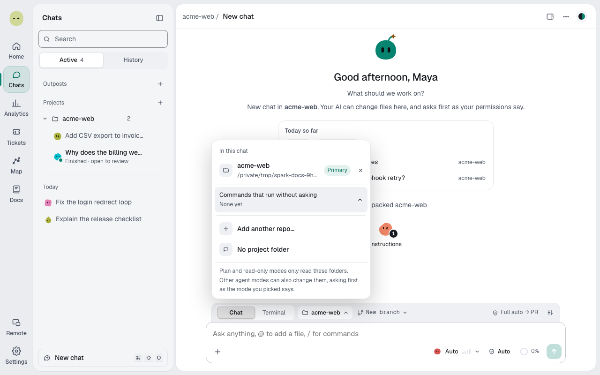

You'll start a chat and point it at your code. About 1 minute.

## Start a chat

1. Select **Chats** in the rail, then **New chat** (**⌘⇧O**).
2. Type your message and press **Enter**.

You can also type in **Start a new chat** on **Home**.

## Link a project

Without a project, the agent can answer but can't read or change files.

1. Above the message box, select **Choose project**.
2. Pick a folder under **Recent**, or select **Choose a folder…**, then **Use this folder**.
3. To add a second repo, select **Add another repo…** in the same menu.

To unlink, select **No project (chat only)** in the menu.

## Write a message

| Type or select                    | To                                                                       |
| --------------------------------- | ------------------------------------------------------------------------ |
| **Enter** / **Shift+Enter**       | Send / add a new line                                                    |
| **@**                             | Add a file from the project                                              |
| **/**                             | Run a command: `/plan`, `/review`, `/model`, `/effort`, `/mcp`, `/fresh` |
| **+** (**Add files and context**) | **Upload a file**, **Add a screenshot** or **Add from repo**             |

You can also paste or drag files into the box.

> **Tip:** To talk to a named teammate, select **Talk to…** before your first message. See [Make a Spark](sparks.md).

**Next:** [Pick the model, effort and mode](agent-mode.md)
