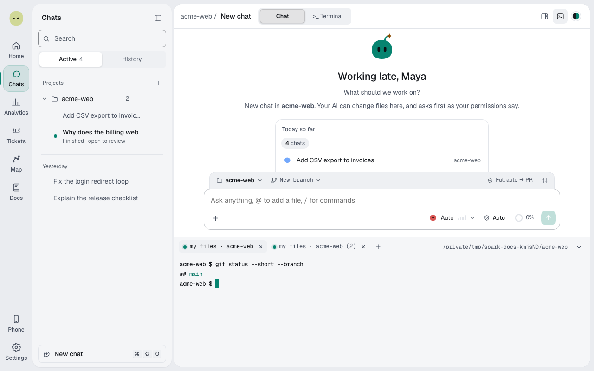
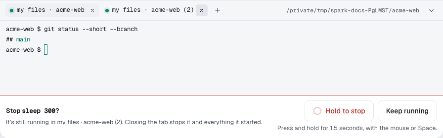

Open an AI terminal. About 1 minute.

> **Important:** A Terminal session runs the provider's CLI under the agent's mode. Spark's cards, [protected paths](protected-paths.md) and audit don't apply. Spark records state, tool names and times, tokens and cost, no commands or replies unless [recorded](settings.md#record-terminal-sessions).

## Start a Terminal session

1. Select **New chat**, then **Terminal** above the message box.
2. Select **Choose project → Choose a folder…**, then **Use this folder**.
3. Beside **Start terminal**, pick **Claude Code** or **Codex** and permissions.
4. Describe the work; press **Enter**.

A line shows while dependencies copy. Pull requests aren't automatic.

**Running**, **Waiting for input**, **Waiting for permission** and **Idle** follow agent events. Esc before Claude replies stays **Running** until you send. **Open**: no tracking. Dropped files insert paths.

Selection copies, with **Add to terminal**, **Ask about this**, **Comment** and **New chat with this**. You press Enter. Hold Option to select when the agent uses the mouse. [Browser pane](use-the-browser.md#point-at-something) picks land there too.

**Focus terminal** (**⌘⇧F**) hides the chat list and Work panel. **⋯** has **Copy folder path**, **Reconnect** and **Stop session** (hold). [Paired devices](use-your-phone.md) can follow.

## Open a shell beside Chat

1. In a chat's **…** menu, select **Terminal**, or press **⌃\`**.
2. Type commands; Spark doesn't ask.
3. **+** adds a tab, **×** closes one.

It starts in the chat's worktree, checkout or home. A busy tab asks **Hold to stop**; **Keep running** cancels.

## Watch an agent's command

1. On a reply's command, select **Open in terminal**.

The read-only tab is **Claude · pnpm dev**. **Stop turn** stops it. Claude and Z.ai output shows when it ends.

## Close and recover

Switching chats, closing windows or disconnecting keeps agents running; Terminal sessions survive restarts, updates and crashes. **Quit** stops Spark-owned agents.

After reboot or exit, **Resume session** restores history, not running commands; else **Start again** resends your first message unless stopped.

**Next:** [Use the browser](use-the-browser.md)
