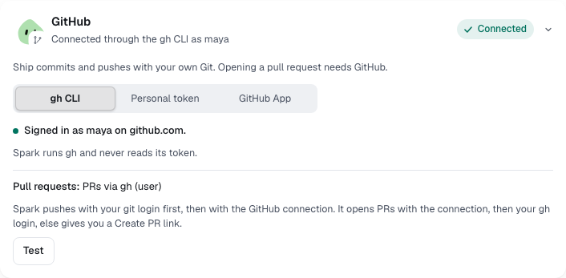

You'll connect GitHub and your ticket tracker. About 3 minutes.

Every connection is optional. Committing and pushing work without GitHub connected.

## Connect GitHub

1. Open **Settings → Connectors** and select the **GitHub** card.
2. Pick how to connect:
   - **gh CLI**: if it says "Installed but not signed in.", run `gh auth login` in a terminal, then select **Check again**.
   - **Personal token**: paste it into **Personal access token**, add an **Enterprise host** if you use one, and select **Verify token**.
3. Check the status, such as "Connected through the gh CLI as maya".
4. Select **Test** to check each project's remote and sign-in without changing anything.

## Connect Jira or Linear

1. Open **Settings → Connectors** and select **Jira** or **Linear**.
2. Fill in the form:
   - **Jira**: **Site URL**, **Email** and an **API token**.
   - **Linear**: an **API key**.
3. Select **Save and check**. The card says "Connected to … as …".

Keys and tokens are stored in your system keychain and never shown again. To stop, select **Disconnect** or **Remove token**.

## Keep tickets in sync with pull requests

Each connected Jira or Linear card has two switches, both on by default:

| Switch                                        | Does                                            |
| --------------------------------------------- | ----------------------------------------------- |
| **Move tickets to In review when a PR opens** | Moves the linked ticket when Ship opens its PR. |
| **Move tickets to Done when the PR merges**   | Moves it when Spark sees the PR merged.         |

Spark always adds the PR link to the ticket. It never posts comments on your tickets.

> **Tip:** Start work from a ticket, not a blank chat, so Spark links them for you.

**Next:** [Work from the Tickets inbox](tickets-inbox.md)
