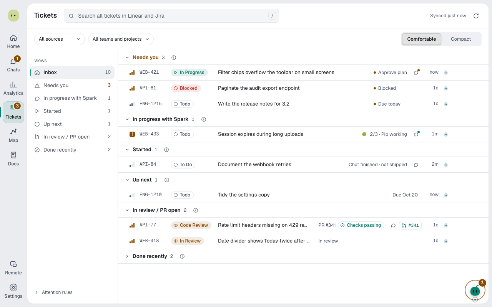
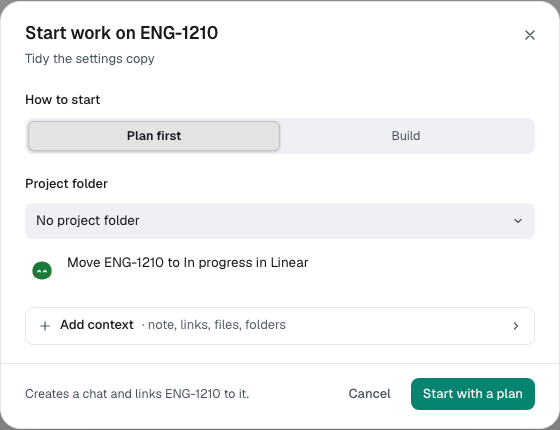

You'll start work from a ticket. About 2 minutes.

First [connect a tracker](tickets-and-github.md#connect-a-ticket-tracker).

## Find your tickets

1. Select **Tickets** in the rail. See [Ticket groups](statuses-and-limits.md#ticket-groups).
2. Select a view in the side column, such as **Needs you**.
3. Narrow with **Source**, **Team or project** and **Assignee**, or search.

Snooze hides a ticket until later. **Dismiss** clears a **Needs you** ticket until something changes.

Failing checks appear under **In review / PR open**.

Select a ticket for **Development**, including linked pull requests.

## Start a chat from a ticket

1. Point at a ticket's row and select **Start**.
2. Pick **Chat** or **Terminal**; Terminal asks for **Claude Code** or **Codex**.
3. Under **How to start**, pick **Plan first** or **Build**.
4. Pick the **Project folder**.
5. Leave **Move** _KEY_ **to In progress** on to update your tracker.
6. Optionally open **Add context** for a **Note**, **Add link**, **Add files** or **Add folder**.
7. Select **Start with a plan** or **Start building**.

In Terminal, the agent has Spark tools and you answer there.

Ticket text is data, never instructions. For a link or a folder, Spark sends only the address or path. Secret files are refused.

## ServiceNow records

Records keep their own states; **Resolved** is in review. **Show** on the ServiceNow card picks **Assigned to me** or **Me and my groups**.

**Add work note** is internal; **Post comment the caller sees…** asks first. **Move** never resolves, closes or cancels; an agent can, on a card that always asks, like its comments. **Changes** are read only.

## Follow it to a pull request

When you ship, Spark [updates the ticket](tickets-and-github.md#keep-tickets-in-sync-with-pull-requests).

**Open chat** on a ticket's row returns to its chat.

**Next:** [Use Spark Island](desktop-companion.md)
