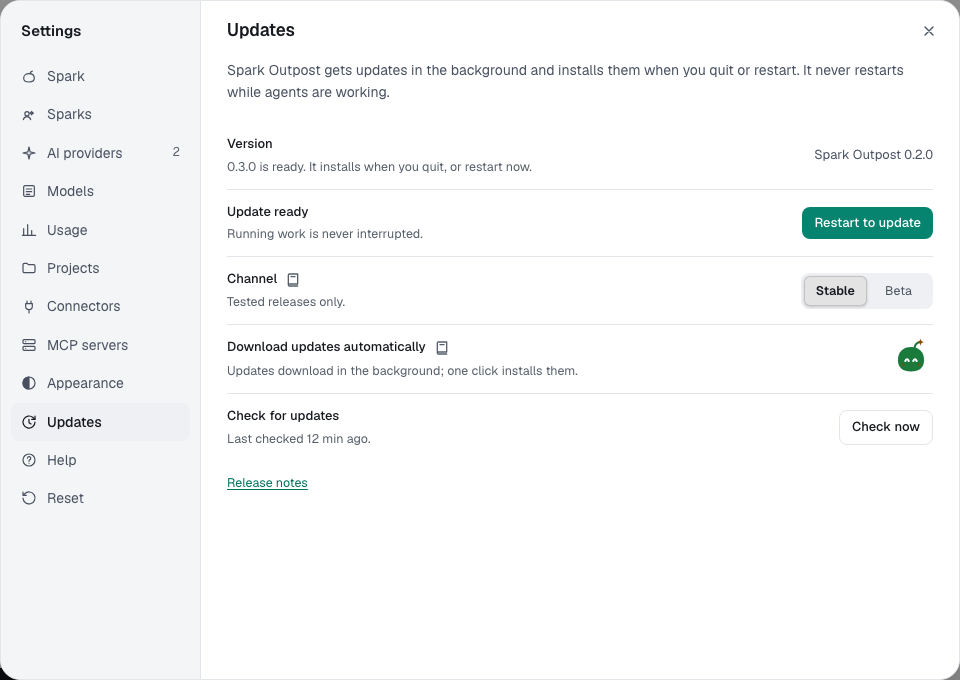

You'll install an update when it suits you. About 1 minute.

The Mac app checks for updates when it starts and every 4 hours. It never installs while agents are working.

## Install an update

1. Find the blob in the rail, just above **Settings**. A gray **Update** blob means one is ready to download. Select it.
2. The blob fills as the update downloads. When it says **Restart**, select it.

A ready update also installs the next time you quit. If a chat is running or waiting for you, the blob says **Waiting** and Spark installs once nothing is running.

## Stable or Beta

1. Open **Settings → Updates**.
2. Under **Channel**, pick **Stable** (tested releases, the default) or **Beta** (new features earlier, rougher).

Spark never installs an older version. Moving from Beta to Stable keeps your version until Stable catches up.

## Download updates automatically

**Download updates automatically** is on by default. Turn it off to download only when you select **Update** or **Get the update**. Select **Check now** to look for one.

## Your data during an update

Before an update changes how data is stored, Spark backs up your database to `~/Library/Application Support/Spark Outpost/backups` and keeps the three newest.

If the change fails, Spark restores your data, skips that version, and shows "Spark Outpost could not continue" with **Open previous version instructions**.

> **Important:** If the message says your data could not be put back, don't delete anything. The instructions explain how to recover it.

## Preview the update flow

For people running the dev app: start it with `SPARK_UPDATE_PREVIEW=flow pnpm desktop:dev`, or select **Preview the update flow** in **Settings → Updates**. It fakes an update; your version and data stay the same.

**Next:** [Mac privacy settings](mac-privacy.md)
