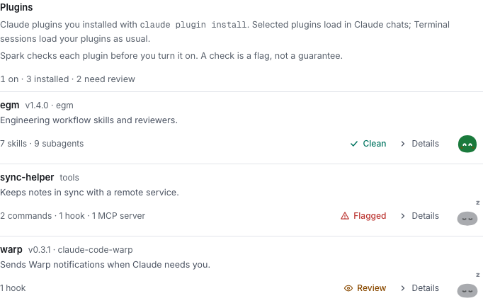
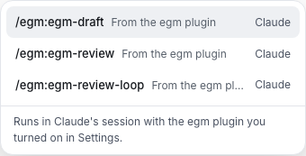

Load a Claude Code plugin in Claude chats. About 3 minutes.

## Turn a plugin on

1. In Terminal, run `claude plugin install <plugin>@<marketplace>`.
2. On the Mac, open **Settings → Chats & autonomy → Plugins**.
3. Read its status: **Checking…**, **Clean**, **Review** or **Flagged**.
4. **Details** sums up the plugin, then lists findings worst first and what **Runs automatically**.
5. Turn it on. **Review** and **Flagged** need a hold.

An update turns it off until you turn it on again. Codex chats and Ask Spark don't get plugins; Terminal sessions load their own.

## Use its commands

1. In a Claude chat, type `/`.
2. Pick a command, such as `/egm:egm-review`.

Skills and subagents it used show as steps and in **Crew**.

## What runs without asking

| Part                              | In a chat                                                               |
| --------------------------------- | ----------------------------------------------------------------------- |
| Hooks                             | Run with no card                                                        |
| Inline shell in a command         | No Spark card; the agent's mode decides                                 |
| MCP server tools                  | A card per call, unless the [agent mode](agent-mode.md) runs everything |
| `allowed-tools`, `permissionMode` | Removed                                                                 |

An agent may ask to turn one on or off with a [card](cards.md#around-the-result) only you answer, on the Mac.

## What the agent review sends

While Claude is connected, it reviews each installed plugin once per version, on or off, with no tools, outside chats.

Claude's provider gets the manifest, hook and MCP config, scripts they run, and skill, command and agent text, up to 150,000 characters.

**Details** shows its cost, counted in spend; **Check again** retries a failed one. A check is a flag, not a guarantee.

**Next:** [Answer an approval card](answer-approvals.md)
